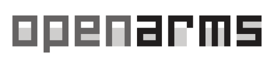
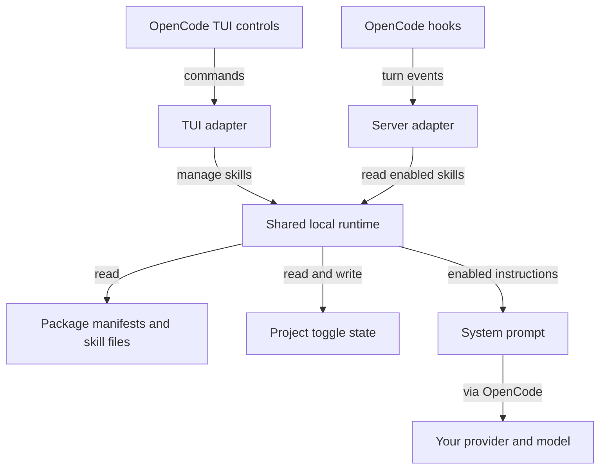

<p align="center">
  
</p>
<h1 align="center">OpenArms</h1>
<p align="center">Project skills and runtime controls for OpenCode.</p>
<p align="center">
  <a href="#getting-started">Get started</a> ·
  <a href="docs/guides/skill-management.md">Skill guide</a> ·
  <a href="docs/guides/local-opencode.md">Optional profiles</a> ·
  <a href="LICENSE">MIT license</a>
</p>

## Overview

OpenArms is a plugin layer for [OpenCode](https://github.com/anomalyco/opencode),
not an OpenCode fork or distribution. It lets you turn project skills ON or OFF
and adds controls for tool output, usage reports, and context tracking.

A skill is a local file with instructions. Skills start OFF. When you enable a
skill, the server adds its instructions to the system prompt on every turn.
There is no model-facing `load_skill` tool. OpenCode runs your chosen provider
and model; OpenArms does not bundle one or choose a fallback.

## Main features

| Feature | What it does |
| --- | --- |
| Project skill controls | Manage ON/OFF/ERROR states from `/skills` in the TUI. |
| Simple local packages | Read package manifests from `.openarms/packages`; no central registry is needed. |
| Safe, bounded reads | Check file paths and limit how much skill content enters a turn. |
| Reviewed installation | Ask for review and separate consent before sending source or writing an install. |
| Output and usage controls | Shorten large tool output and report usage and context information. |
| Optional workflow prompts | Provide controller, scout, and implementer examples where supported. |

## Architecture

OpenCode owns model calls and host permissions. The server and TUI adapters
share a local runtime for packages and project state.



```text
src/                         Shared core and local runtime
plugins/                     Server and TUI adapters
prompts/                     Optional workflow instructions
examples/local-opencode/     Config examples to review and merge
docs/                        Guides, architecture, and testing
```

## Getting started

### 1. Install the checkout

You need **Node.js 22 or newer**, Git, and an installed OpenCode.
Keep the checkout in a stable location.

```bash
git clone https://github.com/apase95/OpenArms.git
cd OpenArms
npm ci
```

### 2. Register both plugins

Manually merge the server entry into your OpenCode `opencode.json`:

```json
{
  "plugin": [
    "file:///absolute/path/to/OpenArms/plugins/skill-router-server.ts"
  ]
}
```

Merge the TUI entry separately into `tui.json` alongside that config:

```json
{
  "plugin": [
    "file:///absolute/path/to/OpenArms/plugins/skill-router-tui.tsx"
  ]
}
```

Replace `/absolute/path/to/OpenArms` with your checkout's absolute path.
Keep existing settings and plugin entries; do not replace your whole config.
Restart OpenCode, then open `/skills` in your project.

### 3. Add your first skill

In the project where you use OpenCode, create these files under its canonical
project root (the resolved project directory):

```text
.openarms/packages/writing/
├── package.json
└── edit.md
```

Put this manifest in `package.json`:

```json
{"skills":{"edit":"edit.md"}}
```

Write a small instruction in `edit.md`, for example:

```markdown
# Clear writing
Use short sentences. Keep the original meaning when editing text.
```

In OpenCode, run `/skills list writing`, then `/skills use writing`.
Check `/skills status` and send a writing task. The skill ID is `writing/edit`.
Use `/skills disable writing` to turn it OFF for future turns.

Toggles apply to the project, not just one session. OFF does not erase earlier
conversation content. A confirmed directory change in Status resets skills to
OFF; no global library is selected automatically. Copying the repository's
`skills/` folder alone does not register skills.
See the [skill guide](docs/guides/skill-management.md) for commands and migration.

## Development

From the repository root, install dependencies and review the task's test plan:

```bash
npm ci
node scripts/arms-test.mjs verify --plan --file README.md --task my-task
npm test -- --file README.md --task my-task
```

Replace `README.md` with your task's full scope. Repeat `--file <path>` for each
changed, new, or removed file, or use `--base <revision>` for committed changes.
Explicit files replace Git discovery. `npm run test:plan` previews the plan for
Git changes. The unified runner selects host checks; docs-only edits skip code
tests. Unknown paths need a reviewed policy mapping.

See the [testing guide](docs/testing/testing.md) for syntax checks and opt-in
pre-push verification. Sandbox checks are reference-only and never run by default.

## Limits and privacy

- Skill instructions are trusted input, not security isolation or OS permissions.
  ON means readable and enabled, not proof that a model follows the instructions.
- Usage reports do not enforce a budget. Automatic session rotation and measured
  token or cost savings are not promised.
- Host checks and pinned dependencies do not certify live OpenCode compatibility
  or provider behavior. Review your setup before relying on it.
- Keep credentials, runtime data, logs, and local state out of Git. OpenArms state
  uses `$XDG_STATE_HOME/openarms/state.json`, or `~/.local/state/openarms/state.json`.
  Setup does not copy authentication or overwrite installed configuration.

## Documentation

- [Project skills: format, controls, and migration](docs/guides/skill-management.md)
- [Optional controller/scout/implementer profiles](docs/guides/local-opencode.md)
- [Architecture](docs/architecture/README.md)
- [Testing policy and commands](docs/testing/testing.md)
- [Full documentation index](docs/README.md) — includes historical designs and reports.

## License

The OpenArms engine uses the [MIT License](LICENSE). Bundled skills keep their
own license files; only skills with an explicit license are included.
