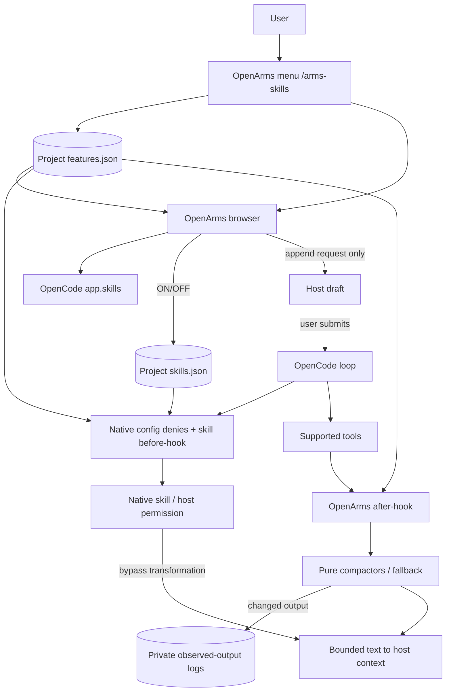

# Architecture — ranh giới nhỏ, đường chạy rõ

[← Mục lục](README.md)

## 1. Ownership

| Thành phần | Sở hữu |
|---|---|
| OpenCode | Agent loop, model calls, native skill discovery/loading, tools, permissions, conversation persistence |
| OpenArms TUI | Main menu, project feature flags, catalog names, skill ON/OFF và draft request |
| OpenArms server | Project skill denies/guard; transform supported output, lưu observed-output artifacts |

Không grants/approval database hoặc conversation DB cạnh tranh. Quyết định project ON/OFF
cho phép file opt-out tối thiểu `.openarms/skills.json`, feature flags `.openarms/features.json`,
native in-memory permission denies và deny-only skill before-hook. ON không cấp quyền hoặc bỏ deny của host. Skill browser và
output compactor độc lập; không model routing hay session/task orchestration.



## 2. Module map

| Đường dẫn | Trách nhiệm |
|---|---|
| [`plugins/skill-router-tui.tsx`](../plugins/skill-router-tui.tsx) | Entry giữ path/ID tương thích, cài menu và browser |
| [`plugins/skill-dialog-frame.tsx`](../plugins/skill-dialog-frame.tsx) | Footer Back/Done dùng JSX trong host dialog stack; modal shortcuts cleanup theo component |
| [`plugins/skill-list.tsx`](../plugins/skill-list.tsx) | Names-only list bằng public OpenTUI primitives, OFF red, bounded rows, filter và navigation |
| [`src/skill-list.ts`](../src/skill-list.ts) | Renderer contract và pure filtering/selection/window/color helpers |
| [`src/openarms-menu.ts`](../src/openarms-menu.ts) | Sole `/arms-skills` command, main menu, feature ON/OFF, status và navigation guards |
| [`src/project-features.ts`](../src/project-features.ts) | Hai feature IDs thực tế, defaults và typed flag store |
| [`src/project-switches.ts`](../src/project-switches.ts) | Shared private project storage, validation, exclusive locks và atomic rename |
| [`src/native-skills.ts`](../src/native-skills.ts) | Feature-gated catalog, ON/OFF/REQUEST, safe errors, target guards và draft append |
| [`src/project-skills.ts`](../src/project-skills.ts) | Skill opt-out schema, feature-gated native config denies và before-hook |
| [`plugins/skill-router-server.ts`](../plugins/skill-router-server.ts) | Cùng project root cho output after-hook và skill restrictions |
| [`src/output-hooks.ts`](../src/output-hooks.ts) | Tool allowlist, giữ title/metadata |
| [`src/output-governor.ts`](../src/output-governor.ts) | Normalize/classify, parse/fallback, save và final cap |
| `src/*-output-compactor.ts` | Pure parser theo domain, không process/filesystem side effects |
| [`src/file-inspection-compactor.ts`](../src/file-inspection-compactor.ts) | Nhận diện binary/minified/long-line output |
| [`src/output-logs.ts`](../src/output-logs.ts) | Private exclusive save, flush và retention |

Thư viện skill được cài và quản lý riêng, không nằm trong repo này. SDK chỉ được import
làm type contract; server/core dùng built-ins và host API. TUI footer và colored skill list dùng JSX/OpenTUI và
Solid runtime shared của host, không tạo renderer/Prompt mới. Public host DialogSelect
không có per-option title color nên chỉ catalog names dùng custom list trong host dialog stack;
actions/feature menus vẫn dùng DialogSelect. UI peers được pin để typecheck;
Node unit tests inject frame/list adapters và kiểm tra pure helpers, không nạp live OpenTUI.

## 3. Luồng chạy

### Feature controls

`/arms-skills` là slash command duy nhất, mở main menu; Features luôn truy cập được
kể cả khi tất cả runtime features OFF. Skill browser là internal controller, không đăng ký lệnh riêng.
TUI lưu flag vào project cố định lúc mở, không gọi model/tool để mutate config. Backend
reread flags khi chạy hooks, không chỉ đổi hiển thị UI. Persistence, failure policy và
ý nghĩa OFF có nguồn chuẩn ở [Features](features.md). Không thêm flag riêng cho log cutting
vì compaction/artifact là cùng pipeline evidence.

### Skill request

```text
Capture directory/worktree/home/session → require skills-management ON
 → host catalog + project preferences → names
 → ON/OFF: revalidate → save opt-out to original project → update bound UI
 → REQUEST: revalidate + reread opt-outs → append → check result/target → user reviews
```

Target gồm directory, project root/worktree, route và session ID nếu có. Callbacks giữ target ban đầu, không
chọn lại target theo thời điểm click. Lifecycle signal được truyền cho append SDK call;
dispose làm callbacks không còn tác dụng.

Guard là kiểm tra client, không host transaction. API không có session ID/compare-and-append,
nên in-flight outcome có thể uncertain. View token vô hiệu callback sau Back/Done/Esc, chặn async completion reopen/clear UI mới.
Không auto-retry, không tuyên bố loaded sau append;
chi tiết UX và error codes có một nguồn chuẩn ở [Skills](skills.md#draft-safety).
Không replace Prompt slots, intercept Enter, reset draft hoặc thêm scanner fallback.

Project switches chỉ hỗ trợ local TUI/server cùng filesystem. Khi skills-management ON,
config hook thêm native
skill deny (kể cả agent overrides) vào effective config lúc load; không ghi host config.
Before-hook reread opt-outs trước mỗi native skill execution để chặn cả cached approvals.
ON không nới cached native rules: restart host để dựng lại từ original config. Feature OFF
ngừng before-hook opt-outs và không thêm config denies khi load, nhưng không tự nới deny cached. Không hủy
in-flight tools hoặc xóa instructions đã load; [Skills](skills.md#project-switches) sở hữu
persistence, failure và privacy contract. Không chặn read/Bash hoặc tạo grant engine.

### Output

```text
After-hook observed text → require output-compaction ON → pure transform
 → save original if changed → publish bounded text
```

Artifact phải save/flush thành công mới có log reference. Parser/sink failure được diễn đạt
bằng marker và bounded fallback, không raw exception hoặc status thành công giả. Định dạng,
limits, privacy và retention có một nguồn chuẩn ở [Output](output.md).

### Compact transcript (bản vá host tùy chọn)

[Bản vá OpenCode v1.19.3](../patches/opencode-v1.19.3-transcript.patch) là nguồn
chuẩn trong OpenArms cho giao diện transcript gọn. SDK TUI không có slot thay
renderer của từng tool call, nên bản vá phải được áp dụng lên mã nguồn OpenCode;
chỉ nạp plugin OpenArms sẽ không bật giao diện này.

Launcher bật bản vá bằng `OPENARMS_COMPACT_TRANSCRIPT=1`. TUI plugin cung cấp
trạng thái công tắc theo project qua bridge nội tiến trình; bản vá không tự ghi preferences.
Khi bật, tool call chỉ
hiện trong lúc chờ hoặc đang chạy. Khi kết thúc, transcript chỉ giữ đường dẫn từ
các tool `write`, `edit` và `apply_patch` thành công. File trong thư mục dự án đang
mở hiển thị tương đối với dấu `/` đầu dòng (ví dụ `/src/index.ts`); file bên ngoài
không bị cắt tiền tố. Các dòng này căn cùng lề với
văn bản trả lời và có `...` nếu quá dài; các khối reasoning như `+ Thought:` được ẩn.
Footer của phản hồi hoàn thành thêm giờ kết thúc theo múi giờ cục bộ (ví dụ `2:50 AM`).
Todos và câu hỏi tương tác vẫn dùng renderer gốc. Bản vá chỉ đổi hiển thị, không thay tool output
mà model nhận và không sửa dữ liệu phiên.

Khi bảo trì, cập nhật bản vá ở đây, dùng `git apply --check <đường-dẫn-bản-vá>`
trên checkout OpenCode `v1.19.3` sạch, rồi áp dụng vào runtime cục bộ. Trên runtime
đã vá, dùng `git apply --reverse --check <đường-dẫn-bản-vá>` để kiểm tra. OpenArms
không tự cài đặt hay sửa launcher/cấu hình của host.

## 4. Host contract và compatibility

- Browser cần `app.skills` và `tui.appendPrompt`, route home/session và public dialogs/keymap API.
- Dependency/type declarations pin theo `package.json`/lockfile; host source tham khảo là
  OpenCode `v1.19.3`. Pin/typecheck không chứng nhận mọi host version tương thích.
- Catalog API có thể trả content, nhưng browser mới chỉ render names; body không tự vào model context.
- Host có thể bỏ skill lỗi hoặc resolve duplicates trước response; plugin chỉ validate dữ liệu nhận được.
- Chỉ có project opt-outs và feature flags tối thiểu, không legacy state. Library paths và quyền nền thuộc host config.
- Pinned plugin config callback còn dùng SDK legacy chưa type native skill permissions;
  adapter validate riêng shape runtime host `1.19.3`. Typecheck không thay live acceptance.
- Sửa source/restart không tự deploy installed runtime. [Migration](migration.md) sở hữu quy trình upgrade.

**Tiếp theo:** [Development](development.md) để sửa code; [Verification](verification.md) để kiểm tra contract.
