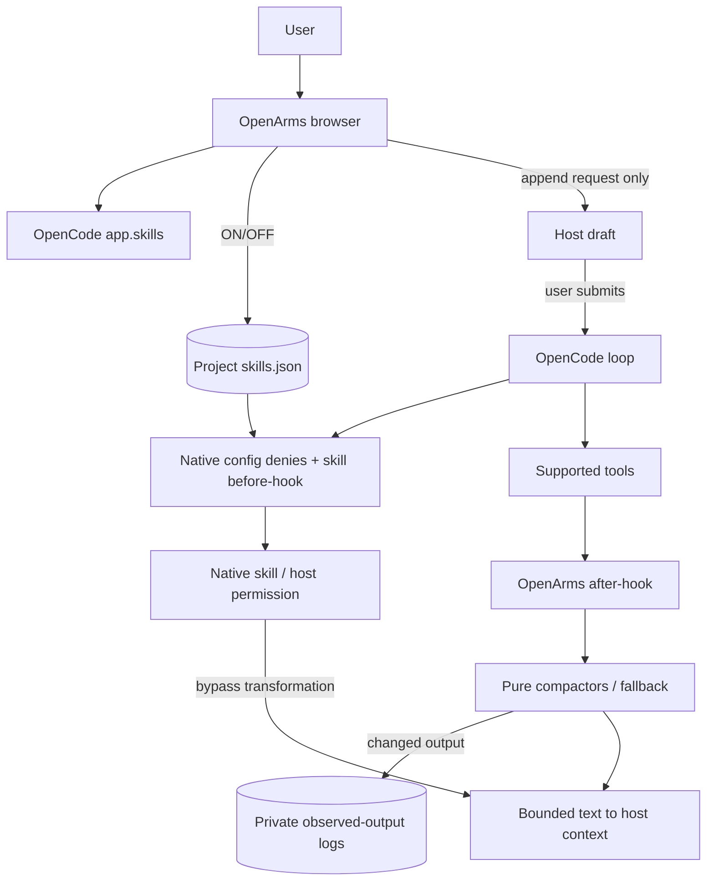

# Architecture — ranh giới nhỏ, đường chạy rõ

[← Mục lục](README.md)

## 1. Ownership

| Thành phần | Sở hữu |
|---|---|
| OpenCode | Agent loop, model calls, native skill discovery/loading, tools, permissions, conversation persistence |
| OpenArms TUI | Catalog names, project ON/OFF, stage request trong draft |
| OpenArms server | Project skill denies/guard; transform supported output, lưu observed-output artifacts |

Không grants/approval database hoặc conversation DB cạnh tranh. Quyết định project ON/OFF
cho phép file opt-out tối thiểu `.openarms/skills.json`, native in-memory permission denies
và deny-only skill before-hook. ON không cấp quyền hoặc bỏ deny của host. Skill browser và
output compactor độc lập; không model routing hay session/task orchestration.



## 2. Module map

| Đường dẫn | Trách nhiệm |
|---|---|
| [`plugins/skill-router-tui.tsx`](../plugins/skill-router-tui.tsx) | Entry giữ path/ID tương thích, cài browser |
| [`plugins/skill-dialog-frame.tsx`](../plugins/skill-dialog-frame.tsx) | Footer Back/Done dùng JSX trong host dialog stack; modal shortcuts cleanup theo component |
| [`src/native-skills.ts`](../src/native-skills.ts) | Catalog names, ON/OFF/REQUEST, safe errors, target guards và draft append |
| [`src/project-skills.ts`](../src/project-skills.ts) | Private project opt-outs, exclusive writes, native config denies và skill before-hook |
| [`plugins/skill-router-server.ts`](../plugins/skill-router-server.ts) | Cùng project root cho output after-hook và skill restrictions |
| [`src/output-hooks.ts`](../src/output-hooks.ts) | Tool allowlist, giữ title/metadata |
| [`src/output-governor.ts`](../src/output-governor.ts) | Normalize/classify, parse/fallback, save và final cap |
| `src/*-output-compactor.ts` | Pure parser theo domain, không process/filesystem side effects |
| [`src/file-inspection-compactor.ts`](../src/file-inspection-compactor.ts) | Nhận diện binary/minified/long-line output |
| [`src/output-logs.ts`](../src/output-logs.ts) | Private exclusive save, flush và retention |

`skills/` là nội dung mẫu có license riêng, không tự đăng ký/chạy. SDK chỉ được import
làm type contract; server/core dùng built-ins và host API. TUI footer dùng JSX/OpenTUI và
Solid runtime shared của host, không tạo renderer/Prompt mới. UI peers được pin để typecheck;
Node unit tests inject frame adapter, không nạp live OpenTUI.

## 3. Hai luồng chính

### Skill request

```text
Capture directory/worktree/home/session → host catalog + project preferences → names
 → ON/OFF: revalidate → save opt-out to original project → update bound UI
 → REQUEST: revalidate + reread opt-outs → append → check result/target → user reviews
```

Target gồm directory, project root/worktree, route và session ID nếu có. Callbacks giữ target ban đầu, không
chọn lại target theo thời điểm click. Lifecycle signal được truyền cho append SDK call;
dispose làm callbacks không còn tác dụng.

Guard là kiểm tra client, không host transaction. API không có session ID/compare-and-append,
nên in-flight outcome có thể uncertain. View token vô hiệu callback sau Back/Done/Esc, chặn async completion reopen/clear UI mới.
Không auto-retry, không tuyên bố loaded sau append;
chi tiết UX và error codes có một nguồn chuẩn ở [Skills](skills.md#draft-safety).
Không replace Prompt slots, intercept Enter, reset draft hoặc thêm scanner fallback.

Project switches chỉ hỗ trợ local TUI/server cùng filesystem. Config hook thêm native
skill deny (kể cả agent overrides) vào effective config lúc load; không ghi host config.
Before-hook reread opt-outs trước mỗi native skill execution để chặn cả cached approvals.
ON không nới cached native rules: restart host để dựng lại từ original config. Không hủy
in-flight tools hoặc xóa instructions đã load; [Skills](skills.md#project-switches) sở hữu
persistence, failure và privacy contract. Không chặn read/Bash hoặc tạo grant engine.

### Output

```text
After-hook observed text → pure transform → save original if changed → publish bounded text
```

Artifact phải save/flush thành công mới có log reference. Parser/sink failure được diễn đạt
bằng marker và bounded fallback, không raw exception hoặc status thành công giả. Định dạng,
limits, privacy và retention có một nguồn chuẩn ở [Output](output.md).

## 4. Host contract và compatibility

- Browser cần `app.skills` và `tui.appendPrompt`, route home/session và public dialogs/keymap API.
- Dependency/type declarations pin theo `package.json`/lockfile; host source tham khảo là
  OpenCode `v1.19.3`. Pin/typecheck không chứng nhận mọi host version tương thích.
- Catalog API có thể trả content, nhưng browser mới chỉ render names; body không tự vào model context.
- Host có thể bỏ skill lỗi hoặc resolve duplicates trước response; plugin chỉ validate dữ liệu nhận được.
- Chỉ có project opt-outs tối thiểu, không legacy state. Library paths và quyền nền thuộc host config.
- Pinned plugin config callback còn dùng SDK legacy chưa type native skill permissions;
  adapter validate riêng shape runtime host `1.19.3`. Typecheck không thay live acceptance.
- Sửa source/restart không tự deploy installed runtime. [Migration](migration.md) sở hữu quy trình upgrade.

**Tiếp theo:** [Development](development.md) để sửa code; [Verification](verification.md) để kiểm tra contract.
