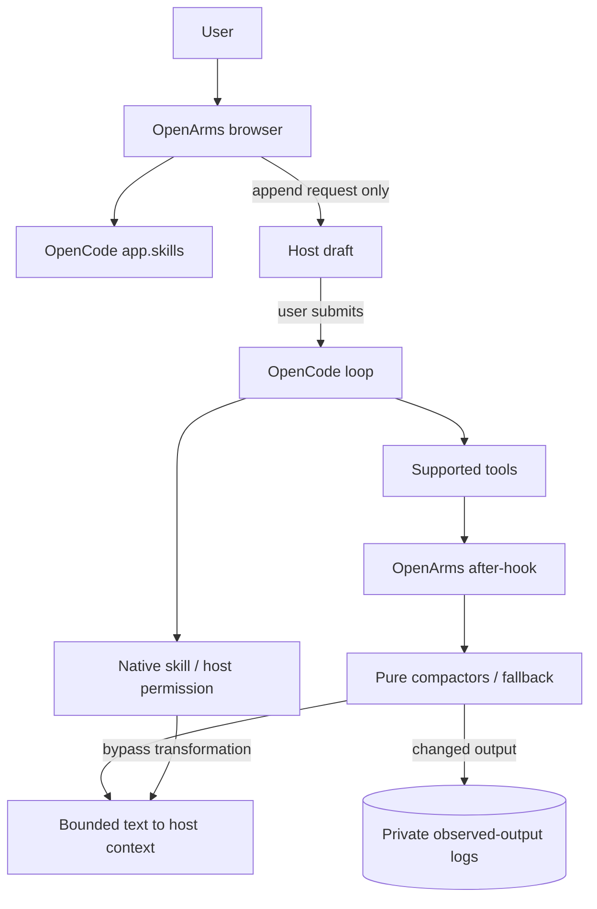

# Architecture — ranh giới nhỏ, đường chạy rõ

[← Mục lục](README.md)

## 1. Ownership

| Thành phần | Sở hữu |
|---|---|
| OpenCode | Agent loop, model calls, native skill discovery/loading, tools, permissions, conversation persistence |
| OpenArms TUI | Browse/inspect host catalog, stage skill request trong draft |
| OpenArms server | Transform supported tool text, lưu observed-output artifacts |

Không shared selection/state database, custom permission engine hoặc conversation DB
cạnh tranh. Skill browser và output compactor độc lập; không có model routing hay
session/task orchestration trong OpenArms.



## 2. Module map

| Đường dẫn | Trách nhiệm |
|---|---|
| [`plugins/skill-router-tui.tsx`](../plugins/skill-router-tui.tsx) | Entry giữ path/ID tương thích, cài browser |
| [`src/native-skills.ts`](../src/native-skills.ts) | Validate catalog, safe error codes, dialogs, target guards và draft request |
| [`plugins/skill-router-server.ts`](../plugins/skill-router-server.ts) | Chọn root, chỉ đăng ký output after-hook |
| [`src/output-hooks.ts`](../src/output-hooks.ts) | Tool allowlist, giữ title/metadata |
| [`src/output-governor.ts`](../src/output-governor.ts) | Normalize/classify, parse/fallback, save và final cap |
| `src/*-output-compactor.ts` | Pure parser theo domain, không process/filesystem side effects |
| [`src/file-inspection-compactor.ts`](../src/file-inspection-compactor.ts) | Nhận diện binary/minified/long-line output |
| [`src/output-logs.ts`](../src/output-logs.ts) | Private exclusive save, flush và retention |

`skills/` là nội dung mẫu có license riêng, không tự đăng ký/chạy. SDK chỉ được import
làm type contract; runtime modules dùng built-ins và host API.

## 3. Hai luồng chính

### Skill request

```text
Capture home/session target → host catalog → validate → browse/preview
 → revalidate skill + target → append request → check result/target → user reviews
```

Target gồm directory, route và session ID nếu có. Callbacks giữ target ban đầu, không
chọn lại target theo thời điểm click. Lifecycle signal được truyền cho append SDK call;
dispose làm callbacks không còn tác dụng.

Guard là kiểm tra client, không host transaction. API không có session ID/compare-and-append,
nên in-flight outcome có thể uncertain. Không auto-retry, không tuyên bố loaded sau append;
chi tiết UX và error codes có một nguồn chuẩn ở [Skills](skills.md#draft-safety).
Không replace Prompt slots, intercept Enter, reset draft hoặc thêm scanner fallback.

### Output

```text
After-hook observed text → pure transform → save original if changed → publish bounded text
```

Artifact phải save/flush thành công mới có log reference. Parser/sink failure được diễn đạt
bằng marker và bounded fallback, không raw exception hoặc status thành công giả. Định dạng,
limits, privacy và retention có một nguồn chuẩn ở [Output](output.md).

## 4. Host contract và compatibility

- Browser cần `app.skills` và `tui.appendPrompt`, route home/session và public dialogs/keymap API.
- Dependency/type declarations pin theo `package.json`/lockfile; host source tham khảo là
  OpenCode `v1.19.3`. Pin/typecheck không chứng nhận mọi host version tương thích.
- Catalog API có thể trả content cho preview; điều đó không có nghĩa body được đưa vào model context.
- Host có thể bỏ skill lỗi hoặc resolve duplicates trước response; plugin chỉ validate dữ liệu nhận được.
- Không có runtime config/state riêng của OpenArms; library paths/permissions thuộc host config.
- Sửa source/restart không tự deploy installed runtime. [Migration](migration.md) sở hữu quy trình upgrade.

**Tiếp theo:** [Development](development.md) để sửa code; [Verification](verification.md) để kiểm tra contract.
