# OpenArms — Bản đồ kiến trúc và vận hành

> **Ý chính:** OpenArms là plugin độc lập chạy bên trong OpenCode. Nó quản lý
> cách skill đi vào context và đang phát triển thêm khả năng giảm output, đo usage
> và hỗ trợ vòng đời session. OpenCode vẫn là host thực thi agent, tool và permission.

**Đối chiếu:** source checkout và roadmap ngày 11/10/2026, Sprint 2.4.
**Current contract:** [Sprint 2.4](../testing/how_to_test/Sprint_24.md), kế thừa
[transaction Sprint 2.3](../testing/how_to_test/Sprint_23.md).
TUI dùng `plugins/tui-core.ts` cho confirmation/action contract, runtime ticket
identity-bound trước dialog, commit cùng persisted transaction. Status/list/inspect
derive authorization, Loaded/Used không che Denied/Unverified. Integrity sidecar
chỉ advisory deny, không source approval hoặc grant. Renderer/PTY thật chưa nghiệm thu.
Các sơ đồ baseline package-wide bên dưới giữ bối cảnh trước Sprint 2.3, không
phải đường thực thi hiện tại. Source nay có sole `load_verified_skill`, persisted
state version 2 và transaction reuse verified core; `package-loader.ts` chỉ tạo
instruction. Registry checkout/library thật vẫn v1 nên content fail-closed.
Không có legacy tool/fallback, không live migration hay owner approval tự động.
Prompt boundary dùng message ID idempotent; transaction khóa state trước content
I/O, chỉ atomic publication khi core read/hash/revalidation thành công. Grants
bind skill/owner/revision/project/session/scope; restore không mang task-used/lock.
Host filesystem permission vẫn riêng, không thể tạo skill grant.
Mô hình hiện tại bên dưới mô tả checkout, không mặc nhiên mô tả mọi bản đã cài.

## Cách đọc bản đồ

| Ký hiệu | Ý nghĩa |
|---|---|
| 🟦 **HIỆN TẠI** | Hành vi có trong source checkout |
| 🟨 **ĐỀ XUẤT** | Thiết kế đích theo roadmap, chưa phải chức năng đã bật |
| 🟪 **HOST** | Trách nhiệm của OpenCode hoặc môi trường thực thi |
| → Đường liền | Luồng chính, gọi hàm hoặc truyền dữ liệu; xem nhãn mũi tên |
| ⇢ Đường nét đứt | Metadata, cấu hình hoặc nhánh có điều kiện |
| Hình trụ | Dữ liệu được lưu, không phải một service |

Các sơ đồ được chia nhỏ để đọc từ trên xuống thay vì gom mọi chi tiết vào một hình.
Màu hỗ trợ phân biệt; trạng thái và trách nhiệm vẫn được ghi bằng chữ.

| Muốn hiểu điều gì? | Đọc phần |
|---|---|
| Dự án này đứng ở đâu so với OpenCode? | [1. Toàn cảnh](#1-toàn-cảnh-openarms-đứng-ở-đâu) |
| Vì sao source và bản đang chạy có thể khác nhau? | [2. Scope và thư mục](#2-năm-scope-không-được-nhầm-lẫn) |
| Code hiện tại được tổ chức ra sao? | [3. Các lớp](#3-các-lớp-code-hiện-tại) |
| Một task nạp skill như thế nào? | [4. Luồng hiện tại](#4-từ-chọn-skill-đến-nạp-context--hiện-tại) |
| Reference và permission liên hệ thế nào? | [5. Reference](#5-reference-hiện-tại-và-contract-đích), [6. Permission](#6-permission-ba-lớp-hai-loại-quyền) |
| Phát triển, kiểm thử và deploy thế nào? | [8. Delivery](#8-phát-triển--kiểm-thử--triển-khai) |
| Sau này dự án sẽ có những khối nào? | [9–12. Kiến trúc đích](#9-kiến-trúc-đích-theo-roadmap--đề-xuất) |

---

## 1. Toàn cảnh: OpenArms đứng ở đâu?

**🟦 BASELINE trước Sprint 2.3 — plugin riêng, tích hợp qua API của host.**

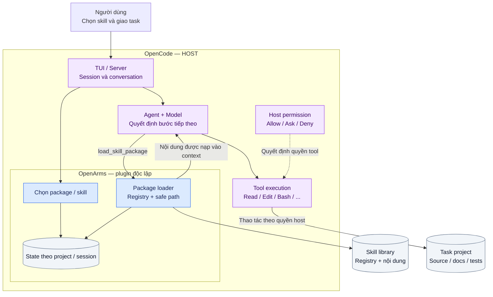

**Cách đọc:** người dùng chọn skill qua TUI; agent lấy nội dung qua loader.
Agent thao tác project bằng tool của OpenCode, không bằng một filesystem engine
riêng của OpenArms. Provider/model cũng thuộc cấu hình host.

| OpenArms chịu trách nhiệm | OpenCode / môi trường chịu trách nhiệm |
|---|---|
| Registry, selection, package/task lock | Model request, agent loop, conversation |
| Nội dung loader trả, safe path | Tool read/write/shell và permission tương ứng |
| State và lịch sử nạp skill | Khả năng truy cập ngoài workspace |
| Tương lai: usage/output/budget helpers | Cơ chế cô lập container/OS và network |

## 2. Năm scope không được nhầm lẫn

**🟦 Các scope tồn tại hiện tại; quy trình deploy bên dưới là mô hình vận hành khuyến nghị.**

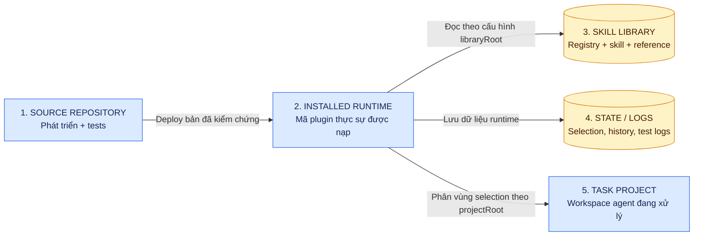

### Đường dẫn cụ thể trong môi trường đang trao đổi

```text
SOURCE — nơi sửa code
/home/hodangthaiduy/Workspace/Extensions/OpenArms/
├── src/                 Core của checkout
├── plugins/             OpenCode adapters
├── docs/                Architecture + roadmap
├── scripts/             Unified test runner
└── sandbox/             Môi trường kiểm tra tích hợp

INSTALLED RUNTIME — cấu hình OpenCode hiện đang trỏ tới
/home/hodangthaiduy/.local/share/opencode-skill-router/
└── plugins/skill-router-server.ts

HOST CONFIG
/home/hodangthaiduy/.config/opencode/opencode.json
└── plugin URL chọn mã runtime được nạp

TASK PROJECT
<folder/worktree đang mở trong OpenCode>
└── Có thể là OpenArms hoặc một dự án hoàn toàn khác
```

Library và runtime có thể cùng nằm trong một thư mục vật lý nhưng vẫn là **hai
vai trò khác nhau**. `.local` không tự cấp quyền và không tự đồng bộ source.

| Root / dữ liệu | Cách xác định trong checkout hiện tại |
|---|---|
| Plugin code | URL plugin trong cấu hình OpenCode |
| `libraryRoot` | Tham số tường minh → `OPENARMS_LIBRARY_ROOT` → root chứa mã plugin |
| Registry | `<libraryRoot>/registry.json` |
| `projectRoot` | `worktree` nếu có và khác `/`; nếu không dùng `directory` |
| State | `stateFile` tường minh, nếu không: `$XDG_STATE_HOME/openarms/state.json` hoặc `~/.local/state/openarms/state.json` |
| Test logs | `.openarms/logs/` của repository theo test runner |

> **Lưu ý phiên bản:** plugin cài đặt cũ đã kiểm tra trong phiên trao đổi dùng
> `~/.local/state/opencode-skill-router/state.json`, còn checkout dùng namespace
> `openarms`. Không giả định hai bản dùng chung state hay tự migrate dữ liệu.
> Registry checkout chỉ có package `docs`; package `shared-skills` thuộc library
> cài đặt đã được cung cấp trong phiên này.

**Ví dụ lỗi đã gặp:** sửa loader ở SOURCE → restart OpenCode → OpenCode vẫn nạp
INSTALLED RUNTIME cũ. Restart là reload mã tại URL cấu hình, không phải deploy.

## 3. Các lớp code baseline trước Sprint 2.3

Sprint 2.1 (11/10/2026) thêm `src/registry-v2-types.ts` và tooling standalone
`scripts/registry-v2{,-operations,-cli,-ci}.mjs`: schema, migration một chiều,
explicit hash IDs, integrity/budget và CI synthetic gate. Không được nối vào
runtime/loader/state v1 ở sơ đồ dưới. [Contract và giới hạn Linux/cooperative
transaction](../testing/how_to_test/Sprint_21.md); library thật chưa migrate/verify.

**🟦 BASELINE trước Sprint 2.3 — hai adapter dùng chung core và runtime composition.**

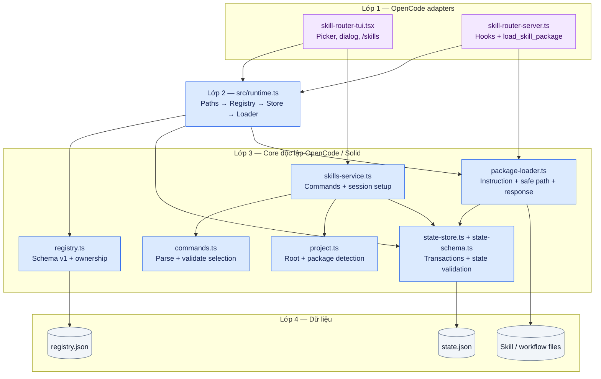

| File / nhóm | Trách nhiệm | Không được hiểu nhầm là |
|---|---|---|
| `src/types.ts` | Hợp đồng registry/state/commands | Schema verified/hash tương lai |
| `src/runtime.ts` | Khởi tạo chung và chọn paths | Công cụ deploy |
| `src/project.ts` | Chọn root, phát hiện package | Filesystem permission engine |
| `src/registry.ts` | Validate registry/path/ownership | Security review nội dung skill |
| `src/package-loader.ts` | Resolve, đọc và trả package/workflow | Chặn mọi cách Bash đọc file |
| `src/state-store.ts` | Atomic state, task lock, load history | Conversation history của OpenCode |
| `src/skills-service.ts` | Selection, status/inspect, restore | Tự nạp nội dung ngay khi enable |
| `plugins/*` adapters | Kết nối UI/hooks/tool với core | Một fork bắt buộc của OpenCode |
| `plugins/shared.ts`, `server-core.ts`, `tui-core.ts` | Facade import tương thích trong checkout | Implementation core thứ hai |

Package detection gợi ý package từ file/extension/dependency; **detected không
đồng nghĩa với enabled**, và enabled cũng không đồng nghĩa với loaded.

## 4. Từ chọn skill đến nạp context — baseline trước Sprint 2.3

### 4.1. Luồng thành công và luồng lỗi

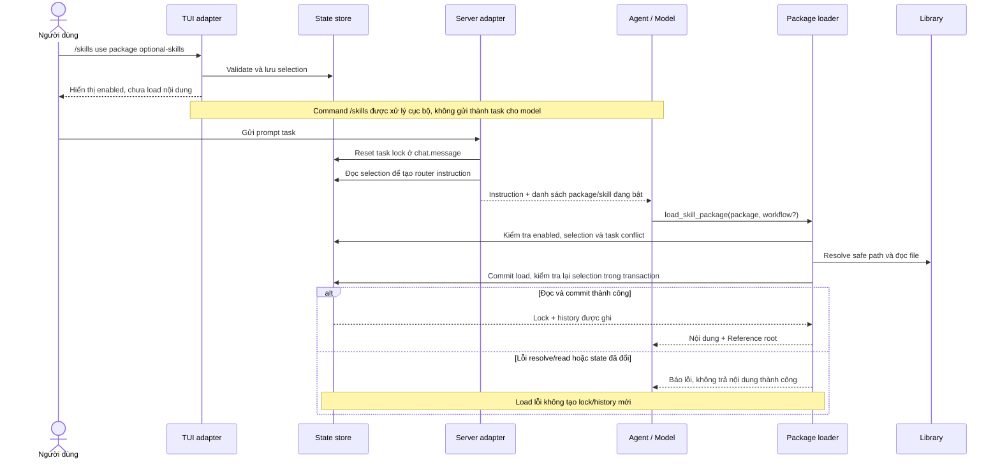

**Hai loại request baseline trước Sprint 2.3 (đã gỡ):**

| Request | Nội dung được trả |
|---|---|
| `{ package }` | Core + tất cả optional skill đã chọn của package, deduplicate |
| `{ package, workflow }` | Workflow Superpower được yêu cầu, khi Superpower đang bật |

Task lock giữ **một package trong một task**; vẫn có thể nạp workflow cùng package.
Trong implementation hiện tại, prompt mới qua `chat.message` reset lock: chưa
phải một task-completed detector độc lập.

### 4.2. State nào thuộc ai?

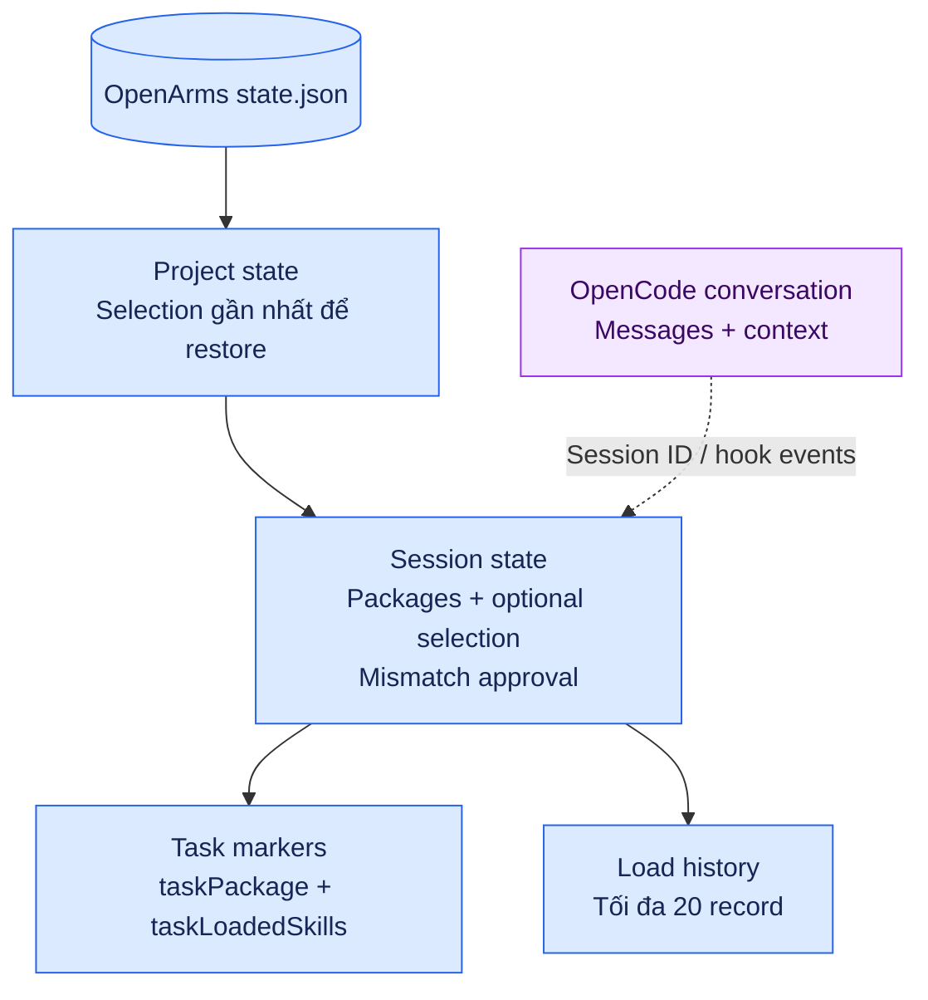

**Invariant baseline trước Sprint 2.3:**

- Registry/state runtime còn v1; SHA-256 có trong tooling 2.1 và core standalone 2.2, chưa kiểm tra ở loader host.
- Resolve skill phải nằm trong library root; workflow phải nằm trong workflow root được kiểm tra.
- Read thành công chưa đủ: transaction phải xác nhận package/selection chưa đổi.
- Hai load khác package chạy đồng thời chỉ một package được commit.
- State dùng atomic rename dưới file lock; JSON/schema/I/O lỗi được báo, không coi là state rỗng.
- `clear` giữ `lastSelection`; `inspect` kết hợp history và task-loaded markers.
- Child hiện kế thừa selection, approval và lock; policy child giới hạn theo task là thiết kế Phase 3.

## 5. Reference: baseline package loader và contract verified hiện tại

**Reference** là tài liệu chi tiết được skill chỉ tới. Skill interface nói “cần
đọc gì”; reference cung cấp schema, prompt, workflow detail hoặc ví dụ dài.

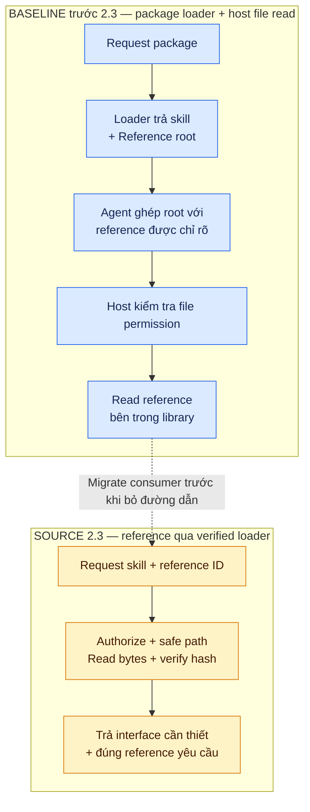

| | Baseline trước 2.3 | Source Sprint 2.3 |
|---|---|---|
| Chọn nội dung | Package/workflow | Skill/workflow/reference ID |
| Đường dẫn cho agent | `Reference root` đã resolve | Không cần absolute library path |
| Ai đọc reference? | File tool của host theo permission | Verified loader |
| Kiểm tra reference | Instruction + quyền host; không phải hash check của package loader | Allowlist, đúng skill root, authorization và hash |
| Reference chưa yêu cầu | Agent chỉ đọc khi cần và được skill chỉ rõ | Loader không tự kéo chỉ vì interface nhắc tới |

Contract core Sprint 2.2 đã được đăng ký trong source adapter Sprint 2.3;
live host acceptance vẫn pending:

```ts
load_verified_skill({ skill, workflow?, reference? })
```

Chỉ nhận tối đa một `workflow` hoặc `reference`. Reference là ID allowlist, không
phải đường dẫn tùy ý. Bỏ `Reference root` sau khi consumer có đường lấy reference
qua API mới; không để skill yêu cầu tài liệu mà loader không cung cấp cách lấy.

`src/verified-loader.mjs` export strict schema/validator, in-memory authorization/
grants, raw buffer hash, file identity/revision revalidation và response budget audit.
Runtime 2.3 reuse core dưới persisted state transaction; không v1 content fallback.
[Contract Sprint 2.3](../testing/how_to_test/Sprint_23.md) nêu default interface +
explicit child, Linux/private-root limits và remaining live gates.

## 6. Permission: ba lớp, hai loại quyền

### 6.1. Ba lớp bảo đảm khác nhau

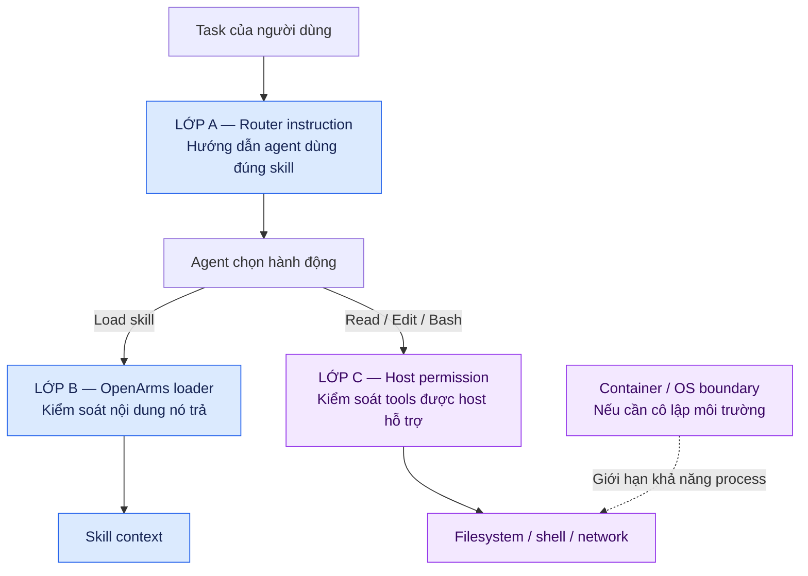

| Lớp | Bảo đảm | Giới hạn |
|---|---|---|
| A — Instruction | Nêu quy trình và nguồn skill được phép | Không phải cơ chế cưỡng chế filesystem |
| B — Loader | Từ chối request/path không hợp lệ trên đường loader | Không kiểm soát mọi tool ngoài loader |
| C — Host/sandbox | Allow/ask/deny tool; giới hạn process nếu được cấu hình | Phải kiểm chứng theo tool/version và môi trường |

**Bash pattern chứa `SKILL.md` chỉ kiểm tra một kiểu command.** Không suy ra mọi
cách shell đọc file đều bị ngăn. Loader tests không chứng minh agent đã bị cô lập
khỏi toàn máy.

### 6.2. Quyền filesystem không tạo skill grant

| Tình huống | Filesystem decision | Skill decision |
|---|---|---|
| Đọc source trong task project | Theo host | Không cần nạp skill mới chỉ để đọc source |
| Đọc text ngoài workspace | Allow/ask/deny theo host | Không tự grant skill vì đã cho phép path |
| Nạp skill đã chọn qua loader | Process loader cần đọc library | Theo approved registry/selection/hash/grant; filesystem allow không cấp grant |
| Sửa plugin đã cài | Task bảo trì/deploy và quyền host | Không được suy ra từ quyền đọc reference |
| Chạy test/build | Theo host shell permission | Skill grant không cấp shell permission |

**Policy tối ưu file:** search/range trước; lockfile có thể đọc trước install.
Không dùng lịch sử ba tool calls làm gate. File lớn có thể warning/ask theo host;
generated/minified rules cần observe/shadow và đánh giá trước activation.

## 7. Vòng đời selection và grant

**🟦 Source Sprint 2.3:** selection và grant theo skill/revision/scope riêng biệt.
**🟨 Phase 3:** grant-aware child bridge/restore UI và lifecycle rollout còn chờ.

Sprint 2.3 đã nối seam in-memory vào persisted state và restore filtering. Bảng
scope bên dưới là source contract; restore UI chi tiết/grant-aware child bridge
vẫn là đích Phase 3. Child hiện giữ selection/mismatch/active lock, không copy
session grants/history; không claim zero optional fallback đã triển khai.

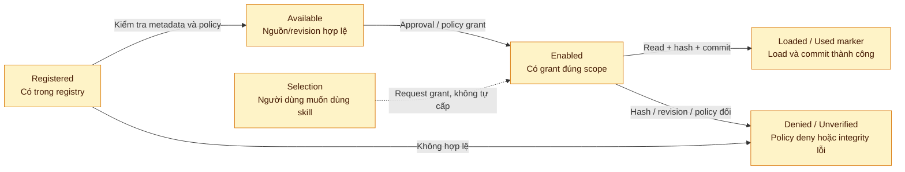

Loaded/Used là marker runtime; không có nghĩa skill được dùng mãi mãi hoặc đã gây
ra toàn bộ token của task. Hash khớp chỉ xác nhận bytes khớp revision đăng ký,
không chứng nhận nội dung an toàn/đúng hay thay thế việc chấp nhận nguồn.

### Grant source Sprint 2.3 và restore

| Scope | Vòng đời | Session mới / restore |
|---|---|---|
| `once` | Hết sau một load thành công | Không mang sang session mới |
| `session` | Chỉ session được cấp | Không mang sang session khác |
| `project` | Đúng project, revision/hash và policy còn hợp lệ | Có thể giữ; không tạo lại từ selection |
| Task markers | Lock và used markers của task | Không restore active lock/used markers |

Restore default No; Yes khôi phục selection sau reconcile và giải thích grant
nào còn hiệu lực. **Child đích** chỉ nhận tập skill cần cho nhiệm vụ qua bridge
đã kiểm chứng; bridge không có thì zero optional skill và request tường minh.
Child không tự nhận toàn bộ parent/project grants, lock hay history. Filesystem
rights của child vẫn do host quyết định riêng.

## 8. Phát triển → kiểm thử → triển khai

### 8.1. Một đường kiểm thử theo phạm vi — HIỆN TẠI

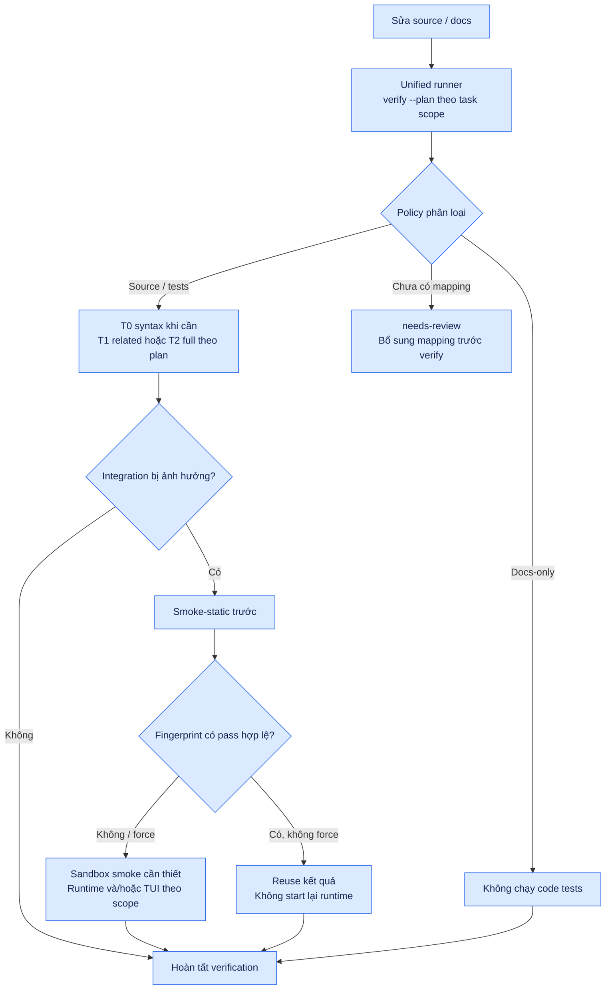

| Tầng | Mục tiêu | Khi nào chạy |
|---|---|---|
| T0 — Syntax | Feedback nhanh | Sau edit code đáng kể |
| T1 — Related | Kiểm tra vùng đổi | Cuối task nếu full không thay thế |
| T2 — Full | Regression toàn suite | Shared/core, test infrastructure, user yêu cầu; pre-push/CI opt-in |
| T3 — Smoke | Tích hợp OpenCode thật | Classifier yêu cầu runtime/TUI/config/sandbox boundary |

T0/T1/T2 không cache. Smoke cache chỉ reuse pass với fingerprint input còn khớp.
Build reuse có fingerprint riêng; smoke thực tế phải có image phù hợp. CI không
mặc nhiên tin local stamp. Log đầy đủ được giữ trước compact; failure retry guard
chặn lần ba cùng lỗi/input nếu không có override có lý do.

```bash
# Chạy từ repository root; thay phạm vi bằng các file của task
node scripts/arms-test.mjs verify --plan --file src/package-loader.ts
node scripts/arms-test.mjs verify --file src/package-loader.ts
```

### 8.2. Delivery khuyến nghị — không phải deploy command đã triển khai

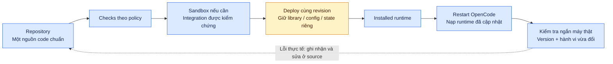

Không đợi xong toàn sản phẩm: triển khai theo từng phần đã kiểm chứng. Với thay
đổi không cần integration, plan có thể skip sandbox. Nên có deploy/diagnostic
workflow ghi revision, plugin root, library root và project root; đây là nhu cầu
vận hành, không khẳng định một lệnh `deploy:local` đã tồn tại.

## 9. Kiến trúc đích theo roadmap — ĐỀ XUẤT

**🟨 Những khối dưới đây không tự xuất hiện chỉ vì đã có core và adapters.**

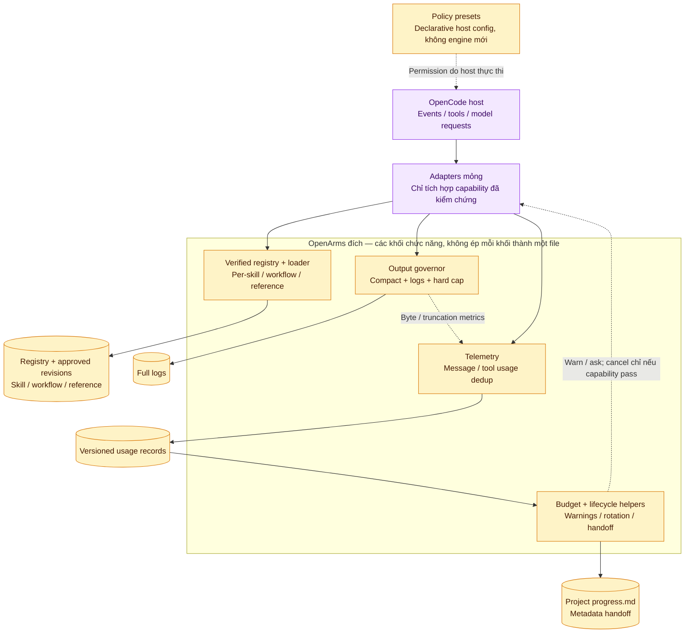

Giữ thiết kế tinh gọn: telemetry, output governor, verified registry/loader và
policy preset là các khối nền tảng; budget/lifecycle phát triển sau trên usage.
Preset là cấu hình host, không phải permission service riêng.

## 10. Verified loader core 2.2: đã nối transaction/adapter source Sprint 2.3

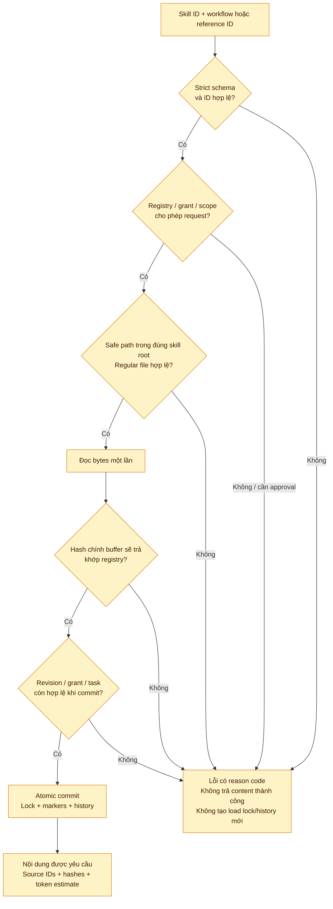

Metadata authorization đứng trước content read; runtime hash kiểm tra **chính
bytes sẽ trả**, không dựa vào flag verified cũ. Approval-required được giải quyết
qua grant có scope, không bằng việc agent tự đi tìm một bản skill khác.

Core 2.2 giữ synchronous verification; runtime 2.3 giữ cooperative state lock qua
flow, atomic rename trước khi trả response. [Báo cáo 2.3](../reports/sprints/report_sprint_23.md)
phân biệt source implementation, fixture evidence và operational gates.

## 11. Output và budget: giảm context trước, chặn sau

### 11.1. Output governor đích — Phase 1

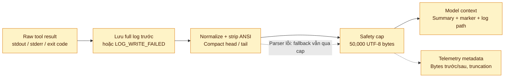

Giữ exit code và lỗi chẩn đoán; không biến fail thành pass. Log không ghi được
phải báo minh bạch. Telemetry không lưu raw output/credential; raw log là dữ liệu
riêng với quyền và retention riêng. Compact test output đã có ở runner Phase 0;
Sprint 1.2 đã thêm `src/output-governor.ts` và SDK after-hook adapter: combined
text được compact/cap, title/metadata giữ nguyên. Không infer exit/stdout/stderr.
Loader từ chối assembled skill >50,000 bytes trước mutation; normal skill không
strip/compact. Xem [host limits và defaults](../testing/how_to_test/Sprint_12.md).

Review corrections: telemetry disk identity dùng JSON tuple như memory dedup;
read shadow đánh giá observed output bytes/lines, không full-file metadata.
Off không enforce dù giữ activeRules/hostEnforcement. Structured process adapter
`scripts/test-process.mjs` opt-in `noisePresets: true` dùng shared
`src/noise-preset.mjs`; default/unknown/path/shell string không bị rewrite.

### 11.2. Budget và rotation đích — Phase 3

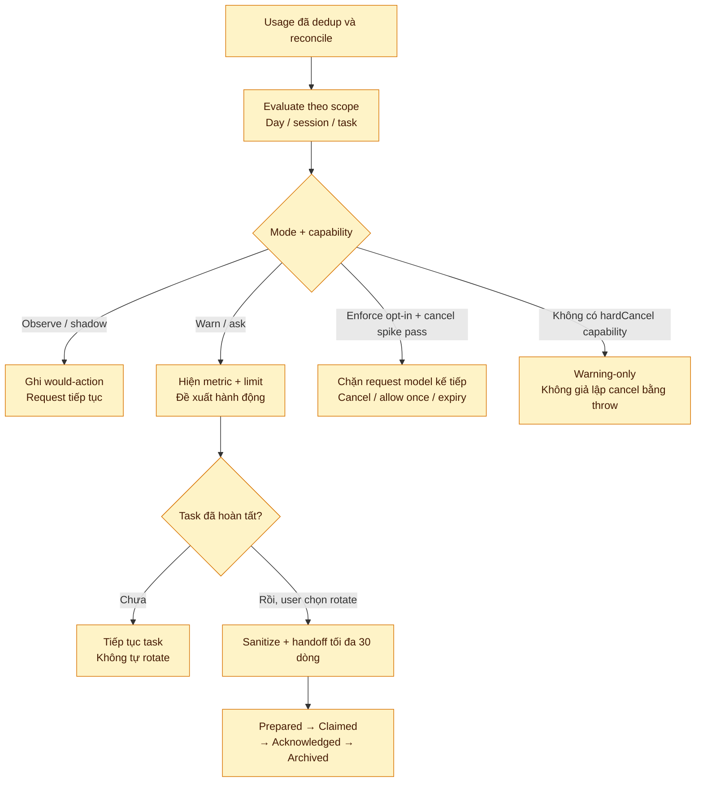

Rotation chỉ đề xuất ở task-completed boundary, không tự đóng session đang edit/test.
Chỉ archive handoff sau acknowledgement hợp lệ. Hard cap output, hard budget và
host permission là ba cơ chế khác nhau, không dùng thay nhau.

## 12. Roadmap: hiện có gì, tiếp theo làm gì?

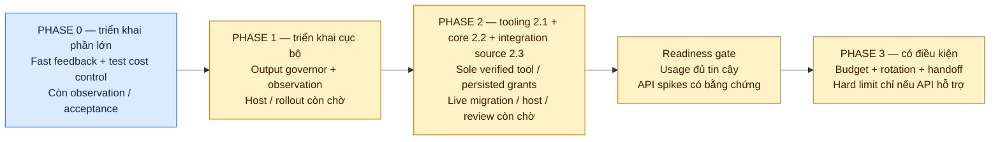

| Năng lực | Hiện trạng / nguồn |
|---|---|
| Package routing, selection, safe path, atomic state | Có trong `src/` và adapters |
| Unified runner, selective smoke, fingerprint, compact test logs | Có; Phase 0 còn TSK-001/023 chờ observation |
| Tool governance telemetry | v1 whitelist/bytes/omissions/shadow; messageID optional; dedup plugin-lifetime |
| Hash và per-skill/reference API | Source Sprint 2.3 nối core vào sole verified tool/persisted transaction; v1 content deny |
| Schema/migration/hash/integrity tooling v2 | Tooling 2.1, synthetic CI; live registry/library migration và approval chưa làm |
| File-access rules | Phase 1 observe/shadow; không có gate lockfile ba tool calls |
| Budget, grant-aware child/restore, handoff | Phase 3; cần readiness/capability evidence |
| Permission engine riêng hoặc sửa trực tiếp OpenCode | Không phải yêu cầu của kiến trúc này |
| Deploy automation + runtime diagnostics | Khuyến nghị vận hành; cần triển khai riêng |

Roadmap Phase 0 hiện là **Fast Feedback & Test Cost Control**, không phải Phase 0
telemetry/integrity trong báo cáo v3 cũ. Khi khác nhau, dùng source cho hành vi
hiện tại và tasklist đang cập nhật cho kế hoạch; báo cáo là bối cảnh lịch sử.

## 13. Tóm tắt mô hình trong một phút

```text
NGƯỜI DÙNG chọn skill và giao task
    │
    ├─ OpenArms: nội dung skill nào được nạp, từ nguồn nào, trong scope nào?
    ├─ OpenCode: agent/tool nào thực thi, được đọc/ghi/chạy lệnh ở đâu?
    └─ Sandbox/OS: process có khả năng tác động tới những tài nguyên nào?

SOURCE ── kiểm thử ── deploy ── INSTALLED RUNTIME ── restart ── sử dụng
                                  │
                                  ├─ đọc SKILL LIBRARY
                                  ├─ lưu STATE / LOGS
                                  └─ phân vùng selection theo TASK PROJECT

ĐỊNH HƯỚNG: đo đúng → giảm context thừa → cảnh báo → enforcement có điều kiện
```

**Bốn điều luôn nhớ:**

1. Enable không phải load; selection không phải grant; grant không phải shell permission.
2. Source sửa xong không có nghĩa runtime đã cập nhật; restart không phải deploy.
3. Safe path/hash bảo vệ đường loader; không chứng minh mọi tool đã bị cô lập.
4. Chỉ bật enforcement khi host hỗ trợ và dữ liệu chứng minh rule không gây hại task hợp lệ.

## 14. Tài liệu đi sâu

- [Mục lục docs](../README.md) và [Overview](openarms-overview.md).
- [Phase 0 — Test cost control](../roadmap/Tasklist_Phase_0.md).
- [Phase 1 — Output governor](../roadmap/Tasklist_Phase_1.md).
- [Phase 2 — Granular verified loader](../roadmap/Tasklist_Phase_2.md).
- [Phase 3 — Budget và lifecycle](../roadmap/Tasklist_Phase_3.md).
- [Testing guide](../testing/testing.md) và [Smoke contract](../testing/smoke-contract.md).
- [Báo cáo định hướng v3](../reports/overview/Task_Optimization_Report_v3.md).
- [README dự án](../../README.md).
