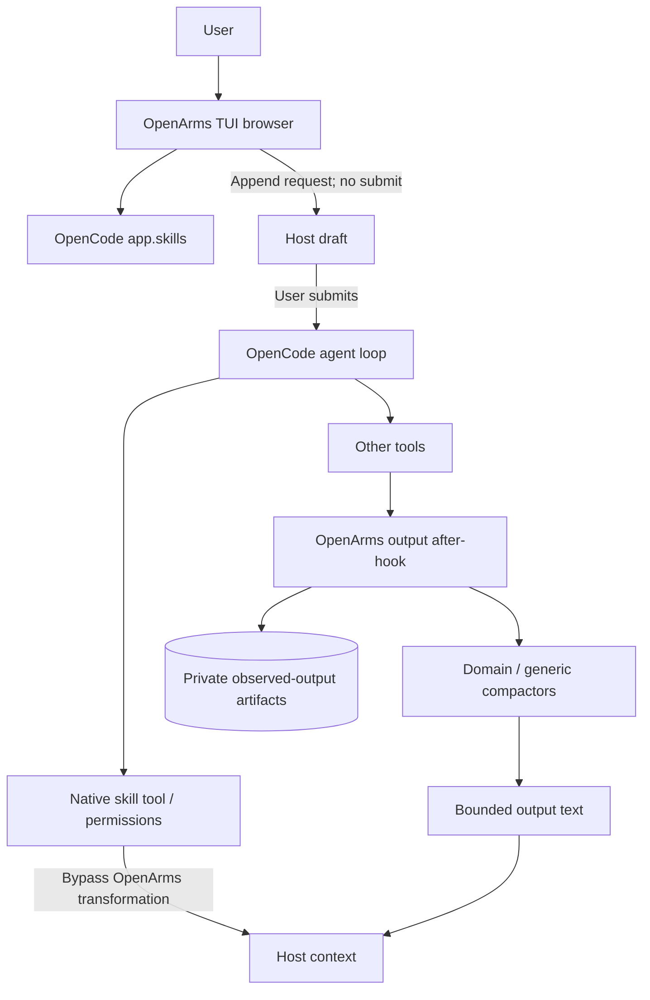

# OpenArms 0.2 — kiến trúc tối giản

## 1. Ownership

OpenArms không phải harness độc lập. OpenCode sở hữu model calls, loop, native skill
discovery/loading, tool execution, permissions và conversation database.
OpenArms chỉ thêm browser và output transformations. Không direct SQL, model fallback,
custom skill grant hoặc task/session orchestration.



## 2. Modules

| File | Trách nhiệm |
|---|---|
| `plugins/skill-router-tui.tsx` | Entry path tương thích, đăng ký browser |
| `src/native-skills.ts` | Host catalog validation, host dialogs, request staging |
| `plugins/skill-router-server.ts` | Chọn project root, đăng ký output hook |
| `src/output-hooks.ts` | Tool allowlist, adapter giữ nguyên title/metadata |
| `src/output-governor.ts` | Classify, parse, fallback, save, cap |
| `src/*-output-compactor.ts` | Pure domain parsers |
| `src/file-inspection-compactor.ts` | Guard output binary/minified/long lines |
| `src/output-logs.ts` | Private save và best-effort retention |

Không shared runtime state/store, registry hoặc package loader. Hai adapters không cần
file IPC hoặc synchronization selection. `skills/` chỉ là mẫu có license riêng.

## 3. Skill catalog và request

1. Mở `/skills` → gọi `app.skills({directory})` với directory hiện tại.
2. Validate response shape/name/location/content; lỗi hiển thị ERROR; duplicate names bị từ chối request.
3. Host DialogSelect lọc; Inspect hiển thị preview tối đa khoảng 12.000 UTF-8 byte + marker.
4. Request refresh catalog và kiểm tra name/location còn tồn tại, không ERROR.
5. Gọi `tui.appendPrompt({directory,text})`; kiểm tra host response, không submit.

Không ghi skills vào system prompt và không custom frontmatter reader. Native tool
của host xử lý nạp nội dung theo yêu cầu và permission. Full content có thể được trả về
trong API để preview nhưng không tự đi vào model context.

Không replace Prompt slots, không intercept Enter, không reset editor. Khi host directory
đổi hoặc plugin dispose trong lúc fetch, UI cũ không được mở. TUI API append theo semantics
host; chưa bảo đảm single-client targeting/atomic ownership giữa nhiều clients. Người dùng
phải ở normal prompt mode và review draft trước gửi. Không tuyên bố đã load skill sau append.

Host có thể loại file lỗi hoặc resolve tên trùng trước khi trả catalog; ERROR chỉ mô tả lỗi
quan sát trong response, không phải filesystem audit hoàn chỉnh. Không API capability → báo lỗi,
không scan library fallback hoặc thay permission để làm cho nó chạy.

## 4. Output pipeline

```text
Observed text → pure normalize/classify/compact
              → nếu thay đổi: save original observed text
              → markers/log reference → final UTF-8 cap → publish
```

Parsers không có filesystem/process side effects. Parser lỗi/malformed response → generic
fallback và `GOVERNOR_FAILED`. Save lỗi → `LOG_WRITE_FAILED`, không path giả. Text không đổi
không tạo log. Native skill/custom tools bypass, không bị cắt authoritative instructions.

Cap cuối 50.000 byte bao gồm markers/reference; cap generic mặc định 32.000 byte.
After-hook chỉ xử lý combined host text; title/metadata/exit information không bị thay thế.
Không capture stdout/stderr trực tiếp, không recover được upstream truncation.

## 5. Persistence duy nhất

Project root: `worktree` khi có và khác `/`, nếu không dùng `directory` từ server input.
Output artifacts: `<projectRoot>/.openarms/logs/output-<uuid>.log`.
Không XDG toggle/usage state mới; không đọc, migrate hoặc xóa state cũ.

Save dùng exclusive create 0600 và fsync trước trả path. Các thư mục `.openarms`/`logs`
phải private (không group/world bits) và không symlink. Không tự chmod repo hoặc edit
`.gitignore`; thư mục không phù hợp làm save fail rõ ràng. Threat model là local owner-controlled
workspace, không hostile concurrent filesystem mutation.

Retention best-effort: 7 ngày / 100 file / 64 MiB, chỉ files khớp tên output mới;
không xóa file đang save hoặc files mới dưới 60 giây. Một file lớn/recent concurrency có thể
vượt quota tạm thời. Legacy logs/state không thuộc cleanup này.

## 6. Configuration và compatibility

- Giữ plugin entry paths/IDs; không có OpenArms runtime configuration/state riêng.
- Native library qua OpenCode discovery hoặc `skills.paths`, do user review/merge.
- Không tự enable/deny skill permissions. Legacy `skill: deny`, `SKILL.md` deny rules có thể
  cần người dùng gỡ nếu chỉ do OpenArms cũ thêm; không reset mọi policy.
- SDK type declarations pin `1.18.34`; nguồn host tham khảo `v1.19.3`. Typecheck/unit tests
  không chứng nhận tương thích live host. TUI capability thiếu phải báo rõ.

## 7. Maintenance

Một thin check runner và small host suite; không tiers/mapping/cache/smoke infrastructure.
Types, local imports và active docs links được kiểm tra. Archive bị loại khỏi live checks vì
là snapshot lịch sử có đường dẫn/lệnh cũ. [Testing](../testing/testing.md).

Bộ nghiên cứu control-plane trước đây được [archive](../archive/README.md), không phải
roadmap đang triển khai. Mọi mở rộng lớn phải có quyết định mới, không khôi phục module
cũ chỉ để thỏa runbook lịch sử.
