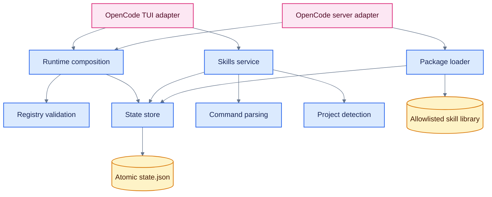
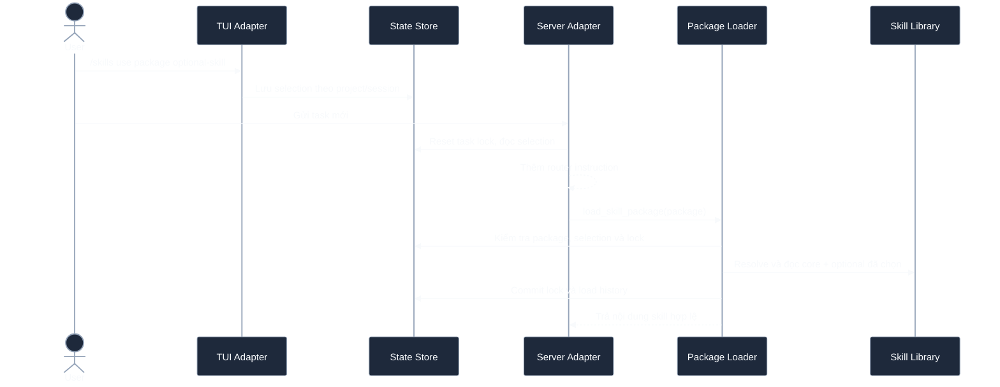
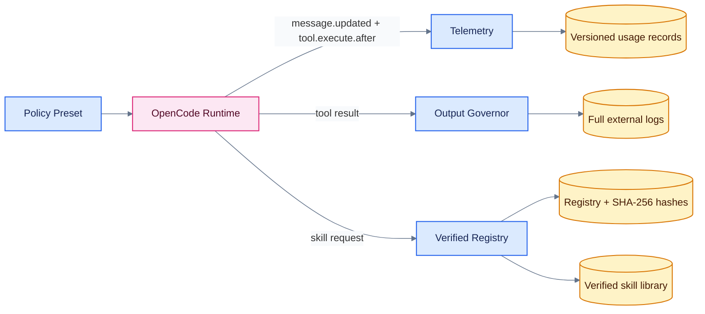

# OpenArms Overview

## Current architecture — single local library (12/10/2026)

Each canonical project starts with an **unset** library root. The user explicitly
chooses one absolute folder containing `registry.json` and `skills/` in `/skills`
Status. No environment default, bundled fallback or multi-source merge is used.
Local v1/v2 metadata is supported without mandatory migration, content hash
approval or scoped grants. The sole server content tool is `load_skill({skill})`,
for exact selected IDs, not paths, packages or workflow/reference selectors.

`src/local-library.ts` owns configuration `{root, revision, registryHash}`,
registry refresh, selection and contained reads. `registryHash` tracks metadata
change, not operator approval or verified content. `src/skills-service.ts`
provides `executeLocalSkillsCommand`; server/TUI adapters use the local flow.
Registry paths such as `skills/<id>/SKILL.md` are metadata. The loader checks
containment, file identity, encoding and response bounds before publishing history.

```text
Status → explicit project library → registry metadata → Use exact IDs
Task → load_skill({skill}) → selected-ID/containment checks → content + Loaded
```

Status puts the editor at the top with empty selection, bottom with populated
selection. Source change defaults to Cancel; cancel preserves state. Confirm
clears prior source state throughout the project and recommends `/new`: already
loaded model context cannot be retracted. Restore defaults to No and restores
selection only within the same library, never grants. States are Selected,
Loaded and Missing, with helpful library errors. Shell/read rights remain
independent host/OS permissions.

Sandbox roots can be `/opt/openarms`, the read-only installed-mode mount
`/opt/installed-router`, or an accessible project library. Mounting is not
selection; unmounted host paths are unreachable inside Docker. See
[Single Library](../testing/how_to_test/Single_Library.md). Final combined
full/smoke verification and real-host acceptance remain pending; no live skill
load or completed redesign validation is claimed here.

## Historical baseline and design context

### Domain-aware governor source update (15/10/2026)

The production hook saves raw output with an exclusive owner-only file and
`FileHandle.sync()` before normalization/classification/compaction, including
short authoritative responses (returned unchanged). Raw logs use
`<projectRoot>/.openarms/logs`, with unique opaque IDs, exclusive 0600 files and
0700 newly created directories. Existing symlink/non-directory or group/world
writable log directories are rejected. The threat model is an owner-controlled
local project, not concurrent hostile filesystem mutation. Numeric telemetry
remains separate in `<router-state-directory>/governance`. Failed sinks explicitly return
`LOG_WRITE_FAILED`, never a persisted-log claim. Successful sink completion is
the boundary of the full-log guarantee, not a disk-failure guarantee.

Default parsers cover test, linter, git diff and build; read/cat inspection is a
separate guard. Unknown formats use generic bounded fallback. Final context,
including markers/provenance, is capped at 50,000 UTF8 bytes. Numeric telemetry
adds fixed-enum domain, rawBytes, compactedBytes (final visible context), and
weighted savingsRatio; legacy measurements remain unknown. Usage/budget savings
are net bytes/4 estimates, not tokenizer, billing or provider-cost measurements.
See [Sprint 35 synthetic-host acceptance](../testing/how_to_test/Sprint_35v2.md).
Docker OpenCode 1.18.35 PTY runs real test/diff/compiler tools through a local
synthetic model transport. This is not live-provider or real-library acceptance.

**Everything below preserves the pre-redesign overview.** Approved registries,
`load_verified_skill`, grants, v1 fail-closed, package locks and legacy loaders
describe their historical revision or proposed roadmap, not current setup.
Historical measurements are not new evidence.

> Tài liệu tổng hợp hiện trạng dự án và định hướng tối ưu runtime. Nội dung được
> đối chiếu từ source hiện tại, `Architecture.md`, báo cáo môi trường trong
> `../reports/overview/` và tasklist hiện tại trong `../roadmap/`.
>
> **Mốc tài liệu:** 07/10/2026. Khi báo cáo và source khác nhau, source hiện tại
> được dùng để mô tả tính năng đã triển khai; báo cáo v3 được dùng làm định hướng.

## 1. Tổng quan

OpenArms là plugin cục bộ cho OpenCode, cung cấp hai năng lực chính:

1. **Verified skill routing:** quản lý skill theo project và session, chỉ đưa nội
   dung skill vào context khi task cần; loader từ chối request ngoài registry.
2. **Runtime governance:** định hướng mở rộng sang đo lường token/chi phí, kiểm
   soát tool output, giới hạn context, quản trị test và vòng đời session.

OpenArms hiện đã triển khai nền tảng skill router. Runtime governance là hướng
phát triển được đề xuất trong hai Task Optimization Report, chưa phải toàn bộ là
hành vi đang hoạt động.

### Tuyên bố giá trị

OpenArms giữ context nhỏ và có nguồn gốc rõ ràng bằng cách chỉ load nội dung cần
thiết, bảo vệ ranh giới thư viện skill và từng bước giảm output không có giá trị
trước khi áp dụng policy cưỡng chế.

### Nguyên tắc phát triển

- **Measure before optimize:** đo chính xác trước khi tối ưu hoặc đặt hard limit.
- **Least context:** chỉ load skill, file và output cần cho task hiện tại.
- **Verified by construction:** registry và safe path là ranh giới tin cậy.
- **Deterministic behavior:** deduplication, truncation và policy phải có kết quả
  ổn định với cùng đầu vào.
- **Shadow before enforcement:** quan sát tác động trước khi chặn hành vi thật.
- **Lean architecture:** ưu tiên số module tối thiểu mà một maintainer có thể vận
  hành và kiểm thử.

## 2. Trạng thái dự án

**Sprint 3.1 source update:** separate observe-default budget policy, private
JSONL usage transactions with a durable warning ledger and rebuildable atomic
aggregates; shared query formatter backs `/usage`, `/budget` and the server's
`openarms_usage` tool. Tool bytes are measured by the existing governor; completed
assistant snapshots are defensively mapped from `message.updated`. Streaming
revision ordering, task/skill attribution, real-host reconciliation, cancellation
and child metadata remain unverified. [Evidence and limitations](../reports/sprints/report_sprint_31.md).
This is report-only functionality, not rotation or enforcement, and does not
change the loader response-budget contract.

**Cập nhật Sprint 2.4:** scoped grant/revoke qua trusted UI ticket, status/list/inspect
Available/Enabled/Loaded/Used/Denied/Unverified từ core; action-contract callbacks
có fixture production, không phải host renderer/PTY proof. [Matrix/runbook hiện tại](../testing/how_to_test/Sprint_24.md).
Source approval vẫn do operator; selection/mismatch/filesystem không grant.

**Cập nhật source Sprint 2.3 (11/10/2026):** sole `load_verified_skill`, persisted
state v2/scoped grants và skill-aware task transaction reuse core. Registry
checkout/library live vẫn v1, content fail-closed, không auto migration/approval.
[Contract hiện tại](../testing/how_to_test/Sprint_23.md), [evidence/gates](../reports/sprints/report_sprint_23.md).
Các sơ đồ package-wide và phần “runtime hiện tại” mục 3–5 bên dưới là baseline
07/10 trước thay đổi này, giữ bối cảnh kiến trúc, không là hướng dẫn gọi legacy tool.

Cập nhật Sprint 2.1 ngày 11/10/2026: standalone tooling schema/migration/hash/CI
integrity có trong source và dùng fixture tổng hợp. Runtime vẫn dùng registry v1;
live library chưa được migrate hoặc chứng thực. Xem [Sprint 2.1](../testing/how_to_test/Sprint_21.md).
Các roadmap trong mục 9 là bối cảnh đề xuất cũ; tasklist hiện tại là nguồn phạm vi.

| Phạm vi | Trạng thái | Ghi chú |
|---|---|---|
| TUI `/skills` | Đã triển khai | TUI xử lý cục bộ, không gửi command quản lý skill đến model |
| Project/package detection | Đã triển khai | Dựa trên file, extension và dependency trong registry |
| Package-level loader | Đã gỡ trong Sprint 2.3 | Không compatibility loader hoặc fallback v1 |
| Registry allowlist và safe path | Đã triển khai | Chặn path tuyệt đối, `..` và symlink thoát thư viện |
| State theo project/session | Đã triển khai | Atomic update dưới file lock |
| Task package lock | Đã triển khai | Một task chỉ load một package; prompt mới reset lock |
| Child session inheritance | Đã triển khai | Hiện kế thừa selection, approval và active package lock |
| Per-tool telemetry | Đã triển khai cục bộ Phase 1 | Whitelist/dedup/bytes/shadow; host/rollout thật còn chờ |
| SHA-256 content hash | Core/tooling nối runtime 2.3 | Mỗi load v2 verify bytes; registry live v1 chưa migrate |
| Output governor và hard cap 50 KB | Đã triển khai Phase 1 | Fixture SDK/core đạt; host hook thật còn chờ |
| Per-skill loader | Source adapter 2.3 | Strict core transaction, scoped persisted grants; live host acceptance pending |
| Budget data/reporting | Source Sprint 3.1 | Durable records/query/warnings; fixture coverage, real-host acceptance pending |
| Context rotation, handoff | Chưa triển khai | Later Sprint 3.2; no automatic actions |
| Shadow Mode | Evaluator/adapter quan sát đã triển khai | Không tự bật enforcement; cohort và owner còn chờ |

Checkout hiện tại ở phiên bản package `0.1.0`, yêu cầu Node.js 22 trở lên và pin
`@opencode-ai/plugin` ở phiên bản `1.18.34`. Registry trong checkout chỉ khai báo
package `docs`; danh sách package rộng hơn trong `OpenArms.md` phản ánh môi trường
cài đặt trước đó, không phản ánh repository hiện tại.

## 3. Kiến trúc baseline trước Sprint 2.3

Cập nhật Sprint 2.2: core per-skill/reference đã có, chưa kích hoạt host tool hoặc
persisted state v2. [Contract và fixture](../testing/how_to_test/Sprint_22.md),
[báo cáo](../reports/sprints/report_sprint_22.md); không công nhận toàn Phase 2.

Kiến trúc tách core độc lập nền tảng trong `src/` khỏi adapter OpenCode trong
`plugins/`. Hai adapter dùng chung `src/runtime.ts` để khởi tạo registry, state
store và package loader.



### Thành phần chính

| Thành phần | Vai trò |
|---|---|
| `src/types.ts` | Hợp đồng registry, command, session và state v1 |
| `src/registry.ts` | Đọc và validate registry, path và ownership của skill |
| `src/commands.ts` | Parse command, validate selection và xử lý package/skill |
| `src/project.ts` | Xác định project root và package phù hợp |
| `src/state-schema.ts` | Validate state trước khi sử dụng |
| `src/state-store.ts` | Quản lý session, restore, inheritance, task lock và load history |
| `src/package-loader.ts` | Tạo router instruction, kiểm tra safe path và load package/workflow |
| `src/skills-service.ts` | Xử lý `/skills`, status, inspect và khởi tạo session |
| `src/runtime.ts` | Ghép registry, store, loader và runtime path |
| `plugins/skill-router-server.ts` | Adapter hook và tool phía server OpenCode |
| `plugins/skill-router-tui.tsx` | Adapter prompt, picker, dialog và toast phía TUI |

Các file `plugins/shared.ts`, `plugins/server-core.ts` và `plugins/tui-core.ts` là
facade tương thích cho import cũ.

## 4. Luồng runtime baseline trước Sprint 2.3



Các invariant quan trọng:

- Selection chỉ biểu thị skill được bật, không có nghĩa nội dung đã vào context.
- Loader chỉ đọc file được registry cho phép và nằm trong library root.
- Load thất bại không tạo task lock hoặc history.
- Commit kiểm tra lại selection để tránh race giữa đọc file và cập nhật state.
- Các package khác nhau load đồng thời chỉ có một package được commit.
- State lỗi schema hoặc lỗi I/O được báo ra thay vì bị coi là state rỗng.

## 5. Mô hình an toàn baseline trước Sprint 2.3

OpenArms dùng registry làm allowlist và loader làm cổng duy nhất cho skill content.

| Lớp bảo vệ | Hành vi hiện tại |
|---|---|
| Registry ownership | Mỗi skill chỉ thuộc một package |
| Safe path | Từ chối absolute path, parent traversal và symlink escape |
| Exclusive loader | Chỉ nội dung do `load_skill_package` trả về được coi là skill hợp lệ |
| Task isolation | Một package cho mỗi task |
| Atomic state | Temporary file, atomic rename và file lock |
| Host permissions | Native skill deny, direct `SKILL.md` read và external directory do OpenCode thực thi |

Safe path không thay thế permission của OpenCode host. Việc bảo vệ direct read,
Bash và external directory cần được cấu hình ở lớp host.

Router instruction hướng dẫn agent; loader kiểm soát nội dung chính nó trả;
host/sandbox kiểm soát khả năng đọc, ghi và thực thi ngoài loader. Chặn command
chứa tên `SKILL.md` chỉ bảo vệ mẫu command đã kiểm tra, không chứng minh mọi
đường shell đều bị chặn. OpenArms không thay permission engine của OpenCode.

Source repository, installed runtime, skill library, state/logs và task project
là các scope riêng. Phát triển/kiểm thử trong repository và sandbox, deploy bản
đã kiểm chứng lên runtime; không ghi đè library/state riêng. Restart không tự
đồng bộ checkout với bản cài. Xem mô hình vận hành trong `Architecture.md`.

Hiện package loader cấp `Reference root` cho các đường dẫn được skill tham chiếu
rõ. Phase 2 chuyển sang request reference ID qua loader; chỉ bỏ đường dẫn khỏi
response khi đường lấy nội dung reference này đã hoạt động.

### Khoảng trống bảo mật cần xử lý

Registry runtime hiện xác thực danh tính skill qua tên và path, chưa xác thực nội dung file.
Tooling v2 có integrity CLI/CI synthetic gate, không chứng minh library thật được owner chấp nhận.
Định hướng v3 bổ sung `contentHash` SHA-256. Loader phải tính lại hash trước mỗi
lần load và từ chối khi hash không khớp. CI cũng phải phát hiện skill thay đổi mà
registry chưa được cập nhật.

SHA-256 chứng minh bytes khớp revision đã đăng ký, không chứng nhận nội dung an
toàn hoặc đúng. Nguồn/revision được operator chấp nhận và integrity là hai điều
kiện riêng; người có thể sửa cả registry lẫn skill vẫn có thể thay bản tin cậy.

## 6. Bài toán tối ưu runtime

Báo cáo v2 tổng hợp giai đoạn 14/09/2026 đến 07/10/2026:

| Chỉ số | Giá trị |
|---|---:|
| Input token | 23,386,711 |
| Output token | 1,494,456 |
| Cache read token | 298,716,595 |
| Tổng token | 323,962,125 |
| Tổng chi phí | 264.01 USD |
| Chi phí trung bình trên 21 ngày hoạt động | 12.57 USD/ngày |
| Ngày cao nhất | 06/10, 57.36M token và 41.26 USD |

Cache read chiếm 92.21% số token, nhưng không thể suy ra nó chiếm cùng tỷ lệ chi
phí vì cách định giá khác nhau giữa provider. Vì vậy, OpenArms không nên tối ưu
dựa trên tổng token đơn thuần.

### Nguồn context waste cần đo

- Tool và test output dài tồn tại trong conversation history.
- File read quá rộng, đặc biệt lockfile, generated file và log.
- Package-wide loading kéo theo skill không cần thiết.
- Session dài khiến cùng context prefix được đọc lại qua nhiều turn.
- Full test chạy lặp lại trong vòng sửa-thử.
- Child session kế thừa state hoặc context nhiều hơn nhu cầu.

Attribution theo skill chỉ chứng minh skill hiện diện trong task, không chứng minh
skill gây ra toàn bộ token của task đó.

## 7. Tiến hóa từ v2 sang v3

V2 xác lập OpenArms như một runtime governor toàn diện, nhưng đề xuất 10-15 module
và 100-150 test tạo gánh nặng lớn cho một maintainer. V3 giữ mục tiêu chính, đồng
thời giảm phạm vi ban đầu xuống bốn khối chức năng.

| Chủ đề | V2 | Quyết định v3 |
|---|---|---|
| Telemetry | Quan sát ở `message.updated` | Bổ sung `tool.execute.after` để đo từng tool call |
| Kiến trúc | Nhiều module riêng theo trách nhiệm | Gộp thành bốn khối cốt lõi |
| Skill verification | Flag `verified` và path | SHA-256 `contentHash` bắt buộc |
| Enforcement | Observe rồi warn theo thời gian | Shadow Mode, chỉ active sau khi đánh giá false positive |
| Output control | Truncation theo ngưỡng | Thêm hard safety cap 50 KB độc lập |
| Child session | Thiết kế inheritance mới | Spike API trước; fallback zero-skill nếu không truyền metadata được |
| Hard budget | Để phase sau | Chỉ triển khai nếu spike chứng minh cancel request an toàn |
| Roadmap | Năm phase mở rộng | Ưu tiên Phase 0 de-risk trước mọi cam kết |

Thứ tự chiến lược được giữ nguyên:

```text
Measure -> Reduce waste -> Warn -> Enforce
```

## 8. Kiến trúc đích tinh gọn

Đây là kiến trúc **đề xuất**, chưa phải topology runtime hiện tại.



### Bốn khối đề xuất

| Khối | Trách nhiệm |
|---|---|
| `telemetry` | Thu thập, deduplicate và lưu usage theo message/tool call |
| `output-governor` | Chuẩn hóa output, strip ANSI, truncate, offload log và áp hard cap |
| `verified-registry` | Validate schema/path/hash và trả đúng skill hợp lệ |
| `policy-preset` | Cấu hình declarative cho permission và agent profile, không tạo engine mới |

### Dữ liệu telemetry tối thiểu

- Message-level: `messageID`, `sessionID`, provider, model, agent, token breakdown,
  cost và timestamp.
- Tool-level: tool, command, `outputBytes`, estimated token, session, message và
  timestamp.
- Mọi state file phải có `schemaVersion` rõ ràng.
- `message.updated` phải upsert theo `messageID`, không cộng dồn stream event.
- JSONL phù hợp MVP; chỉ cân nhắc SQLite khi query hoặc dung lượng thực tế yêu cầu.

## 9. Roadmap khuyến nghị — bối cảnh lịch sử v3

Các mục dưới giữ định hướng báo cáo cũ, không thay tasklist Phase 0–3 hiện tại
hoặc bảng trạng thái source mục 2. Tooling Sprint 2.1 không hoàn tất loader Phase 2.

### Phase 0: De-risk, telemetry và integrity

1. Spike khả năng hủy model request an toàn qua `chat.params`.
2. Spike khả năng truyền metadata từ parent sang child session.
3. Thu thập per-tool-call metrics qua `tool.execute.after`.
4. Thêm message-level usage với idempotent upsert.
5. Thêm `schemaVersion` cho registry, state và usage records.
6. Thêm SHA-256 `contentHash` và CI integrity check.

**Điều kiện hoàn tất:** API spike có kết luận rõ ràng; usage không cộng trùng;
registry phát hiện mọi thay đổi nội dung skill.

### Phase 1: Quick wins và output governor

1. Chuẩn hóa test thành T0 syntax, T1 related và T2 full.
2. Test pass chỉ trả một dòng; test fail giữ tên lỗi và tối đa 30 dòng cần thiết.
3. Lưu full log ngoài context.
4. Áp hard safety cap 50 KB ở tầng thấp nhất.
5. Bật Shadow Mode cho policy đọc lockfile, minified file và generated output.
6. Thêm drift test giữa source file và test mapping.

**Điều kiện hoàn tất:** agent loop không lặp full suite; output lớn không thể làm
tràn context; mọi nội dung bị cắt vẫn có full log để điều tra.

### Phase 2: Granular verified loader

1. Chuyển từ package-wide loading sang per-skill/workflow loading.
2. Tách interface skill ngắn khỏi reference chỉ đọc khi cần.
3. Chỉ load nội dung có SHA-256 khớp registry.
4. Tách filesystem permission khỏi skill permission.

**Điều kiện hoàn tất:** yêu cầu một skill không kéo theo optional skill khác và
reference không thể thoát verified root.

### Phase 3: Context rotation và budget

Phase này chỉ bắt đầu sau khi Phase 0 xác nhận API và telemetry đủ tin cậy.

1. Cảnh báo theo cost, fresh input, context utilization và output volume.
2. Đề xuất rotation khi context vượt 60%, cost vượt budget hoặc task mới không
   liên quan task cũ.
3. Tạo `.openarms/progress.md` dưới 30 dòng làm handoff.
4. Chỉ hard-block nếu API cho phép cancel an toàn, có override và audit log.

## 10. Chính sách vận hành đề xuất

### Test

| Tầng | Mục đích | Thời điểm |
|---|---|---|
| T0 Syntax | Parse, type-check hoặc lint mục tiêu | Sau thay đổi code đáng kể |
| T1 Related | Kiểm tra vùng code đã sửa | Trước khi hoàn thành task |
| T2 Full | Phát hiện regression toàn dự án | Pre-push hoặc CI |

### Output

- Giữ exit code, tên test lỗi và thông tin chẩn đoán cuối.
- Với output vượt ngưỡng mềm, giữ phần đầu/phần cuối và trỏ tới full log.
- Với output vượt 50 KB, safety interceptor luôn truncate kể cả khi logic mềm lỗi.
- Cùng đầu vào phải tạo cùng compact output.
- Không tự động thêm `--silent` cho mọi command vì có thể che warning quan trọng.

### File access

- Search trước, đọc range liên quan, chỉ đọc toàn file khi cần.
- Binary, minified file, source map và generated output chạy observe/shadow trước;
  rule tối ưu chỉ active sau đánh giá và có override, quyền thực tế do host quản lý.
- Lockfile được đọc khi task cần, kể cả trước install; ưu tiên search/range.
  Không dùng cửa sổ ba tool calls để cấp quyền. Đọc toàn file lớn có cảnh báo
  dung lượng hoặc ask nếu host được cấu hình như vậy.
- `watcher.ignore` chỉ giảm watcher noise, không phải access control.

### Session

- Không bắt buộc một task một session.
- Rotation dựa trên ngưỡng và chỉ thực hiện sau khi task hiện tại hoàn tất.
- Handoff không chứa full diff, stack trace, tool output hoặc secret.
- Nếu OpenCode không truyền được metadata sang child, child mặc định zero-skill.
- Child chỉ nhận skill grant cần cho task được giao; filesystem rights do host
  quyết định riêng. Restore selection sau xác nhận, không restore active task lock;
  grant once/session/project có vòng đời riêng theo roadmap Phase 3.

## 11. KPI và tiêu chí thành công

Các mục tiêu dưới đây là target thử nghiệm từ v2, không phải cam kết sản phẩm:

| KPI | Baseline | Mục tiêu thử nghiệm |
|---|---:|---:|
| Chi phí/ngày hoạt động | 12.57 USD | Giảm 20-40% sau 30 ngày |
| Fresh input/task | Chưa có | Giảm 30% |
| Cache read/turn ở session dài | Chưa có | Giảm 30-50% |
| Full test runs/task | Chưa có | Không quá 1, thường bằng 0 |
| Tool output tokens/task | Chưa có | Giảm 50% |
| Skill tokens/task | Chưa có | Không quá 2K cho task một skill |
| Turns/task | Chưa có | Giảm 20% |
| Task success rate | Chưa có | Không giảm quá 5% |

Mỗi thay đổi tối ưu phải theo dõi đồng thời cost, fresh input, cache read, output,
số turn và task success rate. Giảm token nhưng làm giảm chất lượng task không
được coi là thành công.

## 12. Rủi ro chính

| Rủi ro | Biện pháp giảm thiểu |
|---|---|
| Architecture bloat | Giữ bốn khối cốt lõi; chỉ tách module khi có test boundary rõ |
| Telemetry cộng trùng | Upsert theo `messageID`, schema version và integration test |
| Truncation che lỗi | Giữ exit code/tên lỗi, lưu full log, kiểm tra output tất định |
| Targeted test bỏ sót regression | Full suite ở pre-push và CI |
| Hash registry bị lệch | CI integrity test và script cập nhật hash có kiểm soát |
| Hard limit chặn task hợp lệ | Shadow Mode, override rõ ràng và audit log |
| Child session rò state | API spike; fallback zero-skill |
| OpenCode API thay đổi | Adapter nhỏ, contract test và pin dependency |
| Permission bị Bash bypass | Kiểm chứng từng đường tool của host; dùng sandbox/OS nếu cần cô lập thực sự |
| Tối ưu sai nguồn | Per-tool telemetry trước khi xây filter phức tạp |

## 13. Ưu tiên thực thi

Ba việc có giá trị cao nhất và cần làm trước:

1. **Kiểm chứng OpenCode Plugin API:** xác định khả năng cancel request và truyền
   metadata sang child session trước khi thiết kế enforcement.
2. **Thu thập per-tool telemetry:** đo bytes/token từng tool call để xác định đúng
   nguồn gây context waste.
3. **Bảo vệ integrity của skill:** thêm SHA-256 content hash vào registry và kiểm
   tra drift trong CI.

Sau ba việc này, ưu tiên `output-governor` vì test/tool output là vùng có khả năng
mang lại hiệu quả sớm với rủi ro thấp. Per-skill loader đứng sau integrity để tránh
mở rộng bề mặt loader trước khi chuỗi tin cậy được hoàn chỉnh.

## 14. Phạm vi chưa cam kết

- Tự động chọn model hoặc model routing.
- Tự động đóng hoặc xoay session đang hoạt động.
- Billing system thay provider.
- Dependency graph test hoàn chỉnh.
- Viết lại permission engine của OpenCode.
- Hard blocking trước khi telemetry và API integration được kiểm chứng.

## 15. Nguồn tham chiếu

- [`Architecture.md`](Architecture.md): kiến trúc của checkout hiện tại.
- [`OpenArms.md`](../reports/overview/OpenArms.md): báo cáo môi trường cài đặt trước đó và hành vi
  skill router.
- [`Task_Optimization_Report_v2.md`](../reports/overview/Task_Optimization_Report_v2.md): phân tích
  usage, runtime governance toàn diện, KPI và roadmap ban đầu.
- [`Task_Optimization_Report_v3.md`](../reports/overview/Task_Optimization_Report_v3.md): kiến trúc tinh
  gọn, per-tool telemetry, content hash, API spike và Shadow Mode.
- [`../../README.md`](../../README.md): phạm vi, cài đặt và development entry point.

Các report định hướng nằm trong `docs/reports/`; roadmap triển khai nằm trong `docs/roadmap/`.
