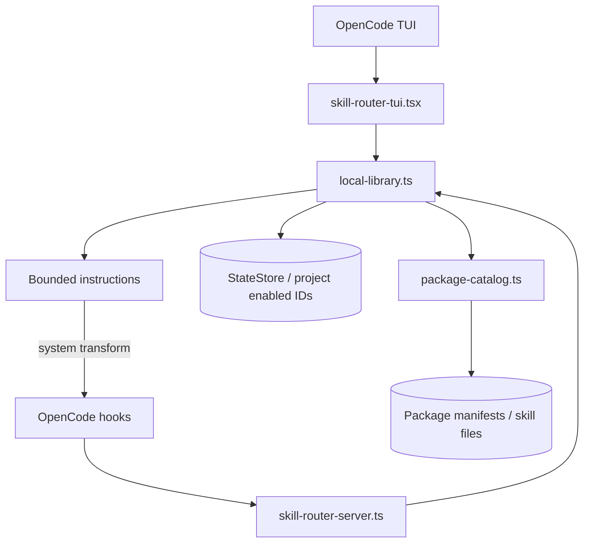
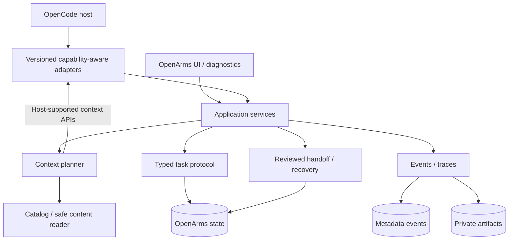

# OpenArms — kiến trúc hiện tại và định hướng cải tổ

## 1. Trạng thái tài liệu

Hiện trạng được đối chiếu với source baseline `bdd62e8`; tài liệu này không chứng nhận
live OpenCode/provider acceptance. Phần **đích** là hướng cải tổ, chưa phải tính năng bật.
Bản đồ sprint/verified-loader trước đây ở trang này đã được thay bằng mô tả route active;
đối chiếu lịch sử qua [sprint reports](../reports/sprints/README.md),
[tasklists](../roadmap/README.md) và Git history, không dùng chúng làm setup hiện hành.

Nguồn contract skill: [skill management](../guides/skill-management.md).
Bộ nghiên cứu cải tổ:

1. [Lỗi/rủi ro và checklist vá](../reports/overview/openarms-remediation-audit.md).
2. [Kiến trúc các harness](../reports/overview/agent-harness-architecture-survey.md).
3. [Tính năng phù hợp và tiêu chí nghiệm thu](../reports/overview/openarms-feature-proposals.md).

## 2. Quyết định định hướng

**Giữ OpenArms là plugin/control plane cho OpenCode**, tập trung vào context, workflow,
observability và recovery. Không xây loop cạnh tranh, không viết DB conversation host,
không tạo permission engine thứ hai. Chi tiết feature/API cần ADR trước triển khai.

| Trách nhiệm | Chủ sở hữu |
|---|---|
| Agent loop, provider/model calls, streaming | OpenCode |
| Tool execution, retry/interruption được host hỗ trợ | OpenCode |
| Conversation/messages và host permissions | OpenCode; isolation thực tế theo OS/sandbox |
| Skill catalog/toggles và nội dung plugin inject | OpenArms |
| Compact observed tool output, usage report | OpenArms qua hooks |
| Task metadata/context planner/traces | Hướng mở rộng OpenArms, chưa triển khai đầy đủ |
| Reviewed handoff/recovery | OpenArms phối hợp qua API host; không thay quyền sở hữu session |

Instruction không phải enforcement; hash không chứng nhận nội dung an toàn;
atomic rename không thay writer lock; idle không chứng minh task đã hoàn tất.

## 3. Route skill đang active



- Server khởi tạo `createLocalRuntime()` từ `src/local-library.ts`.
- Root mặc định: `<project>/.openarms/packages`; một external root có xác nhận là tùy chọn.
- Mỗi package có `package.json` ánh xạ skill name tới relative file.
- Skill ON/OFF/ERROR; package chỉ cung cấp bulk toggles, không core/optional dependency.
- Selection theo project, không phải permission grant hay model-loader session state.
- `buildInjection()` đọc an toàn và assemble skill ON mỗi system transform có session ID.
- Server không đăng ký model-facing `load_skill`, `load_verified_skill` hoặc topic tool.
- OFF dừng injection ở lượt sau, không xóa nội dung đã có trong conversation.
- Budget skill mặc định `153600` byte; không phải token budget theo model.

`src/runtime.ts`, registry tooling và verified loader vẫn tồn tại, nhưng không phải
composition root của server active. Không kết luận mọi module đó là dead code;
cần audit imports trước khi cách ly/gỡ. Scoped grants và task locks trong các báo cáo
cũ không phải yêu cầu để dùng project toggles hiện tại.

## 4. Output, usage và lifecycle hiện có

### Output

```text
Host-observed output
 → private artifact save
 → normalize / domain compaction
 → final cap 50.000 UTF-8 byte
 → model-visible text + markers
```

`governance-hooks.ts` nhận combined `output.output`, không tự suy ra stdout/stderr/exit code.
“Full log” chỉ là **full observed output** tại hook; host có thể đã truncate trước đó.
Governor có test/build/linter/git-diff compactors và file-inspection guard, generic fallback.
Raw capture có thể chứa dữ liệu nhạy cảm; private permissions không thay redaction.

Retention hiện tại best-effort: 7 ngày / 100 file / 64 MiB cho mỗi sink folder; không
xóa file vừa flush, có grace period cho file mới. Đây không phải quota cứng toàn hệ thống.
Source hiện còn tự append `.gitignore` trong log hook; audit đề nghị chuyển sang setup
có xác nhận, chưa sửa hành vi đó trong task tài liệu.

### Usage/budget

`message.updated` completed snapshots và tool metrics đi vào usage store; unknown khác zero.
Byte/4 là estimate, không phải tokenizer hoặc provider billing measurement.
Budget hiện là reporting/advisory; không hứa hard cancellation/billing limit.
Usage JSONL có lock/atomic persistence nhưng cần benchmark write amplification khi lớn.

### Handoff

Có journal, phase tracking, sanitized fields, selection snapshot và reviewed action.
Production automatic threshold rotation chưa bật; không coi tên `AutoSessionRotator` là
bằng chứng auto-run. Source/target freshness, consent và single-controller assumptions
vẫn cần tuân thủ; ambiguous create/submit không tự retry.
Target injection acknowledgement không chứng minh model đã hiểu, làm đúng hoặc task hoàn tất.

## 5. Scope filesystem và deployment

| Scope | Vị trí/cách xác định |
|---|---|
| Source | Checkout nơi phát triển và kiểm thử |
| Installed runtime | Plugin URL trong effective host config |
| Skill library | Project `.openarms/packages` hoặc external root đã xác nhận |
| Persistent state | `$XDG_STATE_HOME/openarms/state.json`, fallback `~/.local/state/openarms/state.json` |
| Output artifacts | `<project>/.openarms/logs` |
| Governance/usage | Thư mục tương ứng cạnh state file |
| Task artifacts | `.openarms/` trong project, gồm handoff/progress/budget policy tùy tính năng |

Các artifact `.openarms/` không đồng nghĩa toàn bộ toggle state nằm trong project.
Lock/fsync/rename là contract của từng writer, không phải bảo đảm mọi file đều được khóa.

Trong snapshot khảo sát, global config `.json` trỏ tới
`~/.config/opencode/openarms-runtime/plugins/skill-router-*.ts[x]`, không phải checkout.
Còn `.jsonc` và project overrides: cần xác nhận effective config của phiên thật.
Installed runtime có auto-prune DB host và thiếu một số guard mới;
đây là drift/rủi ro cần vá, **không phải thiết kế được chấp nhận**.

```text
Source → checks → release artifact → reviewed deploy → restart → runtime identity check
```

Deploy/doctor/rollback thống nhất còn là đề xuất. Restart không tự đồng bộ source;
không copy credential/library/state để thay cho deploy code.

## 6. Kiến trúc đích — chưa triển khai đầy đủ



Đây là các khối trách nhiệm, không bắt buộc mỗi khối thành một service/file mới.

### Context

Đích: `available → enabled → selected-for-task → injected-for-request`.
Giữ project injection làm compatibility mode cho tới khi có benchmark và migration.
On-demand/explicit selection là proposal; chưa tồn tại model-facing loader mới.

### Observability

Tách host transcript, operational events và private artifacts. Có task/session/request/span
correlation, timing, errors, config/revision identity; không raw content mặc định trong events.
Artifacts có provenance, sensitivity và expiry. OTel chỉ là exporter tùy chọn, không phải MVP bắt buộc.

### Workflow/recovery

Task envelope có objective, scope/revision, inputs, acceptance criteria và evidence.
Delegation tùy chọn; không thay model hay mở quyền vì prompt yêu cầu. Recovery không
claim exactly-once hoặc atomic cross-client ownership nếu host không cung cấp capability.

### Configuration

Schema/effective values/provenance; mỗi control ghi enforced/advisory/disabled và lý do.
Control chưa được host hỗ trợ phải báo unsupported, không giả lập bằng prompt hoặc throw.

## 7. Checklist phát triển theo định hướng

- [ ] Vá P0 và hợp nhất runtime trước khi thêm automation.
- [ ] Pin host/adapter compatibility và kiểm tra capability thực tế.
- [ ] ADR/spec tách hiện trạng với proposal; test failure/concurrency/recovery paths.
- [ ] Đo quality, cost trên task thành công, latency, reread và `NEEDS_CONTEXT`.
- [ ] Quyền host, privacy, retention và rollback được review trước rollout.
- [ ] Dùng runner theo [testing policy](../testing/testing.md); smoke explicit-only.
- [ ] Không coi fake SDK/synthetic-host pass là live provider/TUI acceptance.

## 8. Thứ tự thực hiện

1. Chặn cleanup nguy hiểm và triển khai guard an toàn.
2. Runtime identity, release/deploy/rollback và capability diagnostics.
3. Event/artifact schema và baseline đo lường.
4. Task-scoped context/evidence selection.
5. Typed workflow và recoverable handoff sau khi host capability được xác minh.

Checklist chi tiết và tiêu chí nghiệm thu nằm trong
[audit](../reports/overview/openarms-remediation-audit.md) và
[feature proposals](../reports/overview/openarms-feature-proposals.md), không dùng
nhãn “completed” của sprint lịch sử làm trạng thái rollout hiện tại.
