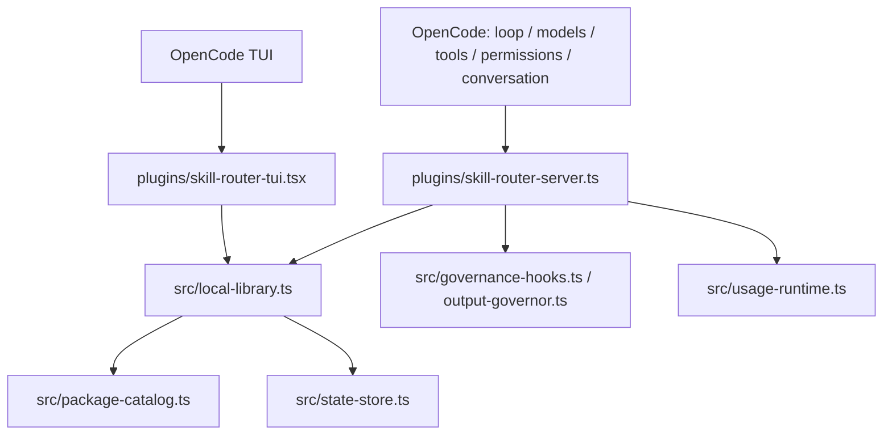

# OpenArms — architecture cheat sheet

## 1. Ba lớp và ownership



`plugins/server-core.ts` và các facade cũ không phải composition root của server active.
`src/runtime.ts`/verified-loader có trong codebase nhưng không được hiểu là route skill
đang chạy chỉ vì tên file. Audit imports trước khi xóa hoặc refactor.

## 2. Skill lifecycle hiện tại

```text
New project → .openarms/packages → package manifests → all OFF
TUI ON/OFF → project enabled IDs → system transform → safe reads → instructions
Read failure → ERROR; OFF → không inject ở lượt sau
```

Không model-facing loader, không core/optional dependency hay skill grants trên route này.
OFF không xóa instruction trong history. [Format/migration](../guides/skill-management.md).

## 3. Dữ liệu không nằm chung một scope

| Dữ liệu | Nơi lưu |
|---|---|
| Mã plugin | Runtime URL trong effective OpenCode config |
| Skill content | Project `.openarms/packages` hoặc external root đã xác nhận |
| Toggle/project/session state | `$XDG_STATE_HOME/openarms/state.json`, fallback `~/.local/state/openarms/state.json` |
| Observed output artifacts | `<project>/.openarms/logs` |
| Usage/governance metadata | Thư mục cạnh state file |
| Handoff/project policy | `.openarms/` theo tính năng |

Atomic write và writer lock phải kiểm chứng theo từng writer; không claim mọi cấu hình
đều ở project hoặc mọi write đều được khóa. Restart không đồng bộ checkout với runtime.

## 4. Đích cải tổ — chưa phải tính năng đã bật

Context planner theo task, typed workflow, correlated events/artifacts và recoverable
reviewed handoff. OpenCode tiếp tục sở hữu agent loop và conversation DB.
Không tự đổi model, xóa DB host hoặc giả lập sandbox bằng Bash regex.
Unsupported controls phải báo rõ advisory/unsupported.

## 5. Trước khi code

- [ ] Đọc [audit P0/runtime drift](../reports/overview/openarms-remediation-audit.md).
- [ ] Xác định route active, scope và capability host cần dùng.
- [ ] Đọc [kiến trúc đầy đủ](../architecture/Architecture.md) và [feature proposals](../reports/overview/openarms-feature-proposals.md).
- [ ] Phân biệt implementation, offline test, synthetic-host và live acceptance.
- [ ] Theo [testing policy](../testing/testing.md): host verify, smoke explicit-only.
