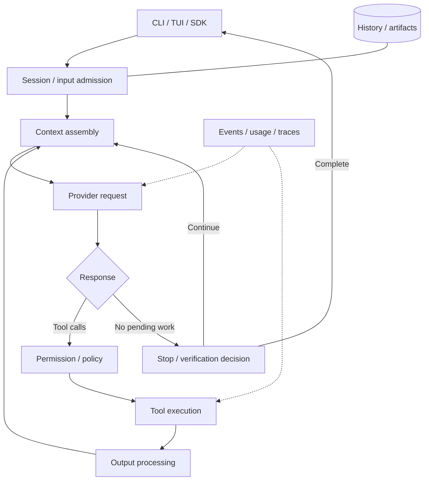
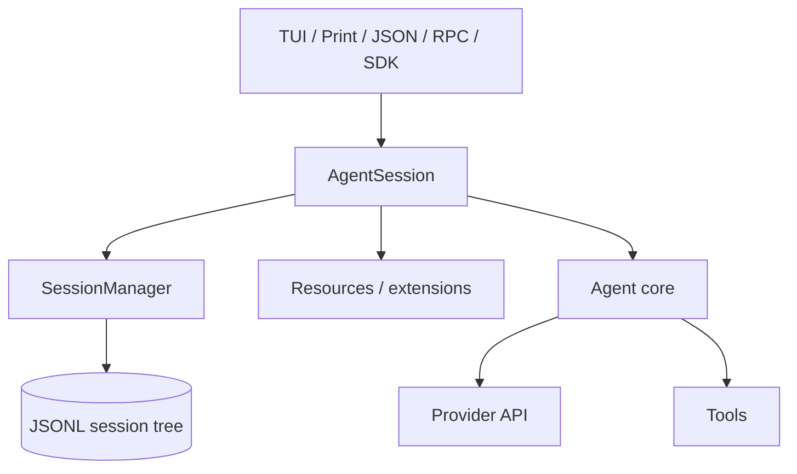

# Kiến trúc và điểm đáng học của các agent harness

## Phạm vi nghiên cứu

Tổng hợp từ tài liệu/source đã đọc trong khảo sát OpenArms baseline `bdd62e8`.
Đây không phải benchmark, đánh giá bảo mật hay chứng nhận mọi phiên bản hiện tại.
URL nhánh `main`/trang docs có thể thay đổi; cần pin revision khi triển khai theo source đó.
“Aiden” được tạm hiểu là **Aider**; chưa có URL để xác nhận một sản phẩm Aiden khác.

Các sơ đồ Mermaid là bản diễn giải của người viết, không phải ảnh chính thức.
Nguồn bên dưới ưu tiên mô tả kỹ thuật chính thức và code; không gán implementation
nội bộ chưa công khai cho Claude Code. Với Pi, đã đọc tài liệu bản cài và agent core;
không nên suy rằng mọi extension của Pi có cùng hành vi.

Liên quan: [audit OpenArms](openarms-remediation-audit.md),
[tính năng có thể áp dụng](openarms-feature-proposals.md).

## 1. Từ cơ bản đến chuyên sâu



| Tầng nghiên cứu | Câu hỏi cần trả lời |
|---|---|
| Loop | Ai sở hữu model calls? Điều kiện stop/retry/continue/interrupt? |
| Context | History nào được chọn? Có tokenizer, compaction, on-demand content không? |
| Execution | Tool concurrency, permission, cancellation và timeout là gì? |
| Persistence | Sau crash khôi phục ở đâu? Có nguy cơ lặp side effect không? |
| Logs | Transcript, operational events và artifacts có tách biệt không? |
| Configuration | Precedence, effective values, capability và version compatibility? |

Không đồng nhất “model được hướng dẫn” với “runtime cưỡng chế”; không đồng nhất
compaction context với xóa lịch sử. Tool-call count, model step và user task là các đơn vị khác nhau.

## 2. Pi — core tối giản, nhiều interface dùng chung cơ chế

### Nguồn

- [How Pi Works](https://github.com/earendil-works/pi/blob/main/packages/coding-agent/docs/how-pi-works.md)
- [Agent package README](https://github.com/earendil-works/pi/blob/main/packages/agent/README.md)
- [Agent loop source](https://github.com/earendil-works/pi/blob/main/packages/agent/src/agent-loop.ts)
- [Session format](https://github.com/earendil-works/pi/blob/main/packages/coding-agent/docs/session-format.md)
- [Extensions](https://github.com/earendil-works/pi/blob/main/packages/coding-agent/docs/extensions.md)

### Bản đồ



### Điểm đáng học

- **History khác context:** JSONL entries có `id`/`parentId`, hỗ trợ branching. Compaction
  thay context dựng cho request sau nhưng giữ entries gốc trong session tree.
- **Context pipeline rõ:** `AgentMessage[] → transformContext → convertToLlm → Message[]`.
  Custom extension state không bắt buộc đi vào model context.
- **Steering khác follow-up:** steering bổ sung chỉ dẫn ở boundary của turn đang chạy;
  follow-up chờ pending work kết thúc. Không phải cùng một hàng text nối tùy tiện.
- **Scheduling có contract:** bản agent core được khảo sát có parallel/sequential tool execution;
  tool có thể buộc batch tuần tự. Completion events có thể khác thứ tự persisted tool results.
- **Hooks điều khiển tiếp tục:** `finishTurn` có thể end/continue; unconditional continue có thể
  gây loop vô hạn. Error/aborted vẫn là hard exits theo contract khảo sát.
- **Skills on-demand:** descriptions hỗ trợ discovery; full instructions có thể chỉ đọc khi cần.
- **Interfaces:** JSON events, RPC JSONL và SDK tái sử dụng agent/session mechanisms.
- **Trust:** tools chạy theo quyền OS của process; extensions chạy trong process. Tối giản
  không đồng nghĩa có sandbox hoặc permission engine mạnh mặc định.

**Áp dụng:** học cách tách history/context/state và extension boundary; không cần sao chép
agent loop khi OpenArms vẫn là plugin OpenCode.

## 3. OpenCode — host sở hữu session, loop và execution

### Nguồn pin theo host đã cài

- [Prompt/loop v1.19.3](https://github.com/anomalyco/opencode/blob/v1.19.3/packages/opencode/src/session/prompt.ts)
- [Processor v1.19.3](https://github.com/anomalyco/opencode/blob/v1.19.3/packages/opencode/src/session/processor.ts)
- [Configuration](https://opencode.ai/docs/config/)

Nhánh `dev` được khảo sát ở commit `0ac0d7ee7260c3e711a481ceb4580bb60f4d9dd4`
đã có cấu trúc `packages/core/src/session/runner`, execution coordinator và durable inbox.
Không áp semantics/API của nhánh đó cho host `1.19.3` nếu chưa kiểm chứng.

### Bản đồ

```text
TUI / App / SDK
       ↓
Server → Session execution
           ├─ messages / history
           ├─ context / compaction
           ├─ model streaming / retries
           ├─ tool execution / permissions
           └─ plugin hooks → OpenArms
```

### Điểm đáng học

- **Ownership rõ:** host sở hữu model calls, loop, tools, permission, session/message persistence.
- **Lifecycle hooks:** plugin bổ sung tại điểm host cung cấp; after-hook không tự chặn side effect đã xảy ra.
- **Step limits:** source v1.19.3 có `agent.steps ?? Infinity`; phải đọc cách xử lý bước cuối,
  không tự coi đây là hard monetary/token budget.
- **Loop safety:** processor có retry và xử lý dạng tool repetition/doom-loop permission.
- **Context management:** host có compaction/pruning; plugin không cần một conversation DB cạnh tranh.
- **Configuration:** phải xác định effective config và provenance, không chỉ đọc một file global.
- **Execution recovery ở dev:** durable admission/inbox và write-ahead execution claim là bài học
  về recovery. Tài liệu source cũng không claim clustered fencing/exactly-once chỉ nhờ claim đó.

**Áp dụng:** versioned adapter, capability matrix, contract tests. Chỉ yêu cầu cancel/create/prompt
qua API được hỗ trợ; không viết trực tiếp DB conversation của host.

## 4. Claude Code — agentic loop, lifecycle hooks và quan sát

### Nguồn chính thức

- [How Claude Code works](https://code.claude.com/docs/en/how-claude-code-works)
- [Hooks reference](https://code.claude.com/docs/en/hooks)
- [Monitoring usage / OpenTelemetry](https://code.claude.com/docs/en/monitoring-usage)
- [Agent SDK overview](https://platform.claude.com/docs/en/agent-sdk/overview)

Trang How Claude Code works là điểm bắt đầu cho mô tả trực quan. Các trang HTML đã đọc
được trong khảo sát; một số yêu cầu `.md`/truy cập lại bị HTTP 403. Không suy ra nội dung
không truy cập được, không có bộ ảnh chính thức được tải/lưu trong báo cáo này.

### Mô hình công bố

```text
Gather context → Take action → Verify results
       ↑                            │
       └──────── điều chỉnh ─────────┘
```

### Điểm đáng học

- **Loop thích nghi:** task hỏi đáp có thể chỉ cần context; sửa lỗi cần action/verify lặp lại.
  Đây là mô tả vận hành, không phải state machine nội bộ đã được công khai hoàn toàn.
- **Lifecycle hooks:** `SessionStart`, `PreToolUse`, `PostToolUse`, `PostToolUseFailure`,
  `Stop`, `SubagentStop` có contract riêng. Phải đọc quyền quyết định của từng event.
- **Observability:** OTel metrics/events, tùy chọn traces theo tài liệu; không phải lấy transcript
  làm nguồn duy nhất rồi suy ngược latency/cost/tool decisions.
- **Context:** skills, subagents và compaction quản lý lượng thông tin model phải xử lý.
- **Recovery/safety:** checkpoints, permissions và sandboxing là những cơ chế khác nhau;
  checkpoint không đảo ngược mọi external side effect.
- **SDK:** tái sử dụng harness trong ứng dụng thay vì tự viết lại toàn bộ model/tool loop.

**Áp dụng:** event taxonomy, trace correlation, failure visibility; không quảng bá hook hay regex
như OS isolation. Không copy tên control nếu OpenCode adapter không có capability tương ứng.

## 5. Aider — chọn context liên quan và sửa code có cấu trúc

### Nguồn

- [Repository map](https://aider.chat/docs/repomap.html)
- [Chat/architect modes](https://aider.chat/docs/usage/modes.html)
- [Edit formats](https://aider.chat/docs/more/edit-formats.html)
- [Configuration options](https://aider.chat/docs/config/options.html)

### Mô hình

```text
Task + selected files + repo map + history
                ↓
        Model / architect
                ↓
       Structured edit format
                ↓
       Apply → lint/test → feedback
```

### Điểm đáng học

- **Repo map:** symbol/signature và dependency graph ranking để chọn phần repo phù hợp
  token budget; không đổ toàn bộ source vào context. `--map-tokens` điều chỉnh map budget.
- **Architect/editor separation:** có thể tách lập phương án khỏi chuyển phương án thành edits.
  Nhiều model không mặc nhiên tốt hơn; cần benchmark latency/cost/success.
- **Edit formats:** hợp đồng chỉnh sửa rõ giúp parse/apply và feedback khi edit thất bại.
- **History/debug config:** `--chat-history-file`, `--llm-history-file` phục vụ nhu cầu khác nhau;
  raw LLM history cần quản trị privacy riêng.
- **Verification:** `--auto-lint`/`--auto-test` và test command tạo feedback sau thay đổi,
  nhưng OpenArms phải tôn trọng test policy của repository, không bật suite tùy tiện.

**Áp dụng:** context/evidence manifest và file/range selection trước khi xây graph indexer;
đo hiệu quả context selection trước khi bắt buộc tách scout/implementer.

## 6. Codex — tham khảo thêm về boundary OS

[Codex core README](https://github.com/openai/codex/blob/main/codex-rs/core/README.md)
được đọc bổ sung về sandbox assumptions theo nền tảng: Seatbelt trên macOS và các đường
Linux Landlock/bubblewrap theo policy. Không khảo sát đầy đủ Codex loop/logging trong task này.

**Bài học giới hạn:** filesystem/network isolation là cơ chế OS/backend, không được thay bằng
string matching trong Bash hay instruction “không đọc file”. Không đề xuất OpenArms tự viết
sandbox engine chỉ để giống Codex.

## 7. Long-running harness: trạng thái công việc hơn bản tóm tắt chat

[Nguồn Anthropic](https://www.anthropic.com/engineering/effective-harnesses-for-long-running-agents)
mô tả initializer/coding agent, feature list, progress artifacts và Git history để tiếp nối
qua nhiều context windows. Làm từng feature và verify trước khi đánh dấu passing.
Đây là mẫu nghiên cứu, không phải yêu cầu auto-commit hoặc browser smoke cho mọi task.

**Áp dụng:** handoff gồm objective, revision, scope, progress, pending work và verification
artifacts; source/target freshness checks; không coi idle hay model nói “done” là completion proof.

## 8. Ma trận áp dụng

| Chủ đề | Tham khảo chính | Phù hợp OpenArms | Không sao chép máy móc |
|---|---|---|---|
| History/context separation | Pi | Cao | Không tạo DB conversation thứ hai |
| Host capabilities | OpenCode | Bắt buộc | Không áp dev API vào host đã pin |
| Lifecycle/OTel | Claude Code | Cao | Không claim có control host chưa hỗ trợ |
| Repo/context selection | Aider | Cao | Không làm indexer lớn trước benchmark |
| OS isolation | Codex | Ủy quyền host/OS | Không coi regex là sandbox |
| Multi-session continuity | Anthropic harness article | Cao | Không tự xóa session hoặc tự commit |

## 9. Checklist trước khi chuyển bài học thành code

- [ ] Pin phiên bản/commit tài liệu và host mục tiêu; lưu capability evidence.
- [ ] Phân biệt chức năng host, plugin và proposal trong spec.
- [ ] Chọn một task corpus có baseline chất lượng, cost và latency.
- [ ] Có privacy/retention policy cho transcript, events và artifacts.
- [ ] Test error/abort/retry/parallel paths, không chỉ happy path.
- [ ] Kiểm tra phục hồi không tự retry side effect khi trạng thái chưa rõ.
- [ ] Chỉ bật default sau benchmark; có rollback và chế độ tương thích.
