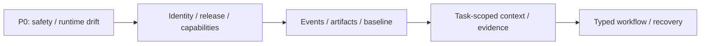

# OpenArms — định hướng cải tổ và tasklists lịch sử

## 1. Hướng ưu tiên mới

Giữ OpenArms là plugin/control plane cho context, workflow, observability và recovery.
OpenCode sở hữu loop, model/tool execution, permissions và conversation persistence.
Đây là định hướng cho công việc sắp tới; không tự kích hoạt tính năng hoặc đánh dấu các
sprint cũ hoàn tất. Chi tiết thiết kế/API cần ADR và review trước implementation.

## 2. Backlog cải tổ có thể hành động

- [Audit FIX-01…27](../reports/overview/openarms-remediation-audit.md): lỗi/rủi ro,
  checklist và tiêu chí nghiệm thu, ưu tiên installed auto-prune và guard handoff.
- [Feature proposals F-01…09](../reports/overview/openarms-feature-proposals.md):
  phụ thuộc, MVP, controls và evaluation trước rollout.
- [Harness survey](../reports/overview/agent-harness-architecture-survey.md): nguồn và
  bài học tham khảo, không phải dependency/product commitments.
- [Architecture](../architecture/Architecture.md): phân biệt route active và kiến trúc đích.

### Gate cho từng implementation task

- [ ] Chọn FIX/F IDs, owner, scope và phiên bản host mục tiêu.
- [ ] Có spec/ADR nếu đổi contract, schema hoặc capability.
- [ ] Test plan theo toàn task scope; có regression/failure-path evidence.
- [ ] Privacy/migration/rollback được review.
- [ ] Host verification và deployment identity; live acceptance ghi riêng khi cần.
- [ ] Không bật hard enforcement/automatic submission nếu capability chưa chứng minh được.

## 3. Tasklists theo giai đoạn — cần reconcile trước khi tái dùng

Những file sau giữ task IDs, ý định thiết kế và checkbox từ các revision trước.
Không bảng tổng hợp “Phase done/current” nào ở đây thay thế source, evidence hoặc
backlog cải tổ. Skills hiện là manifest/project ON/OFF/injection; verified grants,
load tools, dependency resolution hay automatic rotation trong tasklists không tự trở
thành yêu cầu của runtime hiện hành.

| Tasklist | Chủ đề lịch sử |
|---|---|
| [Phase 0](Tasklist_Phase_0.md) | Fast feedback, test cost control |
| [Phase 1](Tasklist_Phase_1.md) | Output governor, telemetry/shadow |
| [Phase 2](Tasklist_Phase_2.md) | Registry/verified loader và skill contracts trước đây |
| [Phase 3](Tasklist_Phase_3.md) | Usage/budget và lifecycle helpers |
| [Phase 3 v2](Tasklist_Phase_3_v2.md) | Domain-aware compaction |
| [Phase 4](Tasklist_Phase_4.md) | Audited ingestion/decompiler/install |
| [Phase 5](Tasklist_Phase_5.md) | Handoff/session lifecycle |

Không xóa evidence blocked hoặc sửa checkbox lịch sử chỉ để khớp định hướng mới.
Khi chuyển một item thành task mới, ghi rõ supersedes/reuses ID nào và acceptance mới.
Testing theo [policy hiện hành](../testing/testing.md): verify host-only;
sandbox/TUI smoke là reference-only và chỉ chạy khi explicit request.
