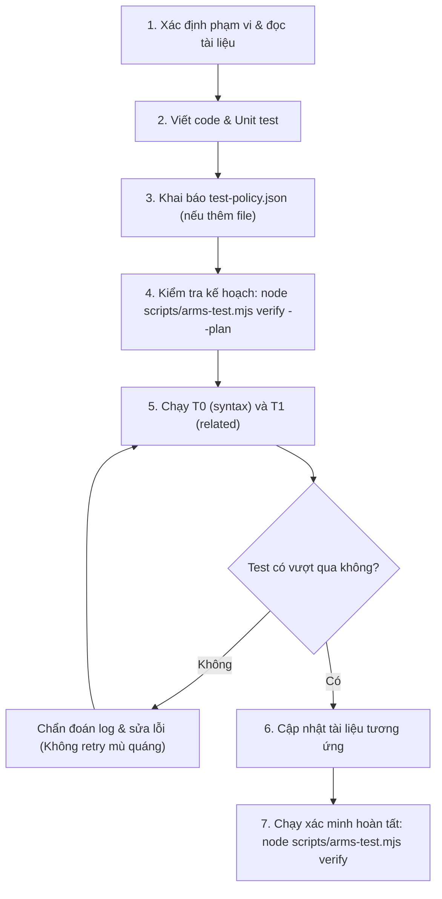

# Hướng dẫn Nhập môn cho Contributor (New Contributor Getting Started)

Chào mừng bạn đến với dự án **OpenArms**! Hướng dẫn này được thiết kế để giúp bạn nhanh chóng hiểu rõ kiến trúc, thiết lập môi trường phát triển cục bộ, nắm bắt quy chuẩn kiểm thử nghiêm ngặt của dự án và tự tin đóng góp mã nguồn (code) hoặc tài liệu (docs).

---

## 🧭 Mục lục nhanh

1. [OpenArms là gì?](#1-openarms-là-gì)
2. [Yêu cầu môi trường & Cài đặt](#2-yêu-cầu-môi-trường--cài-đặt)
3. [Bản đồ cấu trúc mã nguồn](#3-bản-đồ-cấu-trúc-mã-nguồn)
4. [Nguyên tắc Vàng về Kiểm thử (arms-test)](#4-nguyên-tắc-vàng-về-kiểm-thử-arms-test)
5. [Quy trình Phát triển Từng bước](#5-quy-trình-phát-triển-từng-bước)
6. [Quy chuẩn Viết Code & Tài liệu](#6-quy-chuẩn-viết-code--tài-liệu)
7. [Checklist trước khi mở Pull Request](#7-checklist-trước-khi-mở-pull-request)

---

## 1. OpenArms là gì?

**OpenArms** là một tiện ích mở rộng (plugin) chạy bên trong nền tảng **OpenCode**, mang lại hai năng lực trọng tâm:

1. **Local Skill Routing & Isolation (Điều hướng Skill Cục bộ):**
   - Mỗi dự án chỉ chọn đúng **một thư mục thư viện skill cục bộ** (`library root`).
   - Kiểm soát định danh skill chính xác (`load_skill({skill})`) với safe path để ngăn chặn duyệt file trái phép ra ngoài thư viện.
   - Quản lý trạng thái skill (`Selected`, `Loaded`, `Missing`) minh bạch theo từng phiên làm việc (session).
2. **Runtime Governance & Budgeting (Quản trị Runtime & Ngân sách):**
   - Đo lường token và chi phí thực thi theo ngày, phiên và dự án.
   - Đưa ra cảnh báo ngân sách sớm và kiểm soát output của công cụ để tránh làm tràn ngập cửa sổ ngữ cảnh (context window) của LLM.

> [!IMPORTANT]
> **Ranh giới Host và Plugin:** OpenArms là plugin điều hướng và quản lý trạng thái. OpenCode vẫn là host trực tiếp chạy LLM agent, thực thi lệnh shell/tools và quản lý phân quyền hệ điều hành.

---

## 2. Yêu cầu Môi trường & Cài đặt

### Yêu cầu phần mềm:
- **Node.js:** Phiên bản `18.x` trở lên (khuyến nghị Node 20+).
- **npm:** Đi kèm Node.js.
- **Docker & Docker Compose:** Cần thiết nếu chạy bộ kiểm thử hộp cát (sandbox smoke tests).
- **Python 3 & thư viện PTY:** Cần thiết để chạy bộ kiểm thử giao diện dòng lệnh tương tác (`tui-smoke.py`).

### Các bước cài đặt:

```bash
# 1. Clone repository
git clone https://github.com/hodangthaiduy/OpenArms.git
cd OpenArms

# 2. Cài đặt các gói phụ thuộc
npm install

# 3. Kiểm tra cú pháp toàn dự án
node scripts/arms-test.mjs syntax
```

---

## 3. Bản đồ Cấu trúc Mã nguồn

Hiểu cấu trúc thư mục giúp bạn nhanh chóng định vị nơi cần sửa đổi:

```text
OpenArms/
├── src/                  # Core Runtime (TypeScript độc lập, không phụ thuộc UI)
│   ├── local-library.ts  # Quản lý thư viện cục bộ, nạp registry, safe-path reader
│   ├── state-store.ts    # Lưu trữ trạng thái phiên và dự án
│   ├── budget-policy.ts  # Logic cấu hình và xử lý chính sách ngân sách
│   ├── usage-store.ts    # Lưu trữ số liệu token/chi phí
│   └── commands.ts       # Định nghĩa các lệnh điều hướng
├── plugins/              # Các adapter kết nối với OpenCode Host
│   ├── server-core.ts    # Adapter phía máy chủ (Server plugin)
│   ├── tui-core.ts       # Adapter giao diện dòng lệnh (TUI plugin)
│   └── skill-router-*.ts # Tích hợp routing cho server và TUI
├── sandbox/              # Môi trường Docker Sandbox để kiểm thử tích hợp cô lập
│   ├── Dockerfile        # Image sandbox
│   ├── compose.yaml      # Khởi động dịch vụ OpenCode + OpenArms
│   └── tui-smoke.py      # Script tự động hóa kiểm thử PTY TUI
├── scripts/              # Hạ tầng kiểm thử và điều phối chất lượng
│   ├── arms-test.mjs     # Unified Test Runner chính của dự án
│   ├── test-policy.json  # MA TRẬN PHÂN LOẠI FILE BẮT BUỘC
│   └── check-test-policy.mjs # Trình kiểm tra vi phạm quy chuẩn
├── tests/                # Bộ kiểm thử Unit và Integration (Node test runner)
│   ├── core.test.ts      # Test core runtime
│   ├── local-library.test.ts # Test thư viện cục bộ
│   └── ...
├── skills/               # Các gói skill mẫu đi kèm
└── docs/                 # Toàn bộ tài liệu dự án
    ├── README.md         # Bản đồ tài liệu tổng thể (Master Index)
    ├── contributing/     # Hướng dẫn dành cho Contributor
    ├── templates/        # Khung tài liệu tái sử dụng
    ├── architecture/     # Bản vẽ kiến trúc chi tiết
    ├── guides/           # Hướng dẫn vận hành & tính năng
    ├── testing/          # Quy chuẩn và runbooks kiểm thử
    └── reports/          # Báo cáo kỹ thuật và lịch sử sprint
```

---

## 4. Nguyên tắc Vàng về Kiểm thử (`arms-test`)

Dự án OpenArms áp dụng cơ chế phân tầng kiểm thử nghiêm ngặt (xem chi tiết tại [`AGENTS.md`](file:///home/hodangthaiduy/Workspace/Extensions/OpenArms/AGENTS.md) và [`docs/testing/testing.md`](../testing/testing.md)):

### Các Tầng Kiểm thử:
- **T0 (`syntax`):** Kiểm tra cú pháp TypeScript/Node. Chạy nhanh trong vài giây.
- **T1 (`related`):** Chạy các unit/integration test bị ảnh hưởng trực tiếp bởi file thay đổi.
- **T2 (`full`):** Chạy toàn bộ test suite. Chỉ kích hoạt khi thay đổi core dùng chung hoặc hạ tầng test.
- **T3 (`smoke`):** Kiểm thử môi trường thật/sandbox:
  - `smoke-static`: Kiểm tra offline không cần Docker.
  - `smoke-runtime`: Kiểm tra container Docker.
  - `tui-smoke`: Kiểm tra tương tác TUI qua giả lập PTY.

### Lệnh Xem Trước Kế hoạch Kiểm thử:
Trước khi chạy test, bạn **luôn phải** kiểm tra kế hoạch kiểm thử ứng với phạm vi file bạn sửa đổi:

```bash
# Xem trước kế hoạch kiểm thử cho file vừa sửa
node scripts/arms-test.mjs verify --plan --file src/local-library.ts
```

> [!WARNING]
> **Lỗi `needs-review`:** Mọi file mới thêm vào dự án BẮT BUỘC phải được khai báo trong [`scripts/test-policy.json`](file:///home/hodangthaiduy/Workspace/Extensions/OpenArms/scripts/test-policy.json). Nếu file chưa được phân loại, runner sẽ báo lỗi `needs-review` và chặn kiểm thử.

---

## 5. Quy trình Phát triển Từng bước

Khi bạn muốn đóng góp một tính năng hoặc sửa lỗi, hãy thực hiện theo quy trình sau:



### Bước 1: Khảo sát & Đọc tài liệu
- Đọc [Kiến trúc OpenArms](../architecture/openarms-overview.md) và [Architecture Detail](../architecture/Architecture.md).
- Nếu liên quan đến UI/UX, đọc [Local Usage & Budget UX](../guides/budget-ux.md) và [Single Library](../testing/how_to_test/Single_Library.md).

### Bước 2: Viết mã nguồn & Unit Test
- Viết mã trong `src/` hoặc `plugins/`.
- Luôn bổ sung test tương ứng trong thư mục `tests/`.

### Bước 3: Đăng ký trong `test-policy.json` (Nếu tạo file mới)
- Mở `scripts/test-policy.json` và thêm đường dẫn file mới vào nhóm class thích hợp (ví dụ: `core`, `server-adapter`, `docs`, ...).

### Bước 4: Kiểm tra & Chạy Test
```bash
# Kiểm tra cú pháp
node scripts/arms-test.mjs syntax

# Chạy test liên quan
node scripts/arms-test.mjs related
```

---

## 6. Quy chuẩn Viết Code & Tài liệu

### Quy chuẩn Code:
- Giữ nguyên các chú thích (comments) và docstrings hiện có nếu không trực tiếp sửa đổi logic liên quan.
- Xử lý lỗi an toàn (Fail-closed đối với xác thực dữ liệu và safe paths).
- Giữ `src/` hoàn toàn độc lập với OpenCode UI/TUI components.

### Quy chuẩn Tài liệu:
- Khi viết tài liệu mới, hãy tận dụng các khung mẫu có sẵn tại [`docs/templates/`](../templates/README.md).
- Đặt tên file bằng chữ thường và dấu gạch ngang (ví dụ: `my-feature-guide.md`). Tuyệt đối không để dấu cách trong tên file.
- Luôn sử dụng đường dẫn tương đối khi liên kết giữa các file markdown.

---

## 7. Checklist trước khi mở Pull Request

Trước khi gửi PR hoặc bàn giao task, hãy kiểm tra danh sách này:

- [ ] Toàn bộ code mới đã có unit tests bao phủ.
- [ ] Không có file mới nào bị phân loại là `needs-review` trong `scripts/test-policy.json`.
- [ ] Lệnh `node scripts/arms-test.mjs syntax` chạy thành công (exit code 0).
- [ ] Lệnh `node scripts/arms-test.mjs related` hoặc `verify` hoàn tất thành công.
- [ ] Không có broken links (liên kết hỏng) trong tài liệu `docs/`.
- [ ] Đã cập nhật mục lục tại [`docs/README.md`](../README.md) nếu có tài liệu mới được tạo.

---

Chúc bạn có trải nghiệm đóng góp tuyệt vời cùng OpenArms! Nếu bạn có bất kỳ câu hỏi nào, hãy tham khảo các tài liệu sâu hơn trong thư mục [`docs/`](../README.md).
