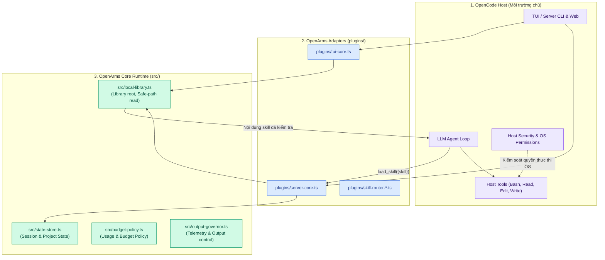

# Sơ đồ Tư duy Kiến trúc OpenArms (Architecture Cheat Sheet)

Tài liệu tóm tắt trực quan các ranh giới kiến trúc cốt lõi của OpenArms giúp contributor mới hình thành mô hình tư duy chuẩn xác trong vòng 3 phút.

---

## 1. Ranh giới 3 Lớp (The 3-Layer Boundary)



---

## 2. Bảng Phân định Trách nhiệm (Who Does What?)

| Nhiệm vụ / Hành vi | Do OpenArms chịu trách nhiệm | Do OpenCode Host chịu trách nhiệm |
|---|---|---|
| **Cấu hình Library** | Cho phép chọn 1 thư mục gốc (`library root`), refresh registry | Không can thiệp thư viện skill |
| **Đọc nội dung Skill** | Kiểm tra safe-path, ngăn ngừa Path Traversal | Không can thiệp nạp skill cục bộ |
| **Quyền truy cập file/OS** | KHÔNG (OpenArms không cấp quyền OS) | **Có** (OpenCode hỏi người dùng Ask/Allow/Deny) |
| **Thực thi lệnh Shell** | KHÔNG | **Có** (Chạy qua Docker sandbox hoặc OS host) |
| **Cửa sổ ngữ cảnh LLM** | Đo lường token, cảnh báo ngân sách (`/budget`) | Gọi API LLM Model Provider |

---

## 3. Vòng đời Nạp Skill Cục bộ (Skill Lifecycle)

```text
[Dự án Mới] ──> Library: UNSET (Chưa cấu hình)
       │
       ▼ (Người dùng chọn thư mục qua TUI /skills)
[Đã chọn Library Root] ──> Quét `registry.json` ──> Danh sách Skills hiển thị
       │
       ▼ (Người dùng bấm chọn Skill: State = SELECTED)
[Selected Skill]
       │
       ▼ (Agent gọi công cụ: `load_skill({skill: "id"})`)
[Kiểm tra Safe Path] ──> Hợp lệ? ──> Đọc nội dung ──> State = LOADED ──> Nạp vào Context
```

---

## 4. Quản lý Dữ liệu trên Đĩa (File Storage Model)

- **Trạng thái cấu hình dự án:** Lưu tại `<project>/.openarms/`
- **Nguyên tắc ghi đĩa:**
  - Luôn sử dụng cơ chế ghi nguyên tử (`atomic write` qua file tạm và rename).
  - Khóa đồng thời (`cooperative writer lock`).
  - Khi người dùng chọn **Cancel** (mặc định): Tuyệt đối không ghi hoặc làm mất dữ liệu cũ.
  - Phục hồi (Restore): Chỉ áp dụng cho các phiên trong cùng một thư viện, không kế thừa trạng thái quyền ngoài ý muốn.
