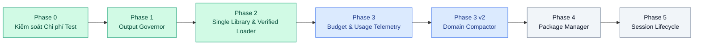

# Lộ trình Phát triển Hệ thống (OpenArms Roadmap)

Thư mục này chứa danh sách các task kỹ thuật chi tiết phân theo từng giai đoạn (Phase) từ lúc khởi tạo dự án cho đến định hướng phát triển trong tương lai.

---

## 🗺️ Bản đồ các Giai đoạn (Phases Overview)

---

## 📋 Danh sách Task theo Phase

| Giai đoạn | Tài liệu | Trọng tâm chính | Trạng thái |
|---|---|---|---|
| **Phase 0** | [**`Tasklist_Phase_0.md`**](Tasklist_Phase_0.md) | Giảm thời gian và chi phí test, thiết lập runner thống nhất T0-T3, cache pass-only. | 🟩 Đã hoàn thành |
| **Phase 1** | [**`Tasklist_Phase_1.md`**](Tasklist_Phase_1.md) | Kiểm soát output của tool, giảm nhiễu ngữ cảnh, đo lường telemetry. | 🟩 Đã hoàn thành |
| **Phase 2** | [**`Tasklist_Phase_2.md`**](Tasklist_Phase_2.md) | Chuẩn hóa thư viện skill cục bộ, metadata v1/v2, loader an toàn. | 🟩 Đã hoàn thành |
| **Phase 3** | [**`Tasklist_Phase_3.md`**](Tasklist_Phase_3.md) | Quản lý ngân sách (`/budget`), đo token theo ngày/phiên, cảnh báo giới hạn. | 🟦 Hiện hành |
| **Phase 3 v2** | [**`Tasklist_Phase_3_v2.md`**](Tasklist_Phase_3_v2.md) | Bộ nén ngữ cảnh thông minh hiểu miền nghiệp vụ (Domain-Aware Context Compactor). | 🟨 Đang triển khai |
| **Phase 4** | [**`Tasklist_Phase_4.md`**](Tasklist_Phase_4.md) | Trình quản lý gói skill thông minh, giải quyết phụ thuộc (Dependency Resolution). | 🟨 Kế hoạch |
| **Phase 5** | [**`Tasklist_Phase_5.md`**](Tasklist_Phase_5.md) | Quản lý vòng đời phiên làm việc đa agent (Session Handoff & Context Lifecycle). | 🟨 Kế hoạch |

---

## 📌 Lưu ý khi sử dụng Tasklist

- **Tasklist là nguồn phạm vi công việc:** Khi bắt đầu một sprint mới, các lập trình viên căn cứ vào mã task (ví dụ: `TSK-301`) để triển khai.
- **Báo cáo hoàn thành:** Sau khi hoàn thành sprint, kết quả kiểm chứng sẽ được đối chiếu và lập thành báo cáo tương ứng tại [`docs/reports/sprints/`](../reports/sprints/).
