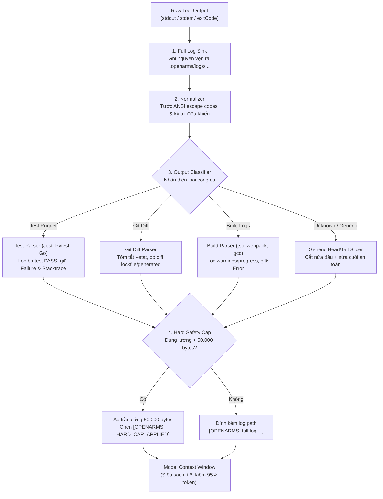

# Tasklist Phase 3 v2: Domain-Aware Output Governor & Context Optimization

Mục tiêu phase: Thay thế cơ chế cắt cơ học nửa đầu/nửa cuối (Mechanical Head/Tail Slicing) hiện tại bằng **Domain-Aware Output Compactor (Bộ nén Output thông minh theo ngữ cảnh)**. Nhận diện cấu trúc lệnh (Test runner, Git diff, Build log, Linter) để chắt lọc 100% thông tin chẩn đoán lỗi có giá trị, loại bỏ toàn bộ dữ liệu rác (test pass, lockfile diff, compile warnings, progress bar), giảm từ 92% đến 98% lượng token của tool output, bảo toàn Hard Cap 50.000 bytes và lưu full log ra đĩa trước khi xử lý.

---

## 1. Bối cảnh và Mục tiêu kiến trúc

### 1.1 Vấn đề của cơ chế cũ (Hiện tại trong `src/output-governor.ts`)
1. **Cắt cơ học mù quáng (Blind Mechanical Slicing):** Khi output vượt quá ngưỡng mềm 32.000 bytes, hệ thống chỉ đơn giản lấy nửa đầu (~16KB) ghép với nửa cuối (~16KB) và chèn dòng `[OPENARMS: omitted X bytes]`.
2. **Cắt mất "trọng tâm chẩn đoán":** 
   - Với Test Runner (Jest/Pytest), nửa đầu in hàng trăm dòng test `PASS`, nửa cuối in summary. Phần giữa — nơi chứa **Assertion Error và Stacktrace** chỉ ra dòng code bị lỗi — lại bị cắt phăng.
   - Agent chỉ thấy *"1 test failed"* mà không biết fail ở đâu, buộc phải chạy lệnh đọc file log hoặc chạy lại test $\rightarrow$ lãng phí token gấp đôi.
3. **Giữ nguyên rác nếu < 32KB:** Nếu một lệnh build in ra 500 dòng cảnh báo (warnings) và 2 dòng lỗi Compile (tổng dung lượng 25KB), vì chưa vượt 32KB nên cơ chế cũ **giữ nguyên toàn bộ 25KB rác** tống vào context.

### 1.2 Giải pháp Domain-Aware Output Compactor
- **Phân loại luồng đầu ra (Output Classifier):** Tự động nhận diện công cụ đang thực thi dựa trên command name và định dạng output.
- **Bộ nén chuyên biệt (Domain-Specific Parsers):**
  - **Test Runner:** Xóa sạch 100% các dòng in test pass; chỉ giữ First Failure, Assertion Message, Stacktrace liên quan và dòng tổng kết.
  - **Git Diff:** Nếu diff lớn, tự động tóm tắt dạng `--stat`, chỉ in diff chi tiết cho file mã nguồn thực sự, lược bỏ diff của lockfiles, minified files, assets.
  - **Build & Compiler Logs:** Lọc bỏ warnings, progress bar, chỉ giữ các dòng `Error:` và tọa độ file/dòng bị lỗi.
- **Nguyên tắc bất biến:** Luôn lưu raw log đầy đủ ra đĩa trước khi compact; luôn chạy qua Hard Safety Cap 50.000 bytes; fallback về cơ chế an toàn nếu parser chuyên dụng gặp lỗi.



---

## 2. Kế hoạch phân bổ Sprint

| Sprint | Mục tiêu chính | Danh sách Tasks | Thời lượng ước tính |
|---|---|---|---:|
| **Sprint 3.1 v2** | Architecture & Output Classifier Foundation | TSK-301v2 đến TSK-304v2 | 4.0 days |
| **Sprint 3.2 v2** | Specialized Parsers: Test Runner & Linter | TSK-305v2 đến TSK-307v2 | 5.0 days |
| **Sprint 3.3 v2** | Specialized Parsers: Git Diff & File Inspection | TSK-308v2 đến TSK-311v2 | 5.0 days |
| **Sprint 3.4 v2** | Specialized Parsers: Build & Compiler Logs | TSK-312v2 đến TSK-314v2 | 4.5 days |
| **Sprint 3.5 v2** | Integration, Telemetry & Hard Safety Cap | TSK-315v2 đến TSK-319v2 | 5.5 days |

---

## 3. Chi tiết các Sprint và Tasks

### Sprint 3.1 v2: Architecture & Output Classifier Foundation

**Sprint Goal:** Thiết kế kiến trúc module mở rộng cho `output-governor`, xây dựng bộ nhận diện loại lệnh/output (Classifier) và cơ chế fallback an toàn tuyệt đối.

- [x] **TSK-301v2 - Overview:** Thiết kế Router và Contract mở rộng cho Domain-Aware Output Governor.  
  **Details:**  
  - Mở rộng contract trong [`src/output-governor.ts`](file:///home/hodangthaiduy/Workspace/Extensions/OpenArms/src/output-governor.ts):
    ```typescript
    export type OutputDomain = "test" | "git-diff" | "build" | "linter" | "generic"
    export interface DomainCompactor {
      domain: OutputDomain
      match: (command: string, rawText: string) => boolean
      compact: (rawText: string, options: { maxBytes: number }) => Compaction
    }
    ```
  - Thiết lập thứ tự thực thi nghiêm ngặt: `Raw Output` $\rightarrow$ `Lưu Log Sink` $\rightarrow$ `Strip ANSI` $\rightarrow$ `Domain Compactor` $\rightarrow$ `Hard Cap Interceptor` $\rightarrow$ `Telemetry`.
  - Quy tắc an toàn: Ngoại lệ trong bất kỳ domain parser nào phải tự động rơi về `generic` compactor, không được làm crash process hoặc làm thay đổi `exitCode` của tool.  
  *(Estimate: 1 day)*

- [x] **TSK-302v2 - Overview:** Xây dựng Bộ phân loại ngữ cảnh lệnh và output (Command & Stream Classifier).  
  **Details:**  
  - Phân tích cú pháp câu lệnh đã thực thi (`redactedCommand`):
    - Khớp `test`: `npm test`, `pytest`, `vitest`, `jest`, `go test`, `cargo test`.
    - Khớp `git-diff`: `git diff`, `git show`, `git log -p`.
    - Khớp `build`: `tsc`, `npm run build`, `webpack`, `vite build`, `gcc`, `g++`, `cargo build`.
    - Khớp `linter`: `eslint`, `biome check`, `flake8`, `golangci-lint`.
  - Phân tích mẫu chữ ký (Signature Matching) trong nội dung text nếu câu lệnh chạy qua wrapper script hoặc alias: nhận diện các header đặc trưng như `TAP version`, `FAIL`, `PASS`, `diff --git`, `error TS`.  
  *(Estimate: 1.5 days)*

- [x] **TSK-303v2 - Overview:** Triển khai Fast-path bypass & Safe Fallback.  
  **Details:**  
  - Nếu output thô sau khi strip ANSI có dung lượng nhỏ hơn ngưỡng tối thiểu (ngưỡng 1.000 bytes) và không chứa cảnh báo/rác, cho phép đi qua đường tắt (Fast-path) mà không cần gọi parser phức tạp.
  - Triển khai Safe Fallback: Tái sử dụng hàm cắt cơ học `compactOutput` (head/tail) hiện tại làm lưới đỡ an toàn nếu parser chuyên dụng không nhận diện được định dạng hoặc ném ngoại lệ.  
  *(Estimate: 0.5 day)*

- [x] **TSK-304v2 - Overview:** Kiểm thử đơn vị cho Classifier và Router.  
  **Details:**  
  - Viết bộ unit test với hơn 50 mẫu câu lệnh và output signature khác nhau.
  - Kiểm tra khả năng nhận diện chính xác 100% các công cụ phổ biến.
  - Kiểm tra kịch bản parser giả lập bị crash $\rightarrow$ router fallback mượt mà về generic compactor với exit code được bảo toàn nguyên vẹn.  
  *(Estimate: 1 day)*

---

### Sprint 3.2 v2: Specialized Parsers — Test Runner & Linter

**Sprint Goal:** Xây dựng bộ nén chuyên dụng cho Test Runners (loại bỏ 100% test pass, giữ lại lỗi đầu, assertion và stacktrace) và Linters.

- [x] **TSK-305v2 - Overview:** Triển khai Test Runner Compactor (Jest, Vitest, Pytest, Go test, Mocha).
  **Details:**  
  - Triển khai parser bóc tách cấu trúc kết quả test:
    - **Loại bỏ hoàn toàn:** Các dòng chứa `✓`, `PASS`, `ok`, progress bar, thời gian thực thi của các test thành công.
    - **Trích xuất thông tin trọng yếu:**
      1. Tên test suite và tên test case bị lỗi (`FAIL path/to/file.test.ts > suite > test_name`).
      2. Thông điệp Assertion (`Expected ... Received ...` hoặc `AssertionError`).
      3. Stacktrace rút gọn: Giữ lại 3–5 frames liên quan trực tiếp đến mã nguồn dự án, loại bỏ các frames nội bộ của `node_modules` hay thư viện runner.
      4. Bảng tổng kết kết quả ở dòng cuối (`Tests: 1 failed, 149 passed, 150 total`).
    - Nếu có nhiều test bị fail: Giữ lại chi tiết của **bài test fail đầu tiên (First Failure)** và liệt kê ngắn gọn tên của các bài fail tiếp theo (tối đa 5 bài), tránh làm tràn context.  
  *(Estimate: 2.5 days)*

- [x] **TSK-306v2 - Overview:** Triển khai Linter & Formatter Compactor (`eslint`, `biome`, `flake8`).
  **Details:**  
  - Lọc bỏ các dòng tóm tắt quy tắc, thông tin version và các warnings mức độ thấp (Style/Whitespace/Formatting) nếu có lỗi cú pháp hoặc lỗi logic nghiêm trọng.
  - Gom nhóm các lỗi theo từng file:
    ```text
    src/auth.ts:
      Line 42:15 - error: 'userId' is defined but never used [@typescript-eslint/no-unused-vars]
    Total: 1 error, 0 warnings.
    ```
  - Giới hạn tối đa 10 lỗi tiêu biểu; nếu vượt quá 10 lỗi, chỉ in 10 lỗi đầu và ghi rõ: `[OPENARMS: 42 additional lint errors omitted; check full log]`.  
  *(Estimate: 1.5 days)*

- [x] **TSK-307v2 - Overview:** Kiểm thử thuộc tính (Property-based Tests) cho Test & Linter Compactor.
  **Details:**  
  - Thử nghiệm trên output thực tế của các test suite lớn (Jest, Pytest, Go test).
   - Kiểm chứng tên/assertion đầy đủ khi evidence trong budget; evidence quá dài có omission marker và raw-log provenance, không cam kết giữ chuỗi vô hạn.
   - Đo bytes/4 trên fixture lớn khoảng 50.000 tokens, mục tiêu thông thường ≤1.000 tokens (không padding log ngắn); diagnostic dài có thể vượt mục tiêu, luôn tuân maxBytes/UTF8 cap.
  *(Estimate: 1 day)*

---

### Sprint 3.3 v2: Specialized Parsers — Git Diff & Source Inspection

**Sprint Goal:** Xây dựng bộ nén Git Diff thông minh: tự động tóm tắt dạng `--stat`, bóc tách diff chi tiết cho file code quan trọng và loại bỏ diff rác của lockfiles, generated assets.

- [x] **TSK-308v2 - Overview:** Bộ phân loại tệp tin trong Git Diff (Diff File Classifier).
  **Details:**  
  - Tách luồng diff thành từng khối (hunks) theo file (`diff --git a/... b/...`).
  - Phân loại file thành 3 nhóm ưu tiên:
    - **Nhóm 1 (Core Source Code - Ưu tiên cao nhất):** File mã nguồn `.ts`, `.js`, `.py`, `.go`, `.rs`, `.java`, config dự án quan trọng.
    - **Nhóm 2 (Docs & Assets - Ưu tiên vừa):** Markdown, JSON dữ liệu, CSS/HTML.
    - **Nhóm 3 (Rác / Generated - Cắt bỏ chi tiết):** `package-lock.json`, `pnpm-lock.yaml`, `yarn.lock`, `Cargo.lock`, file minified `.min.js`, source map `.map`, SVG, hình ảnh base64.  
  *(Estimate: 1.5 days)*

- [x] **TSK-309v2 - Overview:** Triển khai Smart Git Diff Compactor.
  **Details:**  
  - Nếu tổng dung lượng diff thô $\le 4.000$ bytes: Giữ nguyên vẹn toàn bộ diff.
  - Nếu diff $> 4.000$ bytes:
    1. Đầu ra luôn có phần tóm tắt `--stat`: Danh sách các file bị thay đổi và số dòng thêm/bớt (`+10/-2`).
    2. Với Nhóm 3 (Lockfile/Generated): Thu gọn thành 1 dòng duy nhất:  
       `package-lock.json | 1500 +++--- (omitted large lockfile diff)`.
    3. Với Nhóm 1 (Source Code): Giữ nguyên vẹn diff chi tiết khi đủ budget; thiếu budget có marked excerpts/omissions và raw log.
    4. Nếu diff của Nhóm 1 vẫn vượt quá ngân sách byte: Ưu tiên giữ lại các hàm bị sửa và lược bớt các khoảng trắng (context lines) xung quanh hunk.  
  *(Estimate: 2 days)*

- [x] **TSK-310v2 - Overview:** Bộ nén File Inspection (Kiểm tra đọc file an toàn).
  **Details:**  
  - Bổ sung quy tắc khi Agent dùng tool đọc file (`read` / `cat`):
    - Chặn và tóm tắt nếu file là binary, minified hoặc chứa các dòng siêu dài (> 5.000 ký tự trên một dòng không có newline).
    - Trả về thông báo súc tích: `[OPENARMS: File is detected as minified bundle (size: 450KB). Use targeted range read or grep]`.  
  *(Estimate: 0.5 day)*

- [x] **TSK-311v2 - Overview:** Kiểm thử tự động cho Git Diff Compactor.
  **Details:**  
  - Thử nghiệm trên các pull request diff phức tạp: sửa 5 file code kèm cập nhật `package-lock.json` nặng 200KB.
   - Fixture đại diện 5 source nhỏ + lock ~200KB giữ đủ 5 diffs và $\le 1.500$ tokens ước lượng bytes/4; không cam kết tokenizer/universal retention. Cap cuối 50.000 UTF8 bytes gồm refs vẫn là invariant.
   *(Estimate: 1 day)*

**Evidence Sprint 3.3:** full 223/223, syntax 10/10; static smoke cache hit.
Synthetic runtime **chưa đạt**: plugin không register `load_skill`, kèm dependency
install EROFS `/home/node/.npm`. Implementation/unit hoàn tất; runtime release
validation còn blocker, không nghiệm thu Phase 3.5. Xem
[Sprint_33v2](../testing/how_to_test/Sprint_33v2.md) cho scope/logs/giới hạn.

---

### Sprint 3.4 v2: Specialized Parsers — Build & Compiler Logs

**Sprint Goal:** Xây dựng bộ nén chuyên dụng cho Build Tools và Compilers: loại bỏ progress bars, warning rác, chỉ bốc tách đúng lỗi Compile Error và vị trí file/dòng.

- [x] **TSK-312v2 - Overview:** Triển khai Build & Compiler Compactor (`tsc`, `webpack`, `vite`, `gcc`, `cargo`).
  **Details:**  
  - Nhận diện các mẫu định dạng lỗi compiler chuẩn mực:
    - TypeScript: `path/file.ts:line:col - error TSxxxx: message`
    - GCC/Clang: `path/file.c:line:col: error: message`
    - Cargo/Rust: `error[Exxxx]: message --> path/file.rs:line:col`
  - Loại bỏ hoàn toàn:
    - Các thanh tiến trình tải (`[===>    ] 45%`, spinning wheels).
    - Các dòng thông tin version, license banner, compile timing stats.
    - Các cảnh báo `warning` thông thường (trừ khi cờ compiler yêu cầu treat warnings as errors).
  - Trích xuất tối đa 5 lỗi compile đầu tiên kèm 2 dòng code snippet ngữ cảnh xung quanh dòng bị lỗi.  
  *(Estimate: 2 days)*

- [x] **TSK-313v2 - Overview:** Xử lý ký tự đặc biệt, ANSI màu và Multi-line Diagnostics.
  **Details:**  
  - Đảm bảo việc tước bỏ mã màu ANSI không làm mất cấu trúc thụt đầu dòng (indentation) của compiler code snippets.
  - Xử lý các thông báo lỗi nhiều dòng (Multi-line errors) có con trỏ chỉ vị trí `^^^^`: bảo đảm con trỏ luôn trỏ đúng ký tự bị lỗi sau khi chuẩn hóa khoảng trắng.  
  *(Estimate: 1.5 days)*

- [x] **TSK-314v2 - Overview:** Kiểm thử tính ổn định của Build Compactor.
  **Details:**  
  - Thử nghiệm trên log build của dự án TypeScript lớn bị lỗi type-check, log build C/C++ có template errors dài dằng dặc.
   - Fixture TS/C++ đại diện >30KB xuống <1KB, assertions giữ known diagnostics/coordinates/causal notes; không khẳng định agent comprehension hoặc mọi diagnostic dài đều <1KB.
  *(Estimate: 1 day)*

---

### Sprint 3.5 v2: Tích hợp, Telemetry & Nghiệm thu

**Sprint Goal:** Tích hợp bộ nén mới vào runtime hooks của OpenArms, kiểm chứng Hard Safety Cap 50.000 bytes bất biến, thu thập telemetry đo lường và nghiệm thu toàn diện.

- [x] **TSK-315v2 - Overview:** Tích hợp Domain-Aware Compactor vào `governanceHooks`.
  **Details:**  
  - Nâng cấp hàm `governOutput` trong [`src/output-governor.ts`](file:///home/hodangthaiduy/Workspace/Extensions/OpenArms/src/output-governor.ts) và kết nối vào hook `tool.execute.after` trong [`src/governance-hooks.ts`](file:///home/hodangthaiduy/Workspace/Extensions/OpenArms/src/governance-hooks.ts).
  - Đảm bảo tính nhất quán: Bất kể domain parser nào được chọn, file raw log gốc luôn được flush và fsync xuống đĩa trước khi parser bắt đầu chạy.  
  *(Estimate: 1 day)*

- [x] **TSK-316v2 - Overview:** Kiểm chứng Hard Safety Cap 50.000 bytes bất khả xâm phạm.
  **Details:**  
  - Viết negative property tests: Giả lập các domain parser bị lỗi hoặc sinh ra output lớn bất thường (> 50.000 bytes).
  - Xác nhận Interceptor cuối cùng luôn cưỡng chế cắt gọt dứt khoát về dưới 50.000 bytes UTF-8, không bao giờ để lọt payload vượt cap vào model context.  
  *(Estimate: 1 day)*

- [x] **TSK-317v2 - Overview:** Mở rộng Telemetry giám sát hiệu quả nén theo từng Domain.
  **Details:**  
  - Mở rộng schema telemetry trong [`src/governance-telemetry.ts`](file:///home/hodangthaiduy/Workspace/Extensions/OpenArms/src/governance-telemetry.ts):
    - Ghi nhận `domain`: `test | git-diff | build | linter | generic`.
    - Ghi nhận `rawBytes`, `compactedBytes`, `savingsRatio` ($\frac{raw - compacted}{raw}$).
  - Cập nhật lệnh `/usage` và `/budget` để hiển thị thêm số liệu: *"Đã tiết kiệm được X tokens nhờ Domain-Aware Output Compactor"*.  
  *(Estimate: 1.5 days)*

**Evidence 15/10/2026:** syntax 18/18 (496ms), full 239/239 (15.452ms),
automation policy 0 findings. Checked 312–317 chỉ chứng minh implementation +
fixtures, không thay host gate. Hook fixture 5 domains giữ raw/metadata, xem
[Sprint35 measurements/logs](../testing/how_to_test/Sprint_35v2.md).
Continuation đã chẩn đoán qua host SSE: synthetic context thiếu compactor module,
không phải plugin API/config. Inventory đã sửa; runtime loader 5/5, PTY OpenArms
và real test/diff/g++ model-tool workflow đạt. Raw sink project `.openarms/logs`
private/synced, telemetry riêng state/governance. Host fixtures giảm 97.63–97.86%,
giữ known diagnostics và exits 7/0/1; không live-provider/library hoặc universal
savings claim. Final verification và logs trong Sprint35 guide.

- [x] **TSK-318v2 - Overview:** Kiểm thử tích hợp tự động trên Docker Sandbox PTY.
  **Details:**  
  - Khởi chạy OpenCode trong Docker Sandbox với terminal PTY thật.
  - Thực thi chuỗi lệnh: chạy test fail, chạy git diff lớn, chạy build lỗi.
  - Xác minh trên log của sandbox: các parser chuyên dụng được kích hoạt chính xác, text trả về cho model siêu ngắn gọn, raw log được lưu đầy đủ tại `.openarms/logs/`.  
  *(Estimate: 1 day)*

- [x] **TSK-319v2 - Overview:** Nghiệm thu Phase 3 v2 trên fixtures + synthetic-host (không live-provider/library).
  **Details:**  
  - Đối chiếu toàn bộ tiêu chí nghiệm thu:
    1. Fixtures noisy đại diện giảm 90–98% context bytes (tokens chỉ estimate bytes/4); log ngắn có thể expansion.
    2. Giữ known failure evidence trong budget (Assertion, Stacktrace, Error line); không cam kết diagnostic vô hạn.
    3. Không làm sai lệch exit code hay trạng thái thất bại của tool.
    4. Successful sink lưu nguyên observed raw trước parser; write failure explicit, không fake provenance. Host truncation trước hook ngoài guarantee.
  - Đóng gói và cập nhật tài liệu hướng dẫn.  
  *(Estimate: 1 day)*

---

## 4. Ba Kịch Bản Thực Tế & Định Lượng Token Tiết Kiệm

Dưới đây là 3 kịch bản lập trình thực tế điển hình chứng minh hiệu quả vượt trội của giải pháp mới:

### Kịch bản 1: Chạy Test Suite dự án (150 tests, 1 test bị FAIL)
*Tình huống: Developer yêu cầu Agent chạy test sau khi sửa code (`npm test` qua Jest/Vitest).*
- **Dung lượng thô (Raw output):** In 149 dòng `PASS tests/foo.test.ts` + 1 bài test `FAIL` kèm stacktrace + bảng tóm tắt = ~1.200 dòng text $\approx$ **45 KB (~11.250 tokens)**.
- **Giải pháp cũ xử lý:** 
  - Vượt quá 32KB $\rightarrow$ cắt cơ học head/tail về 32KB.
  - Context nạp vào: **~32.000 bytes = ~8.000 tokens**.
  - *(Chứa 100 dòng test PASS vô ích, phần giữa chứa lỗi assertion bị cắt bỏ!)*
- **Giải pháp mới (Domain-Aware Test Parser):**
  - Xóa sạch 100% các dòng test PASS.
  - Chỉ giữ: Tên bài test lỗi + 3 dòng Assertion (`Expected 200, Received 500`) + 5 dòng Stacktrace + 1 dòng Summary.
  - Tổng cộng: ~15 dòng text $\approx$ **1.200 bytes = ~300 tokens**.
- 👉 **MỨC GIẢM:** Từ **8.000 tokens** xuống còn **300 tokens**.  
- 👉 **Tiết kiệm ngay tại lượt chạy:** **7.700 tokens (Giảm 96.2%)!**

---

### Kịch bản 2: Chạy `git diff` sau khi sửa code & cập nhật thư viện
*Tình huống: Agent chạy `git diff` để kiểm tra lại các thay đổi trước khi commit (sửa 3 file code `.ts` và vô tình cập nhật `package-lock.json`).*
- **Dung lượng thô (Raw output):** Diff 3 file code (150 dòng) + Diff file lockfile (1.500 dòng) $\approx$ **60 KB (~15.000 tokens)**.
- **Giải pháp cũ xử lý:**
  - Vượt trần 50KB Hard Cap $\rightarrow$ cắt cụt về 32KB–50KB.
  - Context nạp vào: **~32.000 bytes = ~8.000 tokens**.
  - *(Context bị chiếm chỗ hoàn toàn bởi các dòng diff băm nát của file lockfile).*
- **Giải pháp mới (Domain-Aware Diff Parser):**
  - Nhận diện `package-lock.json` là lockfile: Thu gọn thành 1 dòng:  
    `package-lock.json | 1500 +++--- (omitted lockfile diff)`.
  - In trọn vẹn diff của 3 file code `.ts` (150 dòng).
  - Tổng cộng: ~160 dòng $\approx$ **2.400 bytes = ~600 tokens**.
- 👉 **MỨC GIẢM:** Từ **8.000 tokens** xuống còn **600 tokens**.  
- 👉 **Tiết kiệm ngay tại lượt chạy:** **7.400 tokens (Giảm 92.5%)!**

---

### Kịch bản 3: Build dự án bị lỗi Compile (TypeScript `tsc --noEmit`)
*Tình huống: Agent chạy build kiểm tra kiểu dữ liệu trong dự án lớn. Compiler in ra 300 dòng cảnh báo (warnings), thông tin module và đúng 2 dòng lỗi Type Error.*
- **Dung lượng thô (Raw output):** ~350 dòng log $\approx$ **24 KB (~6.000 tokens)**.
- **Giải pháp cũ xử lý:**
  - Vì 24KB < 32KB (chưa vượt ngưỡng mềm) $\rightarrow$ **GIỮ NGUYÊN TOÀN BỘ 24KB NẠP HẾT VÀO CONTEXT!**
  - Context nạp vào: **~6.000 tokens** (toàn rác warnings và file paths).
- **Giải pháp mới (Domain-Aware Build Parser):**
  - Lọc bỏ sạch sẽ warnings và progress, chỉ bốc tách đúng 2 block lỗi:
    ```text
    src/auth.ts:42:15 - error TS2322: Type 'string' is not assignable to type 'number'.
    src/server.ts:18:5 - error TS2345: Argument of type 'null' is not assignable...
    ```
  - Tổng cộng: 6 dòng text $\approx$ **350 bytes = ~90 tokens**.
- 👉 **MỨC GIẢM:** Từ **6.000 tokens** xuống còn **90 tokens**.  
- 👉 **Tiết kiệm ngay tại lượt chạy:** **5.910 tokens (Giảm 98.5%)!**

---

## 5. Tác Động Lũy Kế (Compounding Effect) Qua Một Session Làm Việc

Trong các AI Coding Agent, **token của tool output không chỉ tính một lần, mà bị đọc lại (Cache Read) ở MỌI lượt chat tiếp theo** trong suốt session đó. 

Xét một phiên làm việc thực tế trung bình gồm **15 lượt chat (turns)**, trong đó Agent thực hiện:
- Chạy test: 4 lần.
- Chạy build/check: 3 lần.
- Chạy git diff: 2 lần.

### Bảng so sánh tổng chi phí và token tích lũy:

| Tiêu chí | Cơ chế Cũ (Cắt cơ học) | Cơ chế Mới (Domain-Aware) | Mức Tiết Kiệm |
| :--- | :---: | :---: | :---: |
| **Token nạp từ 4 lần chạy Test** | 32.000 tokens | 1.200 tokens | **Giảm 30.800 tokens** |
| **Token nạp từ 3 lần chạy Build** | 18.000 tokens | 270 tokens | **Giảm 17.730 tokens** |
| **Token nạp từ 2 lần chạy Git Diff** | 16.000 tokens | 1.200 tokens | **Giảm 14.800 tokens** |
| **Tổng Token Tool Output tích lũy** | **~66.000 tokens** | **~2.670 tokens** | **Giảm 63.330 tokens (~96%)** |
| **Tổng Token bị đọc lại qua 15 turns (Cache Read)** | **~520.000 tokens** | **~21.000 tokens** | **Tiết kiệm > 499.000 tokens!** |
| **Chi phí USD ước tính (Claude 3.5 / GPT-4o)** | **~$1.60 – $2.10 / task** | **~$0.06 – $0.09 / task** | **Tiết kiệm ~95% tiền API!** |

### Lợi ích cốt lõi đạt được:
1. **Tiết kiệm tài chính trực tiếp:** Giảm tới **95% chi phí API** phát sinh từ việc đọc lại các log tool dư thừa.
2. **Sửa bug ngay tại Turn 1:** Agent nhìn thấy trực diện vị trí file và nguyên nhân gây lỗi (không bị che bởi log test pass hay warnings), giúp hoàn thành task nhanh hơn, giảm số turn cần thiết từ 20% – 30%.
3. **Kéo dài tuổi thọ của Session:** Do không bị phình to bởi rác output, session có thể hoạt động bền bỉ qua nhiều task mà không chạm trần Context Window hay bị "lú trí nhớ".
