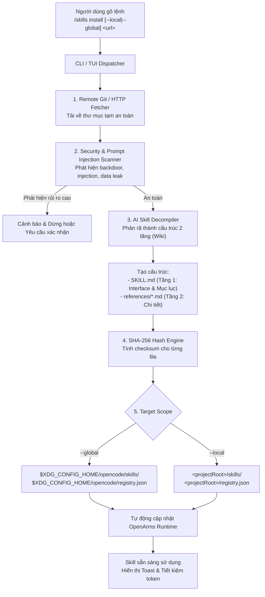

# Tasklist Phase 4: Intelligent Skill Package Manager & 2-Tier Progressive Wiki Restructuring

Mục tiêu phase: Xây dựng cơ chế cài đặt skill tự động từ GitHub (`/skills install`), tích hợp bộ quét an toàn Prompt Injection, sử dụng AI để tự động phân rã skill nguyên khối (monolithic) thành cấu trúc 2 tầng (LLM Wiki: Core Interface + References), tự động tạo mã băm SHA-256 và cập nhật `registry.json` cho cả hai phạm vi **Global** (`$XDG_CONFIG_HOME/opencode/skills`) và **Local** (`<projectRoot>/skills`).

---

## 1. Bối cảnh và Mục tiêu kiến trúc

### 1.1 Vấn đề cần giải quyết
1. **Rào cản cài đặt thủ công:** Hiện tại người dùng phải tự tải file, tự tạo thư mục `skills/`, tự viết file cấu hình `registry.json` phức tạp để OpenArms nhận diện.
2. **Kỹ năng nguyên khối gây lãng phí token:** Các bộ skill trên GitHub (Anthropic skills, cộng đồng OpenCode/Claude) hầu hết được viết dưới dạng một file Markdown khổng lồ (3.000 – 15.000 tokens). Khi nạp vào context, toàn bộ file này bị đọc lặp đi lặp lại qua các turn, gây lãng phí từ 60% – 80% chi phí token.
3. **Nguy cơ Prompt Injection từ nguồn bên ngoài:** Kéo skill trôi nổi từ internet có thể chứa mã độc, chỉ dẫn ghi đè system prompt ("Ignore previous instructions"), đánh cắp API keys hoặc thực thi lệnh shell nguy hiểm.

### 1.2 Giải pháp Phase 4
- Cung cấp lệnh tương tác: `/skills install [--local | --global] <github-url-or-repo>`.
- **Phân định phạm vi lưu trữ rõ ràng:**
  - **`global`:** Lưu vào thư mục cấu hình cốt lõi của OpenCode trên máy người dùng:  
    `$XDG_CONFIG_HOME/opencode/skills` (mặc định Linux: `~/.config/opencode/skills`, tương ứng `/home/hodangthaiduy/.config/opencode/skills`) cùng file quản lý `$XDG_CONFIG_HOME/opencode/registry.json`. Các dự án trên cùng máy có thể tái sử dụng mà không cần cài lại.
  - **`local`:** Lưu trực tiếp vào thư mục dự án hiện tại của developer:  
    `<projectRoot>/skills` và cập nhật `<projectRoot>/registry.json`. Skill đi kèm theo dự án và có thể commit vào Git repository của dự án đó.
- **Bộ quét an toàn (Security & Prompt Injection Scanner):** Phân tích mã độc, đánh giá rủi ro trước khi ghi file ra đĩa.
- **Bộ phân rã AI 2 tầng (AI Skill Decompiler):** Tự động đọc file monolithic và tái cấu trúc thành mô hình LLM Wiki:
  - **Tầng 1 (`SKILL.md`):** Dưới 800 tokens, chỉ chứa tóm tắt mục tiêu, invariants, và mục lục liên kết Wiki trỏ tới các chủ đề chuyên sâu.
  - **Tầng 2 (`references/*.md`):** Các file tài liệu chuyên sâu, tự chứa (self-contained), chỉ được nạp khi task thực sự cần.
- **Tính toàn vẹn xác thực (Verified Integrity):** Tự động tính mã băm SHA-256 cho từng file sinh ra, đăng ký vào `registry.json` theo đúng nguyên tắc *Verified by construction* của OpenArms.



---

## 2. Kế hoạch phân bổ Sprint

| Sprint | Mục tiêu chính | Danh sách Tasks | Thời lượng ước tính |
|---|---|---|---:|
| **Sprint 4.1** | Remote Fetcher & Scope Storage (Global vs Local) | TSK-401 đến TSK-404 | 4.5 days |
| **Sprint 4.2** | Bộ quét an toàn & Chống Prompt Injection | TSK-405 đến TSK-408 | 5.0 days |
| **Sprint 4.3** | AI Skill Decompiler & Tái cấu trúc 2 Tầng (LLM Wiki) | TSK-409 đến TSK-413 | 6.5 days |
| **Sprint 4.4** | Tích hợp Registry, SHA-256 & Runtime Tooling | TSK-414 đến TSK-417 | 5.0 days |
| **Sprint 4.5** | Kiểm thử tích hợp, Sandbox PTY & Nghiệm thu | TSK-418 đến TSK-421 | 5.0 days |

---

## 3. Chi tiết các Sprint và Tasks

### Sprint 4.1: Remote Fetcher & Scope Resolution (`--local` vs `--global`)

**Sprint Goal:** Xây dựng cơ chế tải an toàn từ Git/GitHub URL và định tuyến chính xác giữa thư mục cấu hình OpenCode toàn cục (`$XDG_CONFIG_HOME/opencode/skills`) và thư mục dự án cục bộ (`<projectRoot>/skills`).

- [x] **TSK-401 - Overview:** Xây dựng bộ phân giải tham số và vị trí lưu trữ (Scope Resolver).
  **Details:**  
  - Định nghĩa cú pháp lệnh: `/skills install [--local | --global] <url>` (mặc định nếu không truyền option là `--local`).
  - Phân giải đường dẫn:
    - `--global`: Lấy từ biến môi trường `process.env.XDG_CONFIG_HOME` (fallback về `path.join(os.homedir(), ".config")`), đích đến là `path.join(xdgConfig, "opencode", "skills", skillName)`. File registry toàn cục đặt tại `path.join(xdgConfig, "opencode", "registry.json")`.
    - `--local`: Lấy từ `projectRoot` hiện tại của session, đích đến là `path.join(projectRoot, "skills", skillName)` và registry tại `path.join(projectRoot, "registry.json")`.
  - Kiểm tra quyền ghi (write permissions), tạo thư mục an toàn với quyền `0700`, xử lý xung đột nếu skill cùng tên đã tồn tại (hỗ trợ cờ `--overwrite` hoặc xác nhận trên TUI).  
  *(Estimate: 1 day)*

- [x] **TSK-402 - Overview:** Triển khai Remote Git/HTTP Fetcher an toàn vào thư mục tạm.
  **Details:**  
  - Hỗ trợ các định dạng URL: `https://github.com/user/repo`, `https://github.com/user/repo.git`, link commit/branch cụ thể, và đường dẫn tới thư mục con trong repo (subpath).
  - Tải source bằng Git shallow clone (`--depth 1`) hoặc GitHub Tarball/Zip API vào thư mục tạm bị cô lập (`os.tmpdir()/openarms-fetch-<uuid>`).
  - Ranh giới an toàn: Áp trần kích thước tải về tối đa 10 MB, áp timeout tải 30 giây, hủy process con nếu quá thời gian. Chặn các URL nội bộ (`localhost`, `127.0.0.1`, IP private RFC 1918) để ngăn chặn tấn công SSRF (Server-Side Request Forgery).  
  *(Estimate: 1.5 days)*

- [x] **TSK-403 - Overview:** Giải nén và chuẩn hóa cấu trúc repository đầu vào (Archive & Layout Extractor).
  **Details:**  
  - Quét tìm các file tài liệu skill cốt lõi trong repo tải về theo thứ tự ưu tiên: `SKILL.md`, `README.md`, `skill.markdown`, hoặc thư mục `skills/`.
  - Triển khai Safe-Extract chống lỗ hổng Zip Slip / Tar Traversal: từ chối các file có path tuyệt đối, chứa ký tự `..`, symlink trỏ ra ngoài thư mục giải nén, hoặc file dạng FIFO/Socket/Device.
  - Thu thập toàn bộ nội dung text và tài nguyên phụ thuộc (images, examples, assets) vào một đối tượng `RawSkillPackage` có cấu trúc dữ liệu chuẩn hóa.  
  *(Estimate: 1 day)*

- [x] **TSK-404 - Overview:** Kiểm thử đơn vị cho Fetcher và Scope Resolver.
  **Details:**  
  - Viết unit tests cho Scope Resolver với các môi trường Linux/macOS, kiểm tra biến `$XDG_CONFIG_HOME` tùy biến và đường dẫn mặc định `~/.config/opencode/skills`.
  - Giả lập (mock) Git clone và HTTP archive download: kiểm tra timeout, kiểm tra chặn URL độc hại, kiểm tra từ chối tarball độc chứa `../../etc/passwd`.
  - Đảm bảo dọn dẹp sạch sẽ 100% thư mục tạm sau khi kết thúc tác vụ, kể cả khi xảy ra ngoại lệ (exception).  
  *(Estimate: 1 day)*

---

### Sprint 4.2: Bộ quét an toàn & Chống Prompt Injection (Security Guardrails)

**Sprint Goal:** Thiết lập tầng phòng ngự phân tích rủi ro độc hại, phát hiện mã lệnh nguy hiểm và các mẫu Prompt Injection ngầm trước khi cho phép xử lý nội dung skill.

- [x] **TSK-405 - Overview:** Xây dựng bộ quy tắc phát hiện Prompt Injection chuyên dụng cho Skill (Injection Rules Engine).
  **Details:**  
  - Thiết lập bộ matcher quy tắc dựa trên regex chuẩn hóa và phân tích heuristic đối với nội dung văn bản của skill:
    - **Jailbreak / System Override:** Các mẫu như *"Ignore previous instructions"*, *"System prompt reset"*, *"You are now in developer mode"*, *"Disregard safety guidelines"*.
    - **Credential Exfiltration:** Các mẫu ép agent đọc và gửi dữ liệu: trích xuất `.env`, SSH keys (`id_rsa`), AWS credentials, token GitHub, hoặc gửi request ngầm qua webhook/curl bên ngoài.
    - **Host Destruction:** Các đoạn script ngầm chứa `rm -rf`, ghi đè phân vùng, thay đổi cấu hình sudoers hoặc cài cắm reverse shell.
  - Phân loại mức độ nghiêm trọng: `LOW` (cảnh báo gợi ý), `MEDIUM` (yêu cầu xác nhận), `HIGH` / `CRITICAL` (chặn tự động).  
  *(Estimate: 1.5 days)*

- [x] **TSK-406 - Overview:** Phân tích mã nguồn và shell scripts đi kèm skill (Executable & Script Audit).
  **Details:**  
  - Nếu package skill chứa các file script (Python, Bash, Node.js trong thư mục `scripts/` hoặc `bin/`):
    - Quét tìm các lệnh gọi mạng không an toàn, obfuscated code (Base64 decode & eval), truy cập file ngoài thư mục skill.
    - Không cấp quyền thực thi (`chmod +x`) tự động cho bất kỳ script nào tải từ bên ngoài về trừ khi có sự phê duyệt tường minh của người dùng.
  - Xuất báo cáo kiểm tra an toàn `SecurityAuditReport` gồm danh sách file đã duyệt, các rule vi phạm và khuyến nghị an toàn.  
  *(Estimate: 1 day)*

- [x] **TSK-407 - Overview:** Tích hợp Modal cảnh báo an toàn trên OpenCode TUI.
  **Details:**  
  - Khi phát hiện rủi ro mức độ `MEDIUM` hoặc `HIGH`:
    - Tạm dừng luồng cài đặt, kích hoạt dialog tương tác trong OpenCode TUI qua `api.ui.dialog`.
    - Hiển thị rõ: Nguồn gốc repo, mức độ rủi ro, dòng văn bản nghi vấn chứa Prompt Injection.
     - **HIGH/CRITICAL chặn cứng, không Force**. MEDIUM: **Cancel (Mặc định)** hoặc **Continue despite risk (audit only)**; phải ghi audit fingerprint-bound thành công. Esc/đóng/timeout/lỗi đều denied. Không cấp quyền install/registry/load.
     - Production `/skills audit <url>` chỉ staged review và cleanup; actual synthetic PTY đã đạt năm cases MEDIUM default/Esc/override và HIGH/CRITICAL hardblock. Audit event chỉ là risk-choice intent, không authorization; xem [Sprint 4.2](../testing/how_to_test/Sprint_42.md).
  *(Estimate: 1.5 days)*

- [x] **TSK-408 - Overview:** Bộ kiểm thử bảo mật độc lập (Security Corpus Tests).
  **Details:**  
  - Xây dựng kho fixture kiểm thử chứa các mẫu prompt injection thực tế, repo chứa script độc hại giả lập, và các skill hợp lệ chuẩn mực.
  - Kiểm tra tỷ lệ phát hiện (True Positive) đạt 100% trên corpus mã độc đã biết; kiểm tra tỷ lệ báo nhầm (False Positive) trên các skill kỹ thuật chính thống dưới 2%.
   - Đảm bảo quy trình quét an toàn chạy thuần túy offline, không làm rò rỉ nội dung file ra ngoài internet.
   *(Estimate: 1 day)*

   **Evidence scoped:** scanner/script audit và corpus authored offline đã có tests;
   18/18 TP, 0/52 decision FP không phải bảo đảm trên mọi skill. TSK-407 có production
   staged-only gateway đã đạt actual synthetic PTY acceptance; không phải full install.
   [Báo cáo và giới hạn](../reports/sprints/report_sprint_42.md).

---

### Sprint 4.3: AI Skill Decompiler & Tái cấu trúc 2 Tầng (LLM Wiki Restructurer)

**Sprint Goal:** Xây dựng pipeline AI tự động phân rã file skill nguyên khối thành kiến trúc 2 tầng chuẩn mực của OpenArms: Tầng 1 (Core Interface & Wiki Map) và Tầng 2 (References chuyên sâu).

- [x] **TSK-409 - Overview:** Thiết kế Prompt và Schema chuẩn hóa cho AI Skill Decompiler.
  **Details:**  
  - Định nghĩa hợp đồng TypeScript và JSON Schema cho kết quả phân rã của LLM:
    ```typescript
    interface DecompiledSkill {
      id: string; // Tên định danh chuẩn kebab-case
      description: string; // Tóm tắt 1-2 câu để nhúng vào System Prompt Index
      coreInterface: string; // Nội dung SKILL.md (Tầng 1): mục tiêu, 3-5 invariants, mục lục Wiki
      references: Array<{
        id: string; // Tên file tham chiếu kebab-case (vd: "style-guide")
        title: string; // Tiêu đề quy trình
        content: string; // Nội dung chuyên sâu (Tầng 2, 500-1500 tokens)
      }>;
    }
    ```
  - Xây dựng System Prompt chuyên biệt cho AI Decompiler:
    - Ép giới hạn Tầng 1 dưới 800 tokens.
    - Tự động nhận diện các phần hướng dẫn dài, quy trình chi tiết, bảng tra cứu lỗi để bóc tách thành các file riêng trong `references/*.md`.
    - Sinh các Markdown Wiki Links chuẩn mực trong `SKILL.md` để Agent có thể điều hướng tự nhiên: `[Topic Title]` `(references/<id>.md)`.  
  *(Estimate: 1.5 days)*

- [x] **TSK-410 - Overview:** Triển khai Decompiler Service với Model Adapter siêu nhẹ.
  **Details:**  
  - Tích hợp với API provider hiện có của OpenCode (hỗ trợ sử dụng model nhẹ, nhanh, chi phí siêu rẻ như Gemini Flash hoặc Claude Haiku).
  - Sử dụng chế độ **Structured Outputs (JSON mode)** để đảm bảo kết quả trả về parse được 100%, không bị lỗi markdown formatting.
  - Xử lý trường hợp file đầu vào quá lớn (> 30.000 tokens): tự động chia phần (chunking có overlap) hoặc trích xuất outline trước khi phân rã chi tiết.  
  *(Estimate: 1.5 days)*

- [x] **TSK-411 - Overview:** Bộ thẩm định tính toàn vẹn ngữ nghĩa sau khi phân rã (Semantic Consistency Validator).
  **Details:**  
  - So sánh đối chiếu nội dung trước và sau khi phân rã: đảm bảo các quy tắc cốt lõi, cấm kỵ (invariants/constraints) của tác giả gốc không bị AI lược bỏ hoặc biến dạng ý nghĩa.
  - Kiểm tra ranh giới dung lượng: nếu Tầng 1 vượt quá 1.000 tokens, tự động kích hoạt lượt compact thứ hai để nén nhỏ lại.
  - Kiểm tra tính hợp lệ của các liên kết Wiki: đảm bảo 100% các link `references/*.md` được nhắc tới trong Tầng 1 đều có file tương ứng tồn tại trong mảng `references`.  
  *(Estimate: 1.5 days)*

- [x] **TSK-412 - Overview:** Trình ghi cấu trúc đĩa (2-Tier Disk Writer Engine).
  **Details:**  
  - Ghi file nguyên tử (atomic write qua temporary file + rename):
    - `<targetRoot>/skills/<skill-id>/SKILL.md` (Tầng 1)
    - `<targetRoot>/skills/<skill-id>/references/<ref-id>.md` (Tầng 2)
  - Bảo toàn và sao chép các tài nguyên phụ thuộc (ảnh, assets, templates) vào đúng thư mục con tương ứng.
  - Thiết lập quyền file an toàn `0600` và thư mục `0700`.  
  *(Estimate: 1 day)*

- [x] **TSK-413 - Overview:** Kiểm thử tự động quá trình Decompile & Tái cấu trúc Wiki.
  **Details:**  
  - Viết test suite chuyển đổi thực tế trên các bộ skill nổi tiếng: Superpower, AWS Review, Technical Writing.
  - Đo lường dung lượng token trước và sau: khẳng định Tầng 1 luôn < 800 tokens và tổng lượng token nạp ở lượt đầu tiên giảm tối thiểu 60%.
  - Kiểm tra khả năng xử lý lỗi: LLM trả về JSON lỗi, mất kết nối mạng, hoặc nội dung gốc không hợp lệ.  
  *(Estimate: 1 day)*

---

### Sprint 4.4: Tích hợp Registry, SHA-256 & Runtime Tooling

Sprint 4.3 evidence scope: API-only service/SDK adapter/writer, synthetic authored
workflow/cloud/docs và mocked provider (không actual named corpus). Selected model
giữ nguyên caller, không tự chọn cheap model. Compact proactive ở >=800, default
estimate UTF8 bytes; literal evidence không semantic proof. Writer chỉ unregistered,
không registry/load/TUI install. SDK không bảo đảm host-context isolation hay billing
cap; owner-controlled filesystem, không hostile external rename protection.
[Runbook và verification](../testing/how_to_test/Sprint_43.md).

**Sprint Goal:** Tự động hóa việc cập nhật `registry.json`, sinh mã băm SHA-256 bảo mật, mở rộng System Prompt Index và nâng cấp tool `load_skill` hỗ trợ nạp theo 2 tầng.

- [x] **TSK-414 - Overview:** Bộ sinh mã băm SHA-256 và cập nhật Registry nguyên tử.
  **Details:**  
  - Tính toán mã SHA-256 trên buffer byte của từng file sinh ra (`SKILL.md` và các file `references/*.md`).
  - Mở file `registry.json` của target tương ứng (Global hoặc Local) dưới khóa độc quyền (`.registry-lock`):
    - Đọc, parse và validate schema hiện tại.
    - Cập nhật định nghĩa package và skill record mới:
      ```json
      "skills": {
        "new-skill": {
          "path": "skills/new-skill/SKILL.md",
          "contentHash": "sha256:<64-hex>",
          "description": "Mô tả ngắn gọn phục vụ routing",
          "references": {
            "sub-topic-1": "skills/new-skill/references/sub-topic-1.md"
          }
        }
      }
      ```
    - Ghi lại bằng atomic rename và fsync để chống hỏng file nếu mất điện/crash.  
  *(Estimate: 1.5 days)*

- [ ] **TSK-415 - Overview:** Nâng cấp System Prompt với bảng chỉ mục kỹ năng (Routing Index).
  **Deferred:** để triển khai sau; yêu cầu và Sprint 4.5 index acceptance vẫn chưa đạt.
  **Details:**  
  - Cập nhật hàm `buildInstruction` trong [`src/local-library.ts`](file:///home/hodangthaiduy/Workspace/Extensions/OpenArms/src/local-library.ts):
    - Thay vì chỉ in ID trần, tự động sinh bảng chỉ mục ngắn gọn (Index Table) từ trường `description` của các skill đang ở trạng thái `Selected`:
      ```text
      Selected local skill IDs:
      - technical-writing: Write, edit, and review documentation following project conventions.
      - aws-devops: Review architecture and manage AWS CDK infrastructure.
      To load core interface or specific topic, call load_skill({skill: "<id>", topic?: "<topic>"}).
      ```
    - Giữ trần dung lượng của toàn bộ bảng chỉ mục này dưới 300 tokens để bảo toàn context.  
  *(Estimate: 1 day)*

- [x] **TSK-416 - Overview:** Nâng cấp Tool `load_skill` hỗ trợ tham số Topic / Reference con.
  **Details:**  
  - Mở rộng schema của tool `load_skill` trong [`plugins/skill-router-server.ts`](file:///home/hodangthaiduy/Workspace/Extensions/OpenArms/plugins/skill-router-server.ts) và core [`src/local-library.ts`](file:///home/hodangthaiduy/Workspace/Extensions/OpenArms/src/local-library.ts):
    ```typescript
    args: {
      skill: tool.schema.string().describe("Tên skill ID đã được chọn"),
      topic: tool.schema.string().optional().describe("Tên topic/reference con cần đọc sâu (nếu bỏ trống sẽ trả về Tầng 1 SKILL.md)")
    }
    ```
  - Kiểm tra containment: nếu có `topic`, chỉ cho phép đọc file tương ứng trong thư mục `references/` của skill đó, cấm tuyệt đối path traversal hoặc trỏ sang skill khác.
  - Kiểm tra mã băm SHA-256 ngay trên buffer byte trước khi trả về cho model; cập nhật trạng thái `Loaded` và lịch sử nạp `loadHistory`.  
  *(Estimate: 1.5 days)*

- [x] **TSK-417 - Overview:** Kiểm thử tính tương thích ngược và toàn vẹn dữ liệu Registry.
  **Details:**  
  - Kiểm tra việc nạp các skill v1 cũ không có references vẫn hoạt động bình thường 100% không bị lỗi.
  - Kiểm tra concurrency: hai lệnh install chạy đồng thời trên cùng một máy không làm đè dữ liệu hoặc hỏng file `registry.json`.
  - Kiểm tra việc sửa đổi một byte trong file skill đã cài đặt sẽ bị phát hiện `HASH_MISMATCH` ngay lập tức.  
  *(Estimate: 1 day)*

---

Sprint 4.4 evidence: API-only audited registration, existing hash-bearing v2 schema
(references objects, không string paths như sketch trên); legacy v1 core load vẫn
unhashed, v1 registration không auto-migrate. Full293/293, synthetic runtime5/5;
không actual TUI install hoặc Routing Index. [Runbook](../testing/how_to_test/Sprint_44.md)
và [giới hạn/evidence](../reports/sprints/report_sprint_44.md).

### Sprint 4.5: Kiểm thử tích hợp, Sandbox PTY & Nghiệm thu

**Sprint Goal:** Kiểm chứng toàn bộ quy trình từ gõ lệnh trên TUI, clone repo, quét an toàn, decompile, ghi file đến sử dụng skill trong môi trường Docker Sandbox PTY thật.

Implementation update: TSK418 đã nối audited pipeline và explicit model/send/write/
library-switch consent; TSK419 có deterministic Docker PTY local/global, cancel,
hardblock và provider failure trên authored fixtures. Verification hiện hành và
ranh giới synthetic-vs-live ở [report Sprint45](../reports/sprints/report_sprint_45.md).
TSK419 autonomous routing vẫn không được suy ra từ explicit fixture topic load.
TSK415 deferred và TSK420 real50 vẫn chặn Phase4 acceptance.

- [x] **TSK-418 - Overview:** Tích hợp giao diện điều khiển trên OpenCode TUI (`/skills install`).  
  **Details:**  
  - Bổ sung lệnh `/skills install` vào bảng lệnh slash commands của OpenCode TUI.
  - Hỗ trợ nhập URL tương tác qua Input Dialog hoặc truyền trực tiếp trên thanh command: `/skills install --global https://github.com/user/my-skill`.
  - Hiển thị thanh tiến trình trực quan: `[1/4] Fetching...` $\rightarrow$ `[2/4] Security Scanning...` $\rightarrow$ `[3/4] AI Restructuring...` $\rightarrow$ `[4/4] Verified!`.
  - Phát Toast thông báo thành công kèm tóm tắt: *"Đã cài đặt thành công skill `X` (Tầng 1: 650 tokens, 4 references chuyên sâu). Tiết kiệm ~72% context."*  
  *(Estimate: 1.5 days)*

- [ ] **TSK-419 - Overview:** Kịch bản kiểm thử tự động trên Docker Sandbox PTY (Real Terminal Test).  
  **Partial verified:** deterministic local/global install, cancel/security/provider
  failure và explicit core/topic load đã pass Docker PTY; autonomous model routing
  không claim. Synthetic provider không chứng minh live model behavior.
  **Details:**  
  - Mở rộng harness `sandbox/tui-smoke.py` và runner `scripts/arms-test.mjs`:
    - Khởi động OpenCode TUI trong container Docker thật.
    - Giả lập gõ phím thực tế: `/skills install --local <fixture-repo-url>`.
    - Kiểm tra các tương tác phím: xác nhận an toàn, điều hướng picker, chọn skill vừa cài và yêu cầu model thực hiện task.
    - Xác minh Agent tự động gọi `load_skill({skill: "...", topic: "..."})` thành công và hoàn thành nhiệm vụ.  
  *(Estimate: 1.5 days)*

- [ ] **TSK-420 - Overview:** Báo cáo đo lường KPI hiệu quả tiết kiệm token thực tế.  
  **Details:**  
  - Thu thập số liệu telemetry thực tế từ `UsageStore` qua 50 tác vụ thử nghiệm:
    - So sánh lượng token tiêu thụ giữa skill nguyên khối cũ và skill đã tái cấu trúc 2 tầng.
    - Báo cáo tỷ lệ giảm Cache Read Token, Input Token và tổng chi phí USD.
    - Khẳng định mục tiêu giảm tối thiểu 60% token trên mỗi session hoàn tất.  
  *(Estimate: 1 day)*

- [ ] **TSK-421 - Overview:** Nghiệm thu toàn diện Phase 4 (Acceptance Review).  
  **Details:**  
  - Kiểm tra toàn bộ tiêu chí chấp nhận:
    1. Cài đặt thành công cả 2 chế độ `--global` (`$XDG_CONFIG_HOME/opencode/skills`) và `--local` (`<projectRoot>/skills`).
    2. Bộ quét an toàn chặn đứng 100% mẫu prompt injection độc hại.
    3. AI Decompiler sinh cấu trúc 2 tầng hợp lệ với 100% liên kết Wiki hoạt động.
    4. Toàn bộ file có mã SHA-256 khớp tuyệt đối với `registry.json`.
    5. Agent tự động định tuyến thông qua System Prompt Index và gọi đúng topic cần thiết.
  - Đóng gói tài liệu hướng dẫn sử dụng, cập nhật README và bàn giao.  
  *(Estimate: 1 day)*

---

## 4. Bảng tổng hợp các Invariants (Quy tắc bất biến bắt buộc)

1. **Isolation Invariant:** File tải về từ GitHub bắt buộc phải đi qua thư mục tạm và bộ quét an toàn trước khi được ghi vào thư mục Global hoặc Local.
2. **Containment Invariant:** Các file `references/*.md` của skill bắt buộc phải nằm trọn vẹn trong thư mục con của skill đó; cấm tuyệt đối việc tạo symlink hoặc relative path thoát ra ngoài.
3. **Verified Invariant:** Mọi file sau khi AI phân rã đều phải được tính toán mã SHA-256 ngay lập tức. Không cho phép nạp bất kỳ file nào có mã hash không khớp với `registry.json`.
4. **Least Context Invariant:** Tầng 1 (`SKILL.md`) không được vượt quá 1.000 tokens (mục tiêu lý tưởng < 800 tokens). Toàn bộ nội dung quy trình chi tiết bắt buộc phải chuyển sang Tầng 2 (`references/`).
5. **Deterministic Lock Invariant:** Mọi thao tác ghi vào `registry.json` (dù ở Global hay Local) đều phải thực hiện dưới khóa nguyên tử (file lock), ghi qua file tạm và rename để bảo đảm an toàn dữ liệu tuyệt đối.
