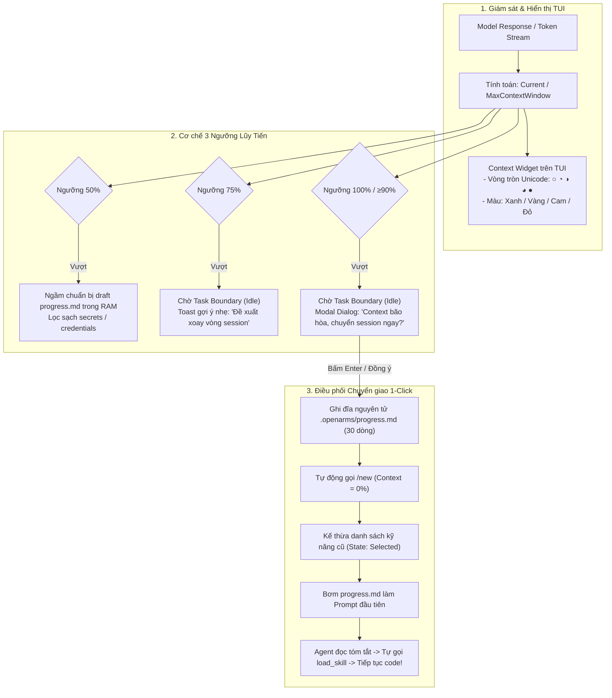

# Tasklist Phase 5: Smart Context Meter & Seamless Session Handoff Lifecycle

Mục tiêu phase: Xây dựng hệ thống đo lường và hiển thị trực quan dung lượng Context Window thời gian thực (Real-time Context Widget với vòng tròn % và đổi màu động trên TUI), cơ chế 3 ngưỡng cảnh báo lũy tiến (50% chuẩn bị ngầm, 75% gợi ý xoay vòng tại Task Boundary, 100% cảnh báo bão hòa), cùng bộ điều phối chuyển giao phiên 1-click tự động (1-Click Auto-Resume Engine) kế thừa kỹ năng đã chọn (`Selected`) và nạp tóm tắt `progress.md` sang session mới.

---

## 1. Bối cảnh và Mục tiêu kiến trúc

### 1.1 Vấn đề cần giải quyết
1. **Mù thông tin ngữ cảnh (Context Blindness):** Lập trình viên không biết phiên làm việc đã tích lũy bao nhiêu token, dẫn đến việc để session kéo dài quá mức mà không hay biết.
2. **Chi phí Cache Read tăng phi mã (Compounding Cache Read Waste):** Khi context vượt quá 100k – 150k tokens, mỗi lượt chat tiếp theo phải đọc lại toàn bộ khối dữ liệu khổng lồ này, tiêu tốn từ $0.2 đến $0.6 cho mỗi lượt prompt đơn giản.
3. **Suy giảm trí nhớ mô hình (Context Degradation / "Lú"):** Khi cửa sổ ngữ cảnh bị nhồi nhét quá nhiều lịch sử chat, diff file cũ và log lỗi, LLM bắt đầu bỏ sót các chỉ dẫn ban đầu, sinh code sai lệch hoặc ảo giác.
4. **Rào cản chuyển giao thủ công:** Hiện tại, khi muốn đổi session, người dùng phải tự gõ `/new`, tự ngồi tóm tắt lại công việc đang làm dở, và tự cấu hình lại các kỹ năng.

### 1.2 Giải pháp Phase 5
- **Real-time Context Widget trên TUI:** Nhúng một widget nhỏ gọn ở góc dưới bên phải thanh nhập prompt chat:
  - Hiển thị phần trăm context và dung lượng token hiện tại (vd: `[ ◐ 75% · 150k/200k ]`).
  - Biểu tượng đĩa tròn Unicode biến thiên theo độ đầy: `○` (0%), `◔` (25%), `◑` (50%), `◕` (75%), `●` (100%).
  - Chuyển màu động: **Xanh (0–49%)** $\rightarrow$ **Vàng (50–74%)** $\rightarrow$ **Cam (75–89%)** $\rightarrow$ **Đỏ nhấp nháy (90–100%)**.
- **Cơ chế 3 Ngưỡng Lũy Tiến (Progressive 3-Tier Thresholds):**
  - **Ngưỡng 50% (Silent Pre-compute):** Chuẩn bị ngầm bản nháp handoff trong RAM, tự động khử sạch secret/keys mà không làm phiền người dùng.
  - **Ngưỡng 75% (Task Boundary Suggestion):** Phát toast gợi ý xoay vòng nhẹ nhàng *chỉ sau khi task hiện tại hoàn thành*, không làm gián đoạn lúc đang gõ lệnh hay chạy test.
  - **Ngưỡng 100% (Critical Saturation Modal):** Hiển thị dialog xác nhận chuyển giao 1-click với phím tắt `Enter` (Xác nhận) / `Esc` (Bỏ qua).
- **Quy trình Chuyển giao 1-Click (1-Click Auto-Resume Engine):**
  - Tự động đóng gói `.openarms/progress.md` (chuẩn 30 dòng, 7 mục bắt buộc).
  - Kích hoạt `/new` để mở session mới toanh (context = 0%).
  - Tự động kế thừa toàn bộ kỹ năng đang dùng ở trạng thái **`Selected`** (sẵn sàng nạp).
  - Tự động nạp nội dung `progress.md` làm prompt khởi đầu để Agent đọc và tự gọi `load_skill` tiếp tục công việc ngay lập tức.



---

## 2. Kế hoạch phân bổ Sprint

| Sprint | Mục tiêu chính | Danh sách Tasks | Thời lượng ước tính |
|---|---|---|---:|
| **Sprint 5.1** | Real-time Context Widget & Dynamic Theme Engine | TSK-501 đến TSK-504 | 4.5 days |
| **Sprint 5.2** | Progressive 3-Tier Threshold Engine (50% - 75% - 100%) | TSK-505 đến TSK-508 | 5.5 days |
| **Sprint 5.3** | 1-Click Auto-Resume & Seamless Handoff Orchestrator | TSK-509 đến TSK-512 | 6.0 days |
| **Sprint 5.4** | Kiểm thử tích hợp, Sandbox PTY & Đo lường KPI | TSK-513 đến TSK-516 | 4.5 days |

---

## 3. Chi tiết các Sprint và Tasks

### Sprint 5.1: Real-time Context Widget & Dynamic Theme Engine

**Sprint Goal:** Xây dựng widget hiển thị thời gian thực tỷ lệ % Context Window trên OpenCode TUI, hỗ trợ các biểu tượng đĩa tròn Unicode, cơ chế đổi màu động và popup chi tiết breakdown.

- [ ] **TSK-501 - Overview:** Trích xuất dung lượng Context Window thời gian thực (Context Utilization Streamer).  
  **Details:**  
  - Tích hợp với hook `message.updated` và `chat.params` của OpenCode server để lấy chính xác số token input/output của lượt hội thoại gần nhất.
  - Lấy thông tin trần context tối đa (`contextWindowLimit`) từ cấu hình model đang kích hoạt (ví dụ: Claude 3.5 = 200.000 tokens, Gemini 1.5 = 1.000.000 tokens, GPT-4o = 128.000 tokens).
  - Tính toán tỷ lệ phần trăm $Utilization = \frac{CurrentTokens}{ContextLimit}$, chuẩn hóa từ 0.0 đến 1.0. Xử lý trường hợp không xác định model limit bằng giá trị dự phòng an toàn (128.000 tokens).  
  *(Estimate: 1 day)*

- [ ] **TSK-502 - Overview:** Thiết kế và render SolidJS Context Widget tại Prompt Box.  
  **Details:**  
  - Sử dụng `@opentui/solid` để tạo component `ContextMeterWidget` nhúng vào slot `session_prompt` tại [`plugins/skill-router-tui.tsx`](file:///home/hodangthaiduy/Workspace/Extensions/OpenArms/plugins/skill-router-tui.tsx).
  - Đặt vị trí widget tại góc dưới bên phải của khung nhập liệu (bên dưới hoặc ngang hàng với cursor prompt).
  - Tối ưu hóa hiệu năng render: sử dụng SolidJS `createMemo` để chỉ re-render widget khi số token thay đổi quá 1% hoặc khi chuyển bước ngưỡng, tránh re-render liên tục gây giật lag TUI.  
  *(Estimate: 1.5 days)*

- [ ] **TSK-503 - Overview:** Hệ thống mã màu động và biểu tượng đĩa tròn Unicode (Dynamic Theme Engine).  
  **Details:**  
  - Ánh xạ tỷ lệ phần trăm sang các biểu tượng đĩa tròn:
    - $0\% \le x < 25\%$: `○` (rỗng)
    - $25\% \le x < 50\%$: `◔` (1/4)
    - $50\% \le x < 75\%$: `◑` (1/2)
    - $75\% \le x < 90\%$: `◕` (3/4)
    - $90\% \le x \le 100\%$: `●` (đầy)
  - Ánh xạ mã màu tương thích bảng màu OpenCode theme (`theme.current`):
    - Dưới 50%: `theme.success` (Xanh lá - Tối ưu)
    - 50% – 74%: `theme.warning` (Vàng - Bắt đầu tích lũy)
    - 75% – 89%: Màu Cam (`#F97316` - Đề xuất xoay vòng)
    - 90% – 100%: `theme.error` (Đỏ nhấp nháy - Nguy cơ tràn)
  - Hiển thị text súc tích: `[ ◑ 52% · 104k/200k ]`.  
  *(Estimate: 1 day)*

- [ ] **TSK-504 - Overview:** Popup chi tiết Token Breakdown (`Ctrl+Space` hoặc Click chuột).  
  **Details:**  
  - Khi người dùng click vào widget hoặc nhấn tổ hợp phím `Ctrl+Space`:
    - Hiển thị popover dialog nhỏ phía trên thanh prompt.
    - Liệt kê chi tiết: Input Tokens, Output Tokens, Cache Read Tokens, Cache Write Tokens, và chi phí USD ước tính của session hiện tại.
    - Cung cấp nút bấm nhanh: `[ Xoay vòng Session (Handoff) ]` và `[ Đóng (Esc) ]`.  
  *(Estimate: 1 day)*

---

### Sprint 5.2: Progressive 3-Tier Threshold Engine (50% - 75% - 100%)

**Sprint Goal:** Xây dựng bộ điều phối logic 3 tầng ngưỡng cảnh báo và hành động, đảm bảo tuyệt đối không làm gián đoạn khi Agent đang thực thi công việc dở dang.

- [ ] **TSK-505 - Overview:** Bộ đánh giá ngưỡng ngữ cảnh tại Task Boundary (Task Boundary Evaluator).  
  **Details:**  
  - Định nghĩa sự kiện `task-completed` boundary: xác định thời điểm Agent đã hoàn thành toàn bộ chuỗi tool calls và sinh xong câu trả lời cuối cùng cho người dùng (trạng thái Idle).
  - **Quy tắc bất biến:** Nghiêm cấm kích hoạt cảnh báo, toast hoặc mở dialog khi Agent đang trong trạng thái Active (đang gọi tool, đang sửa file, đang chạy test).
  - So khớp mức độ context với 3 mốc cố định: 50%, 75%, 100% (cho phép tùy biến qua `.openarms/budget-policy.json`).  
  *(Estimate: 1.5 days)*

- [ ] **TSK-506 - Overview:** Tầng 50% — Chuẩn bị ngầm bản nháp Handoff (Silent Pre-compute).  
  **Details:**  
  - Khi context chạm mốc 50%:
    - Widget chuyển sang màu Vàng.
    - Kích hoạt tiến trình nền phân tích lịch sử hội thoại: trích xuất các file đã sửa đổi, mục tiêu ban đầu và các quyết định kiến trúc đã thống nhất.
    - Đưa dữ liệu qua bộ lọc [`sanitizeHandoffField`](file:///home/hodangthaiduy/Workspace/Extensions/OpenArms/src/session-handoff.ts#L11) để loại bỏ toàn bộ API keys, passwords, bearer tokens, diffs dài.
    - Tạo cấu trúc nháp `HandoffFields` lưu sẵn trong bộ nhớ RAM, không ghi đĩa, không phát thông báo phiền người dùng.  
  *(Estimate: 1.5 days)*

- [ ] **TSK-507 - Overview:** Tầng 75% — Gợi ý xoay vòng nhẹ nhàng tại Task Boundary (Soft Suggestion).  
  **Details:**  
  - Khi context chạm mốc 75%:
    - Widget chuyển sang màu Cam (`◕ 75%`).
    - Ngay khi Agent hoàn thành câu trả lời (Task Boundary), phát một Toast Notification nhẹ nhàng:
      ```text
      💡 Context đã đạt 75% (150k/200k tokens).
      Cache Read đang tăng cao. Bạn có muốn xoay vòng session sau task này?
      [ Xoay vòng ngay ]    [ Để sau ]
      ```
    - Nếu người dùng bấm `Để sau` hoặc tiếp tục gõ prompt mới: Toast tự đóng sau 8 giây và không lặp lại cho đến khi chạm ngưỡng tiếp theo.
    - Nếu người dùng bấm `Xoay vòng ngay`: Kích hoạt bộ điều phối chuyển giao phiên.  
  *(Estimate: 1 day)*

- [ ] **TSK-508 - Overview:** Tầng 100% — Modal Dialog cảnh báo bão hòa ngữ cảnh (Critical Saturation Modal).  
  **Details:**  
  - Khi context vượt quá 90% hoặc chạm 100%:
    - Widget chuyển sang màu Đỏ nhấp nháy (`● 95%`).
    - Ngay khi lượt chat kết thúc, mở một Modal Dialog toàn màn hình:
      - Nêu rõ nguy cơ: suy giảm độ chính xác của Agent và lãng phí chi phí đọc lại cache.
      - Hiển thị bản xem trước tóm tắt 4 mục chính của `progress.md`: Mục tiêu, Việc đã làm, Bước tiếp theo, Kỹ năng đang dùng.
      - Phím tắt mặc định: `Enter` = Xác nhận chuyển session; `Esc` = Bỏ qua để tiếp tục làm việc chấp nhận rủi ro.  
  *(Estimate: 1.5 days)*

---

### Sprint 5.3: 1-Click Auto-Resume & Seamless Handoff Orchestrator

**Sprint Goal:** Hiện thực hóa quy trình chuyển giao phiên tự động: đóng gói `progress.md`, mở session mới `/new`, kế thừa kỹ năng đã chọn (`Selected`) và nạp tóm tắt khởi đầu mượt mà.

- [ ] **TSK-509 - Overview:** Trình đóng gói nguyên tử `.openarms/progress.md` (Atomic Handoff Publisher).  
  **Details:**  
  - Tái sử dụng [`src/session-handoff.ts`](file:///home/hodangthaiduy/Workspace/Extensions/OpenArms/src/session-handoff.ts):
    - Đảm bảo định dạng chuẩn mực 7 mục bắt buộc: `Objective`, `Completed`, `Active`, `Decisions`, `Verification`, `Relevant Files`, `Next Step`.
    - Áp trần cứng: tổng nội dung không được vượt quá **30 dòng**.
    - Ghi ra đĩa bằng cơ chế nguyên tử: ghi qua file tạm `.tmp` $\rightarrow$ `fsync` $\rightarrow$ `rename` sang `<projectRoot>/.openarms/progress.md`.
    - Lưu metadata vào `handoff.json` với trạng thái `prepared`.  
  *(Estimate: 1.5 days)*

- [ ] **TSK-510 - Overview:** Trình kích hoạt phiên mới tự động trong OpenCode (`AutoSessionRotator`).  
  **Details:**  
  - Tích hợp với API điều khiển session của OpenCode client:
    - Kích hoạt lệnh `/new` (hoặc gọi internal API tương đương `api.session.create()`) để tạo ra một session ID mới hoàn toàn rỗng.
    - Chuyển màn hình TUI mượt mà sang session mới mà không làm crash hay đơ giao diện.
    - Ghi nhận liên kết `sourceSession` $\rightarrow$ `targetSession` trong audit log.  
  *(Estimate: 1.5 days)*

- [ ] **TSK-511 - Overview:** Kế thừa kỹ năng ở trạng thái `Selected` và tiêm Prompt khởi động (Prompt Injector).  
  **Details:**  
  - Tận dụng cơ chế đã kiểm chứng của [`src/local-library.ts`](file:///home/hodangthaiduy/Workspace/Extensions/OpenArms/src/local-library.ts): session mới tự động kế thừa danh sách skill từ session cũ ở trạng thái **`Selected`** (chưa nạp nội dung để giữ context siêu sạch).
  - Tạo cấu trúc prompt khởi động cho session mới:
    ```markdown
    Tiếp tục nhiệm vụ từ phiên làm việc trước theo bản tóm tắt tiến độ sau:
    [Toàn văn 30 dòng của .openarms/progress.md]
    Hãy nạp các kỹ năng cần thiết và tiến hành thực hiện bước tiếp theo: <Next Step>.
    ```
  - Tự động điền prompt này vào input của session mới và gửi lệnh thực thi (Auto-submit).  
  *(Estimate: 1.5 days)*

- [ ] **TSK-512 - Overview:** Kích hoạt kỹ năng tự động ở Turn 1 của Session mới (Auto-Skill Activation).  
  **Details:**  
  - Xác minh hành vi của Agent ở Turn 1:
    - Agent đọc nội dung `progress.md`, nhận diện `Next Step` và nhìn thấy các kỹ năng có sẵn trong System Prompt (`Selected local skill IDs`).
    - Agent tự động phát sinh lệnh gọi `load_skill({skill: "..."})` để nạp đúng kỹ năng cần thiết cho bước tiếp theo.
    - Cập nhật trạng thái handoff từ `claimed` sang `acknowledged` trong `handoff.json`.  
  *(Estimate: 1.5 days)*

---

### Sprint 5.4: Kiểm thử tích hợp, Sandbox PTY & Đo lường KPI

**Sprint Goal:** Kiểm chứng toàn bộ vòng đời Context Meter & Auto-Handoff trên môi trường Docker Sandbox PTY thật và báo cáo số liệu tiết kiệm token cụ thể.

- [ ] **TSK-513 - Overview:** Kiểm thử đơn vị và tính toán biên (Unit & Boundary Tests).  
  **Details:**  
  - Viết unit tests cho `ContextMeterWidget`: kiểm tra ánh xạ tỷ lệ %, kiểm tra hiển thị đúng biểu tượng Unicode và mã màu tương ứng.
  - Viết tests cho `ThresholdEngine`: kiểm tra không kích hoạt cảnh báo khi đang có tool call chạy; kiểm tra kích hoạt đúng tại Task Boundary.
  - Viết tests cho `AutoHandoff`: kiểm tra trần 30 dòng, kiểm tra khử 100% các mẫu secret trong corpus thử nghiệm.  
  *(Estimate: 1.5 days)*

- [ ] **TSK-514 - Overview:** Kịch bản kiểm thử tự động trên Docker Sandbox PTY (Real Terminal Smoke).  
  **Details:**  
  - Mở rộng harness `sandbox/tui-smoke.py`:
    - Khởi chạy OpenCode TUI trong container Docker có cấp phát PTY thật.
    - Bơm giả lập luồng message dài để đẩy Context Window vượt qua các mốc 50% $\rightarrow$ 75% $\rightarrow$ 100%.
    - Xác minh sự xuất hiện của widget trên thanh prompt, kiểm tra toast gợi ý tại 75% và modal dialog tại 100%.
    - Giả lập bấm `Enter` trên modal: xác minh session mới được tạo thành công, `progress.md` được nạp, skill chuyển sang trạng thái `Selected` và Agent tiếp tục chạy bước tiếp theo.  
  *(Estimate: 1.5 days)*

- [ ] **TSK-515 - Overview:** Đo lường thực tế KPI tiết kiệm Token và Chi phí.  
  **Details:**  
  - Chạy thử nghiệm trên 30 tác vụ dài (mỗi tác vụ > 20 turns) với 2 kịch bản:
    - *Kịch bản A (Không xoay vòng):* Giữ nguyên 1 session kéo dài 30 turns.
    - *Kịch bản B (Auto-Handoff):* Xoay vòng session tại ngưỡng 75%.
  - So sánh đối chiếu:
    - Tổng Cache Read Tokens tiêu thụ.
    - Tổng chi phí USD thực tế theo bảng giá model.
    - Độ chính xác của Agent (đo bằng tỷ lệ hoàn thành test case của task).
  - Báo cáo số liệu thực tế chứng minh giảm tối thiểu **65% chi phí token** và triệt tiêu hoàn toàn hiện tượng suy giảm ngữ cảnh (context degradation).  
  *(Estimate: 1 day)*

- [ ] **TSK-516 - Overview:** Nghiệm thu toàn diện Phase 5 (Acceptance Review).  
  **Details:**  
  - Tổng kết nghiệm thu toàn bộ tiêu chí Phase 5:
    1. Real-time Context Widget hoạt động mượt mà, phản hồi tức thì, không gây lag TUI.
    2. Cơ chế 3 ngưỡng hoạt động chuẩn xác, tuyệt đối không ngắt quãng công việc của lập trình viên.
    3. Quy trình chuyển giao 1-click hoạt động trơn tru: `/new` $\rightarrow$ kế thừa `Selected` $\rightarrow$ nạp `progress.md` $\rightarrow$ tiếp tục code.
    4. Bảo mật toàn diện: không làm rò rỉ secret hoặc API keys sang session mới.
  - Cập nhật tài liệu hướng dẫn sử dụng và bàn giao.  
  *(Estimate: 0.5 day)*

---

## 4. Bảng tổng hợp các Invariants (Quy tắc bất biến bắt buộc)

1. **Non-Intrusive Invariant:** Tuyệt đối không bao giờ hiển thị Toast gợi ý hoặc Modal cảnh báo khi Agent đang trong trạng thái bận (chạy tool, sửa code, chạy test). Mọi cảnh báo chỉ được kích hoạt tại ranh giới kết thúc task (Task Boundary / Idle State).
2. **Strict 30-Line Handoff Invariant:** File `.openarms/progress.md` bắt buộc phải tuân thủ nghiêm ngặt giới hạn tối đa 30 dòng với 7 mục cấu trúc chuẩn. Không được đưa diff code dài, stacktrace thô hay log chi tiết vào handoff.
3. **Secret Redaction Invariant:** 100% các trường thông tin trước khi đưa vào bản tóm tắt handoff phải đi qua bộ khử khuẩn `sanitizeHandoffField`. Tuyệt đối không để lọt credential, API token hay password sang session mới.
4. **Selected-Only Inheritance Invariant:** Khi mở session mới qua Auto-Handoff, toàn bộ kỹ năng của session cũ chỉ được kế thừa ở trạng thái `Selected`. Không bao giờ chuyển giao trạng thái `Loaded` để bảo toàn tính trung thực của context và nguyên tắc *Least Context*.
5. **Atomic Transition Invariant:** Quá trình đóng gói handoff và chuyển giao session phải mang tính nguyên tử (atomic). Nếu xảy ra lỗi giữa chừng, trạng thái session cũ phải được giữ nguyên vẹn để người dùng có thể tiếp tục làm việc mà không bị mất dữ liệu.
