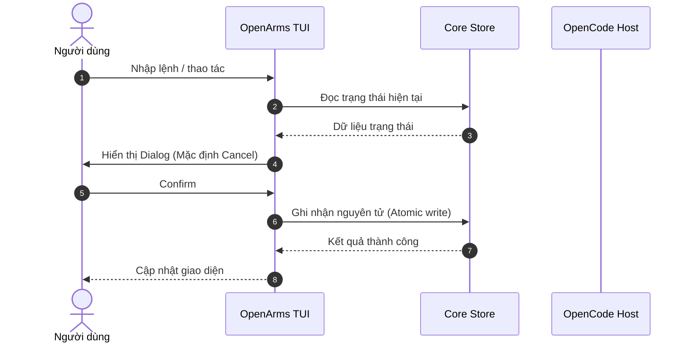

# Đặc tả Tính năng: [Tên Tính năng]

> **Tóm tắt nhanh:** [1-2 câu mô tả ngắn gọn tính năng làm gì, giải quyết vấn đề gì cho ai].

* **Trạng thái:** [Bản thảo (Draft) | Đang triển khai (In Progress) | Đã hoàn thành (Released)]
* **Phạm vi tác động:** [Core / Server Adapter / TUI / Sandbox / Tooling]
* **Người phụ trách:** [Tên Contributor]
* **Ngày cập nhật:** [YYYY-MM-DD]

---

## 1. Mục tiêu & Bối cảnh (Motivation & Goals)

### Tại sao cần tính năng này?
- [Vấn đề người dùng hoặc hệ thống gặp phải]

### Mục tiêu chính (Goals):
- [ ] [Mục tiêu định lượng hoặc hành vi cụ thể 1]
- [ ] [Mục tiêu định lượng hoặc hành vi cụ thể 2]

### Những điều KHÔNG nằm trong phạm vi (Non-Goals):
- Không thay đổi hành vi của host OpenCode.
- Không tự động đưa ra quyết định mà chưa có sự đồng ý của người dùng.

---

## 2. Trải nghiệm Người dùng & Luồng thao tác (UX & User Flows)

### Lệnh & Tương tác:
- Lệnh kích hoạt: `/[command] [args]`
- Phím tắt (nếu có trong TUI): `[Key]`

### Luồng tương tác từng bước:
1. Người dùng gõ lệnh hoặc bấm phím tắt...
2. Giao diện hiển thị modal/dialog với các lựa chọn:
   - [Lựa chọn 1]: [Hành vi]
   - [Lựa chọn 2]: [Hành vi]
3. Khi nhấn Cancel (mặc định): Hệ thống giữ nguyên trạng thái cũ, không ghi đè dữ liệu.
4. Khi nhấn Confirm: Dữ liệu được ghi nhận nguyên tử (atomic write).



---

## 3. Thiết kế Kỹ thuật (Technical Specification)

### Quản lý Trạng thái & File lưu trữ (State & Storage):
- Đường dẫn file lưu trữ: `[đường dẫn, ví dụ: <project>/.openarms/config.json]`
- Định dạng dữ liệu (Schema):
```json
{
  "version": 1,
  "enabled": true,
  "settings": {}
}
```

### Xử lý Đồng thời & An toàn dữ liệu (Concurrency & Safety):
- Cơ chế khóa (Locking): Cooperative writer lock / fsync / atomic rename.
- Xử lý lỗi: Fail-safe / Fail-closed.

---

## 4. Ranh giới Phân quyền & Bảo mật (Security & Boundaries)

| Thành phần | Trách nhiệm của OpenArms | Trách nhiệm của OpenCode Host |
|---|---|---|
| Dữ liệu | [Xác thực schema, safe path] | [Cấp quyền đọc/ghi file hệ điều hành] |
| Thực thi | [Validation nội dung] | [Chạy lệnh shell hoặc LLM agent] |

---

## 5. Kế hoạch Kiểm thử & Tiêu chuẩn Nghiệm thu (Test Strategy)

- [ ] **Unit Tests:** `tests/[feature].test.ts` kiểm tra các trường hợp biên, dữ liệu rỗng, dữ liệu sai định dạng.
- [ ] **Test Policy:** Khai báo file vào `scripts/test-policy.json`.
- [ ] **Manual Testing:** Các bước test thủ công trên TUI (xem [Manual Testing Guide](../testing/manual-testing.md)).
